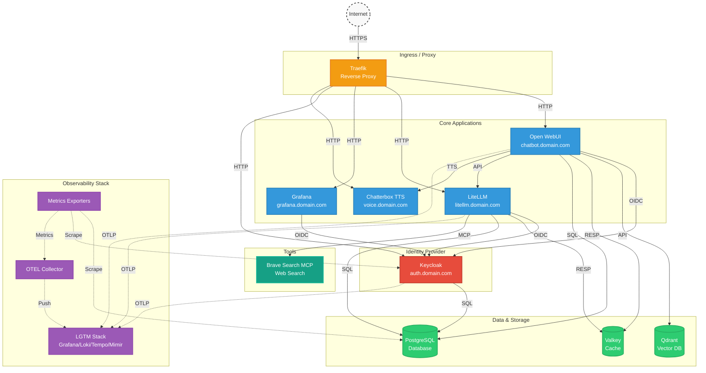

# Open WebUI Stack

Docker Compose stack for [Open WebUI](https://github.com/open-webui/open-webui) with LiteLLM proxy, observability, and security best practices.

## Architecture



## Features

- **Traefik Reverse Proxy**: Automatic HTTPS with self-signed certificates generated by Traefik, HTTP to HTTPS redirect
- **LiteLLM Proxy**: Unified gateway for multiple LLM providers (Gemini, AWS Bedrock, Ollama, local llama.cpp). A built-in content filter runs on every request, and model `auto` routes by prompt complexity.
- **Keycloak Identity Provider**: Single Sign-On (SSO) for all services
- **LGTM Observability Stack**: Grafana, Loki, Tempo, Mimir for logs, traces, and metrics
- **Qdrant Vector Database**: Production-ready vector search for RAG
- **PostgreSQL**: Shared database for Open WebUI, LiteLLM, and Keycloak
- **OpenTelemetry**: Full observability with distributed tracing
- **Security**: Network isolation, secure headers, rate limiting, admin IP restriction
- **Chatterbox TTS**: OpenAI-compatible voice cloning for Open WebUI, with a voice library UI at `voice.<domain>`. This is the only TTS engine in the stack.
- **Brave Search MCP**: Web search for every chat model. The `brave-search-mcp` container serves the official Brave MCP tools over streamable HTTP, LiteLLM mounts them at `/mcp/brave_search`, and a LiteLLM startup hook (`litellm/brave_mcp_callback.py`) injects them into every `/v1/chat/completions` request. Models call the tools; LiteLLM executes them server-side (`require_approval: never`), so no client-side tool wiring is needed.
- **Voice assistant**: LiteLLM alias `voice-assistant` routes to `gemini-3.5-flash-lite` (rendered only when `litellm_gemini_models_enabled: true`, the same flag that gates the Gemini models). `./scripts/create-voice-key.sh` creates a virtual key that can call only that model and stores it in `.env` as `LITELLM_VOICE_API_KEY`.
- **Code Sandbox**: Isolated Jupyter container for model-authored Python (STL/mesh generation, plotting, data transforms). Pinned `quay.io/jupyter/scipy-notebook` image with `numpy-stl` and `trimesh` baked in, token-authenticated, backend-network-only (no published port, no Traefik route), 2G/2CPU caps, non-root. Open WebUI's Jupyter code-execution wiring points at it; the legacy in-process engines stay off. See [Secure Code Execution](#secure-code-execution-code-sandbox).

##  Quick Start

### Prerequisites

- Docker Engine 24.0+
- Docker Compose v2.20+
- 8GB+ RAM recommended
- (Optional) NVIDIA GPU with drivers for GPU metrics

### Installation

1. **Clone the repository**
   ```bash
   git clone https://github.com/mhajder/openwebui-stack.git
   cd openwebui-stack
   ```

2. **Run the setup entrypoint**
   ```bash
   chmod +x scripts/*.sh
   ./scripts/setup.sh
   ```

   `scripts/setup.sh` is a thin wrapper: it installs the Ansible collections (once) and runs `ansible-playbook playbooks/site.yml`. All configuration formerly done by interactive prompts now lives in `ansible/group_vars/all/vars.yml` (domain, TLS mode, compose profiles) and is rendered declaratively:

   - **`.env`** — rendered from `templates/env.j2` with every secret
   - **`docker-compose.yml`** — rendered from `templates/docker-compose.yml.j2`; the `chatterbox_enabled` toggle drops the Chatterbox services entirely
    - **`litellm/config.yaml`** — rendered from `templates/config.yaml.j2` (the Playwright MCP `Host` header needs the deployed domain spelled out; LiteLLM does not expand `${VAR}` in config values). When the rendered content changes, a handler recreates the `litellm` service so the bind-mounted config is reloaded (plain `docker compose up` does not recreate a container for bind-mount content changes)
   - **TLS certificates** — `ssl_cert_type: existing | selfsigned | traefik`; self-signed pairs are generated with `community.crypto` and wired into Traefik via `traefik/dynamic/certs.yml` (replaces `scripts/generate-certs.sh`)
   - **`/etc/hosts`** — service hostnames added on the deployment host for non-localhost domains
   - **Secrets** — explicit values in `ansible/group_vars/all/vault.yml` (tracked template with `CHANGE_ME` placeholders) and `ansible/group_vars/all/vault.local.yml` (real values, gitignored, mode 0600). Nothing reads environment variables or the deployed `.env`. A playbook run fails fast, naming exactly which secrets are still placeholders.

   Edit `ansible/group_vars/all/vars.yml` before the first run to set `domain`, `ssl_cert_type`, `docker_compose_profiles`, and `chatterbox_device`/`chatterbox_enabled`. Copy `vault.yml` to `vault.local.yml`, replace every `CHANGE_ME`, and keep `vault.local.yml` out of git (encrypt it with `ansible-vault` instead for team use).

In `docker-compose.yml` change `ENABLE_SIGNUP` to `true` if you want to register the first admin user via Open WebUI. You can disable it again after the first user is created.

3. **Start the stack**

   The playbook brings the stack up itself (`tasks/compose.yml` applies `docker_compose_profiles`). To run it by hand:
   ```bash
   docker compose --profile monitoring --profile gpu up -d
   ```

4. **Access the services**
   - Open WebUI: https://chatbot.localhost
   - Grafana: https://grafana.localhost
   - LiteLLM: https://litellm.localhost
   - Keycloak (admin): https://auth.localhost/admin
   - Chatterbox voice library: https://voice.localhost

### Complete Reset (retest the playbook from scratch)

`scripts/reset-stack.sh` destroys the deployed stack on the Photon host so the playbook can be validated from a clean slate. It runs `docker compose --profile '*' down -v --remove-orphans`, then sweeps every container, volume, network, and locally-built image carrying the `${COMPOSE_PROJECT_NAME:-openwebui-stack}` prefix (so leftovers the compose file no longer knows about die too), then deletes the deployed tree.

```bash
# On the Photon host, from the repo (or anywhere; the paths are absolute):
bash scripts/reset-stack.sh --dry-run   # show every destructive action first
bash scripts/reset-stack.sh             # wipe stack + /mnt/data1/openwebui-stack
```

Everything in the stack is destroyed: Keycloak users, Open WebUI chats and uploaded files, generated `/models` artifacts, built images. The script only deletes the stack folder itself — everything else under `/mnt/data1` (backups, stashes, old trees, and `/mnt/data1/docker`, which is Docker's data-root) is left alone, and `--dir /mnt/data1` is refused outright. The git checkout and the vault are never touched. After a reset, redeploy with `./scripts/setup.sh`. The script refuses system paths and requires an absolute target with at least two path components; run it as root on the Photon host.

### Local Domain Resolution

Add these entries to your `/etc/hosts`:
```
127.0.0.1 localhost chatbot.localhost grafana.localhost litellm.localhost auth.localhost traefik.localhost voice.localhost
```

## Keycloak SSO

This stack includes **Keycloak** for centralized authentication (Single Sign-On). All services authenticate through Keycloak instead of using separate credentials.

### Services Integrated with Keycloak

| Service | URL | Client ID | Redirect URI |
|---------|-----|-----------|--------------|
| Open WebUI | https://chatbot.example.com | `open-webui` | `/oauth/oidc/callback` |
| Grafana | https://grafana.example.com | `grafana` | `/login/generic_oauth` |
| LiteLLM | https://litellm.example.com | `litellm` | `/sso/callback` |

### Keycloak Administration

Access the Keycloak Admin Console to manage users and applications:

- **URL**: https://auth.example.com/admin
- **Username**: `admin` (or `KEYCLOAK_ADMIN_USER`)
- **Password**: resolves through the secret tiering (vault entry → environment → deployed `.env` → generated once); see `ansible/group_vars/all/vault.yml`

### First-Time Setup

1. After starting the stack, run the Ansible playbook from `ansible/`:
   ```bash
   ansible-galaxy collection install -r requirements.yaml
   ansible-playbook playbooks/site.yml
   ```
    This creates the `platform` realm, the `keycloak-provisioner` service account, confidential clients for Grafana, Open WebUI, and LiteLLM, client roles that match `docker-compose.yml`, group-to-role mappings, and one login user per group. It also turns on passkeys for that realm: Keycloak shows **Sign in with Passkey** on the username form, and users can register a passwordless credential from the account console. Set `keycloak_passkeys_enabled: false` in `ansible/group_vars/all/vars.yml` to leave password login unchanged. It also syncs `otel/`, `grafana/`, `traefik/`, `json-exporter/`, `litellm/`, and `sandbox/` (minus the rendered `config.yaml`) to `project_root` as mode `0644`, carrying the `always` tag so tag-limited runs (`--tags compose`, `--tags environment`) still sync before `docker compose up`. The collector image runs as uid `10001`, and a `0640` root-owned `otel/config.yaml` makes it crash-loop. The sync builds its rsync from the inventory host's key (`private_key` + `rsync_path: rsync` — the delegate-host defaults offer the agent's identities and inject a sudo wrapper that Photon lacks). Before `docker compose up`, `tasks/compose_mount_check.yml` resolves the deployed compose file and fails the run when a file-kind bind source the checkout has (e.g. a mounted guardrail category file) is missing in the deployed tree: `docker compose` auto-creates missing short-syntax bind sources as empty directories, which the sync cannot replace, so the failure names the exact `rm -rf` to run. Client secrets are the `*_OIDC_CLIENT_SECRET` values the role writes to `.env`; every Keycloak secret (admin password, provisioner client secret, OIDC client secrets, and the `keycloak_user_*` passwords) comes from `vault.local.yml`.

2. Only Grafana, Open WebUI, and LiteLLM use Keycloak. Traefik, Keycloak admin, and the exporters keep their own credentials. `./scripts/setup.sh` runs the playbook for you after installing collections.

3. Optional MCP servers are configured by the playbook through per-server task files in `ansible/roles/openwebui_stack/tasks/mcp/`. Each server is toggled by a variable in `ansible/group_vars/all/vars.yml`, and `tasks/mcp/main.yml` includes only the enabled ones:

   | Variable | Task file | What it configures |
   |----------|-----------|---------------------|
    | `brave_search_enabled` + `brave_search_api_key` (vault) | `mcp/brave.yml` | Open WebUI web search and the `brave_search` tool server connection |
    | `playwright_mcp_enabled` (role default `true`) | `mcp/playwright.yml` | The `playwright_cluster` tool server connection (no secret; containers run from docker-compose.yml) |
    | `playwright_mcp_enabled` (same toggle) | `mcp/tool_image_filter.yml` | The `tool_result_image_display` global outlet filter that promotes MCP tool-result images (Playwright screenshots) to chat message files so they render in the chat window |

   The same toggles also gate the containers and LiteLLM wiring in the compose and config templates, so a toggle off drops every piece at once: `brave_search_enabled` (with a non-empty `brave_search_api_key`) gates the `brave-search-mcp` service, the `mcp_servers.brave_search` entry, and the Brave injector startup hook + callback mount on `litellm`; `playwright_mcp_enabled` gates the `playwright-mcp` service (and its Traefik network alias) and the `mcp_servers.playwright_cluster` entry; `chatterbox_enabled` gates the `oauth2-proxy` voice gate alongside the Chatterbox services and the `VOICE_OIDC_CLIENT_SECRET`/`OAUTH2_PROXY_COOKIE_SECRET` entries in `.env`.

    Both MCP tasks **merge** into the same `tool_server.connections` row (matched by `info.id`, sorted canonically), so each preserves the other's entry, and consecutive playbook runs are idempotent: the litellm and open-webui containers are recreated only when the row actually changes. The tool-image filter task is idempotent the same way (it upserts the `function` row only when content/flags differ, then recreates only `open-webui`).

   Add a future MCP server by dropping `<name>.yml` in `tasks/mcp/`, guarding it in `tasks/mcp/main.yml` with `mcp_<name>_enabled`, and adding that variable to `group_vars/all/vars.yml` and the role defaults.

### Role Mapping

Users are assigned roles based on their Keycloak group membership:

| Keycloak group | Grafana role | Open WebUI role | LiteLLM role | Ansible user |
|----------------|---------------|-----------------|--------------|--------------|
| `platform-admins` | GrafanaAdmin | `openwebui_admin` | `proxy_admin` | `platform-admin` |
| `admin` | Admin | `openwebui_admin` | `proxy_admin` | |
| `editor` | Editor | | | `grafana-editor` |
| `viewer` | Viewer | | | `grafana-viewer` |
| `user` | | `openwebui_user` | `internal_user` | `openwebui-user`, `litellm-user` |
| `litellm-admin` | | | `proxy_admin` | |
| `litellm-viewer` | | | `proxy_admin_viewer` | `litellm-viewer` |

Role names are the values in the `roles` token claim. Grafana maps them with the JMESPath in `docker-compose.yml`. Open WebUI treats `openwebui_admin` as admin. LiteLLM reads `proxy_admin`, `proxy_admin_viewer`, `internal_user`, and `internal_user_viewer` from `GENERIC_USER_ROLE_ATTRIBUTE`.

**Creating more users:**

1. Go to Keycloak Admin Console → Users → Add user
2. Fill in user details and save
3. Go to Credentials tab → Set password (uncheck "Temporary")
4. Go to Groups tab → Join one of the groups in the table

To register a passkey for that user, follow [docs/passkey-user.md](docs/passkey-user.md).

**Realm hardening:** The bootstrap task (`tasks/keycloak_bootstrap.yml`) configures the `platform` realm with brute-force detection (5 failures, 60s→900s wait), a password policy (`length(12) and upperCase(1) and digits(1) and notUsername and notEmail and passwordHistory(5)` — applies to new passwords; existing ones are grandfathered), refresh-token rotation (`revoke_refresh_token` with `refresh_token_max_reuse: 0`, so a replayed refresh token fails immediately after a newer one is issued), and event logging (login events with 30-day retention, admin events with full change payloads). Keycloak 26 hashes with Argon2 by default. See `GET /admin/realms/platform/events` for the event store; the Loki dashboards already have `keycloak_user_events_total` panels for it.

**Self-registration:** The playbook turns on user self-registration for the `platform` realm (`keycloak_registration_enabled` in `ansible/group_vars/all/vars.yml`, default `true` in this deployment; role default `false`). The Keycloak login page shows a **Register** link. New accounts land in `keycloak_default_groups` (here: `user`), so group-to-role mappings grant `openwebui_user` (Open WebUI) and `internal_user` (LiteLLM) immediately — the same access as the provisioned `openwebui-user`. `keycloak_verify_email` is off because no SMTP server is configured: with it on and no mail server, a self-registered user is stuck on the Verify Email screen. Configure SMTP in Keycloak (Realm Settings → Email) and set it to `true` to require address verification. Default groups are set after the groups exist (Keycloak's realm update replaces the whole list and fails on a missing group). Set `keycloak_registration_enabled: false` to hide the Register link again.

**LiteLLM SSO seat limit:** LiteLLM's free tier allows UI SSO for up to 5 users — the 6th sign-up gets a 403 ("SSO for more than 5 users requires a LiteLLM Enterprise license"); existing users always sign in. Open WebUI and Grafana have no such limit. Set `litellm_license` in `vault.local.yml` to a `LITELLM_LICENSE` key (e.g. a trial from [litellm.ai/enterprise](https://www.litellm.ai/enterprise)) to lift it; the playbook renders the env var and compose entry only when a license is set.

### SSO Login Flow

**Open WebUI:**
1. Navigate to https://chatbot.localhost
2. Click "Continue with Keycloak"
3. Enter Keycloak credentials
4. Redirected back to Open WebUI, logged in

**LiteLLM:**
1. Navigate to https://litellm.localhost/ui
2. Click SSO login button
3. Enter Keycloak credentials
4. Redirected back to LiteLLM, logged in

**Grafana:**
1. Navigate to https://grafana.localhost
2. Click "Sign in with Keycloak"
3. Enter Keycloak credentials
4. Redirected back to Grafana, logged in

### Security Features

Keycloak includes several security hardening options:

- **Admin IP Restriction**: Restrict access to the admin console by IP
  - Set `KEYCLOAK_ADMIN_IP_RANGE` in `.env` (e.g., `10.0.0.0/8`)
  - Default: `0.0.0.0/0` (allow all)

- **Security Headers**: Strict HTTP security headers configured via Traefik

- **Resource Limits**: Memory and CPU limits applied to Keycloak container

### Realm Import

To import a pre-configured realm:
1. Place your `realm-export.json` file in `keycloak/import/`
2. Keycloak will automatically import it on startup

### Backups

Keycloak database backups can be run on-demand:
```bash
# Run backup
docker compose --profile backup up keycloak-backup

# List backups (bind mount under the deployed tree, not a Docker volume)
ls backups/
```

Backups land in `backups/` under the deployed tree on the host data disk (default `/mnt/data1/openwebui-stack/backups`), so they survive `docker compose down -v` and can be restored straight from the host path. Configure retention with `BACKUP_RETENTION_DAYS` in `.env` (default: 7 days)

### opencode (terminal AI coding agent)

The `opencode` Ansible role installs [OpenCode](https://opencode.ai) on the target host and points it at the stack's LiteLLM proxy, with per-user token accounting. It is a no-op until you list users:

```yaml
# ansible/group_vars/all/vars.yml
opencode_users:
  - username: nicholas.krouse
```

Then run the playbook (tag `opencode` limits the run to this role):

```bash
cd ansible && ansible-playbook playbooks/site.yml --tags opencode
```

Per user, the role:

1. **Installs opencode** globally via npm (`opencode-ai`), installing Node.js first with the OS-appropriate package manager (tdnf on the Photon host, apt/dnf elsewhere) when `opencode_manage_nodejs: true`.
2. **Mints a per-user LiteLLM virtual key** through `POST /key/generate` with the master key from the deployed `.env`, tagging it `key_alias: opencode-<user>`, `user_id: <user>`, and `metadata: {user: <user>, source: opencode}`. Every request opencode makes is then attributed to that user in the LiteLLM UI and `LiteLLM_SpendLogs`, so `/key/list` spend and the Grafana LiteLLM views resolve usage per person without extra headers. The key lands in `~/.config/opencode/litellm.key` (mode 0600); later runs reuse a still-valid key instead of minting again. Optional `models:` on the user entry restricts the key's allowed models, `opencode_key_max_budget`/`opencode_key_rpm` set spend/rate caps.
3. **Auto-discovers models**: the config declares a `litellm` custom provider (`@ai-sdk/openai-compatible`, baseURL `https://litellm.<domain>/v1`) and the [`opencode-plugin-litellm`](https://github.com/yuseferi/opencode-litellm) plugin. The plugin pulls the whole `model_list` from `/v1/models` + `/v1/model/info` (limits, pricing, capability flags) at startup, caches it under `~/.cache/opencode-litellm`, and refreshes in the background — no model list to maintain when you add models to `litellm/config.yaml`. New sessions pick new models up within the 5-minute refresh window. Requires OpenCode ≥ 1.18.29.
4. **Logs local usage**: `~/.config/opencode/plugins/litellm-usage.js` appends one JSON line per assistant message to `~/.local/share/opencode/usage.jsonl` — `user`, `modelID`, input/output/reasoning/cached tokens, cost, and duration — which cross-references the LiteLLM-side spend for the same turns.
5. **Handles the Origin CA**: the proxy serves a Cloudflare Origin certificate, and Node's fetch does not use the system trust store. The role detects the OS: on the Photon host it points `NODE_EXTRA_CA_CERTS` at `certs/origin_ca_rsa_root.pem` in the deployed tree; elsewhere it distributes the public CA root from `ansible/roles/opencode/files/` into `~/.config/opencode/`. Set `opencode_node_ca_cert: false` when the proxy has a publicly trusted cert.

Defaults (`opencode_default_model: litellm/gemini-4-argon`, `small_model: litellm/gemini-3.5-flash-lite`) are set in `ansible/roles/opencode/defaults/main.yml`; any LiteLLM `model_name` works since discovery fills the picker. Run `opencode` and use `/models` to verify the full catalog.

## Configuration

### Environment Variables

Key environment variables in `.env`:

| Variable | Description | Example |
|----------|-------------|---------|
| (provenance) | `.env` is rendered by `ansible/roles/openwebui_stack/templates/env.j2`; every secret resolves through the tiering in `ansible/group_vars/all/vault.yml` (vault → environment → deployed `.env` → generated once) | |
| `COMPOSE_PROJECT_NAME` | Docker Compose project name | `openwebui-stack` |
| `DOMAIN` | Base domain for services | `localhost` or `example.com` |
| `POSTGRES_USER` | PostgreSQL admin user | `postgres` |
| `POSTGRES_PASSWORD` | PostgreSQL admin password | Generated by the playbook on first run |
| `OPENWEBUI_DB_NAME` | Open WebUI database name | `openwebui` |
| `OPENWEBUI_DB_USER` | Open WebUI database user | `openwebui` |
| `OPENWEBUI_DB_PASSWORD` | Open WebUI database password | Generated by the playbook on first run |
| `LITELLM_DB_NAME` | LiteLLM database name | `litellm` |
| `LITELLM_DB_USER` | LiteLLM database user | `litellm` |
| `LITELLM_DB_PASSWORD` | LiteLLM database password | Generated by the playbook on first run |
| `OPENWEBUI_SECRET_KEY` | Secret key for Open WebUI sessions | Generated by the playbook on first run |
| `LITELLM_MASTER_KEY` | Master API key for LiteLLM | Generated by the playbook on first run |
| `LITELLM_SALT_KEY` | Salt key for LiteLLM encryption | Generated by the playbook on first run |
| `LITELLM_LICENSE` | Optional LiteLLM Enterprise license key (renders only when `litellm_license` is set in `vault.local.yml`; lifts the 5-user UI SSO seat limit) | Unset = free tier |
| `TRAEFIK_DASHBOARD_USER` | Traefik dashboard username | `admin` |
| `TRAEFIK_DASHBOARD_PASSWORD` | Traefik dashboard password (plain) | Generated by the playbook on first run |
| `TRAEFIK_DASHBOARD_PASSWORD_HASH` | Traefik dashboard password (apr1 hash, `$$`-escaped for compose) | Computed by the playbook |
| `GF_SECURITY_ADMIN_PASSWORD` | Grafana admin password | Generated by the playbook on first run |
| `KEYCLOAK_DB_PASSWORD` | Keycloak database password | Generated by the playbook on first run |
| `KEYCLOAK_ADMIN_PASSWORD` | Keycloak admin password | Generated by the playbook on first run |
| `KEYCLOAK_ADMIN_IP_RANGE` | Allowed IPs for admin console | `0.0.0.0/0` (all) |
| `OPENWEBUI_OIDC_CLIENT_SECRET` | Open WebUI OIDC client secret | Auto-configured |
| `LITELLM_OIDC_CLIENT_SECRET` | LiteLLM OIDC client secret | Auto-configured |
| `GF_OIDC_CLIENT_SECRET` | Grafana OIDC client secret | Auto-configured |
| `SSL_CERT_TYPE` | SSL certificate type | `selfsigned`, `existing`, `traefik` |
| `LLAMA_CPP_EDGE_NODES` | Comma-separated llama.cpp nodes (`host:port`) | `node1.local:8080` |
| `chatterbox_device` | Ansible value that selects the Chatterbox profile | `gpu` or `cpu` |
| `CHATTERBOX_TTS_VOICE` | Voice library name Open WebUI speaks with | empty uses the built-in sample |
| `LITELLM_VOICE_API_KEY` | Virtual key for the voice assistant. Created by `./scripts/create-voice-key.sh`. Allows only the model behind `voice-assistant`. | empty until the script runs |
| `BRAVE_SEARCH_API_KEY` | Brave Search API key for the MCP server | From [brave.com/search/api](https://brave.com/search/api/) |
| `CODE_SANDBOX_TOKEN` | Bearer token the code-sandbox Jupyter server requires and Open WebUI sends | Generated by the playbook on first run |

### Services Overview

#### Core Services

- **Traefik**: Reverse proxy with automatic HTTPS, routing, and load balancing
- **Open WebUI**: Web UI for interacting with LLMs (chatbot.domain.com)
- **LiteLLM**: Unified gateway for multiple LLM providers (litellm.domain.com). `litellm/config.yaml` ships Gemini 3.8 Flash, Gemini 3.5 Flash-Lite, Gemini 3.1 Pro, and Gemini 4 Argon, plus Bedrock MiniMax M2.5, Qwen3 Next 80B A3B, Qwen3 Coder Next, and Kimi K3 (`us.moonshotai.kimi-k3`) — the Gemini entries render only when `litellm_gemini_models_enabled: true` (default false; they need `GEMINI_API_KEY`), and the Bedrock entries render only when `litellm_bedrock_models_enabled: true` (default false; they need AWS keys). Bedrock calls use `AWS_REGION` (default `us-east-1`). Model IDs were checked on 2026-10-21. The `voice-assistant` alias routes to `gemini-3.5-flash-lite` for short spoken replies. LiteLLM rewrites the alias to that model before checking the key, so the voice key allows `gemini-3.5-flash-lite`. Point Home Assistant at `https://litellm.<domain>/v1`, model `voice-assistant`, with `LITELLM_VOICE_API_KEY`. Do not use the master key. Create it after LiteLLM is healthy:

  ```bash
  ./scripts/create-voice-key.sh
  ```

   The script reads `LITELLM_MASTER_KEY` from `.env`, calls `POST /key/generate` on `http://127.0.0.1:4000`, and writes `LITELLM_VOICE_API_KEY` back to `.env`. It does not print the key. A second run does nothing when that key still works. If the alias already exists but `.env` has no working key, delete the LiteLLM key and rerun; the secret cannot be recovered. `LITELLM_URL` overrides the proxy address. Port 4000 is not published, so from the host use `LITELLM_URL=https://litellm.<domain>` (the script uses `curl`, which follows the stack's TLS). From another container on the backend network, use `http://litellm:4000`. Chatterbox remains the only speech engine: Open WebUI uses `http://chatterbox-tts:4123/v1`, and a speaker client uses `https://voice.<domain>/v1`. Chatterbox does not do speech-to-text.

   **Guardrails.** `default-content-filter` is the built-in LiteLLM content filter (`litellm_content_filter`). It is `default_on`, so it runs on every request without the client naming it. `pre_call` scans the user message and `post_call` scans the reply. System and tool turns are skipped (`skip_system_message_in_guardrail`, `skip_tool_message_in_guardrail`) so stack prompts and tool results are not scanned. US SSNs, AWS access keys, AWS secret keys, and GitHub tokens are blocked. Email addresses and US phone numbers are masked. Prompt-injection categories and harmful self-harm, violence, weapons, and child-safety categories block the request. There is no extra container or API key. A blocked call returns HTTP 400 before the model is billed. Docs: [content filter](https://docs.litellm.ai/docs/proxy/guardrails/litellm_content_filter).

   All five `prompt_injection_*` categories are conditional matches in the built-in data: an identifier word plus a block word in the same sentence blocks at hardcoded high severity, and the block words are ordinary dev vocabulary (`alter table`, `subprocess`, `crontab`, `system prompt`, `user data`, `debug mode`). Any SQL question, Python script, or prompt-engineering discussion false-blocked — including model replies, since `post_call` scans the response too (a generated backup script using `subprocess` blocked mid-generation). The stack overrides all five with files in `litellm/guardrail_categories/` referenced via `category_file` in the LiteLLM config, mounted at `/app/guardrail_categories/` in the compose file (`LITELLM_CONTENT_FILTER_ALLOW_EXTERNAL_PATHS: "true"` lets the guardrail read outside the litellm package data). Each override keeps the always-block payload lists, so genuine payloads (`'; DROP TABLE`, `' OR '1'='1`, `rm -rf /`, `curl | bash`, `nc -e /bin/sh`, `powershell -enc`, `ignore previous instructions`, `exfiltrate data`, DAN-mode jailbreaks) still block. Four categories drop the conditional match entirely; `prompt_injection_malicious_code` keeps a narrowed one (action verb + `reverse shell`/`fork bomb`) so bind-shell phrasings stay caught. Verified by parity test against the built-in files: no detection the built-in made is lost. Because the overrides are pinned (`category_file` replaces the built-in data entirely, so upstream keyword updates do not flow in), `scripts/check-guardrail-drift.sh` compares each override's always-block list against the latest LiteLLM sdist from PyPI and fails listing the missing keywords; the `Guardrail Drift Check` GitHub workflow (`.github/workflows/guardrail-drift.yml`) runs it weekly, on changes to the override files, and manually via workflow_dispatch. Run it locally with `scripts/check-guardrail-drift.sh [version]` (needs `python3` + PyYAML).

    **Complexity routing.** Model `auto` is `auto_router/complexity_router` (rendered only when `litellm_gemini_models_enabled: true`; its tiers route only to the Gemini models, so it is gated by the same flag). The heuristic scorer (no extra API call) maps each turn to a model already in `model_list`:

    | Tier | Model |
    | --- | --- |
    | SIMPLE | `gemini-3.5-flash-lite` |
    | MEDIUM | `gemini-3.8-flash` or `gemma-4-26b-a4b` (random pick) |
    | COMPLEX | `gemini-4-argon` |
    | REASONING | `gemini-3.1-pro` |

    A tier with a two-model pool picks randomly, so MEDIUM traffic splits ~50/50 between `gemini-3.8-flash` and the local vLLM node. Unclassifiable turns use `gemini-3.8-flash`. `session_affinity` is off, so a short follow-up is not stuck on the model that answered a hard first turn. Open WebUI can select `auto` like any other model. Bedrock models stay direct-select only. Docs: [auto routing](https://docs.litellm.ai/docs/proxy/auto_routing). `store_model_in_db` is on, so a guardrail or router key saved in the Admin UI overrides the same key in this file after a restart.

   **Adaptive routing (beta).** Model `adaptive` is `auto_router/adaptive_router` (rendered only when `litellm_gemini_models_enabled: true`; its `available_models` list only names the Gemini models, so it is gated by the same flag). Unlike the heuristic `auto` router, it is a Thompson-sampling bandit that learns which model wins each request type (`code_generation`, `code_understanding`, `technical_design`, `analytical_reasoning`, `writing`, `factual_lookup`, `general`) from conversation signals (user satisfaction, stagnation, misalignment). It balances quality against cost with `weights: {quality: 0.7, cost: 0.3}`:

    | Model | quality_tier | strengths | input $/tok |
    | --- | --- | --- | --- |
    | `gemini-3.5-flash-lite` | 1 (budget) | factual_lookup | 0.0000003 |
    | `gemini-3.8-flash` | 2 (mid) | writing, code_understanding | 0.00000075 |
    | `gemini-3.1-pro` | 3 (frontier) | analytical_reasoning | 0.000002 |
    | `gemini-4-argon` | 3 (frontier) | code_generation, technical_design, analytical_reasoning | 0.000002 |
    | `gemma-4-26b-a4b` | 2 (mid) | code_generation, code_understanding, analytical_reasoning | 0 (self-hosted) |

    The vLLM model's adaptive preferences are registered by the `vllm_compute` role (`vllm_adaptive_quality_tier`, `vllm_adaptive_strengths`, `vllm_adaptive_input_cost_per_token` in `ansible/roles/vllm_compute/defaults/main.yml`, set per node in group_vars), not by this file — its LiteLLM entry lives in the model DB, created by `POST /model/new` during the role run. `/model/new` does not persist `input_cost_per_token` in `model_info`, and the adaptive router defaults a missing cost to 0 — correct for a self-hosted node, which also biases the 0.3 cost weight toward it.

   Cold start uses these declared tiers; after ~10 real requests per model per type, learned estimates take over. The response carries `x-litellm-adaptive-router-model` naming the model actually used. Force a frontier model on one request with the `x-litellm-min-quality-tier: 3` header (or `min_quality_tier` request metadata). Inspect what it has learned with `GET /adaptive_router/state` (admin). Learned state persists in Postgres (`LiteLLM_AdaptiveRouter*` tables) and survives restarts. Beta: latency is not scored and signals are regex/English-biased. Docs: [adaptive router](https://docs.litellm.ai/docs/adaptive_router).
- **Keycloak**: Identity provider for SSO (auth.domain.com)
- **PostgreSQL**: Shared relational database for Open WebUI, LiteLLM, and Keycloak
- **Valkey**: High-performance Redis alternative for caching and sessions
- **Brave Search MCP**: Official Brave Search MCP server (`mcp/brave-search`) over streamable HTTP. LiteLLM mounts it at `/mcp/brave_search` and injects the tools into every chat request (see [Web Search](#web-search-brave-search-mcp)). Not published to the internet; only reachable on the backend network.
- **Playwright MCP cluster**: Five `mcr.microsoft.com/playwright/mcp` replicas behind Traefik, giving concurrent browser automation (clicks, PDFs, devtools) for chat models. MCP sessions live in each replica's process memory, so the Traefik `playwright` service pins every request of a session to one replica with sticky cookies; without it, round-robin routing returns `404 Session not found`. LiteLLM mounts the cluster as `playwright_cluster` via Traefik's non-redirecting `mcp` entrypoint (`http://traefik:8082/mcp`). See [Browser Automation (Playwright MCP cluster)](#browser-automation-playwright-mcp-cluster).
- **Chatterbox TTS**: Local OpenAI-compatible text-to-speech with voice cloning (`voice.domain.com`). Open WebUI calls `http://chatterbox-tts:4123/v1` on the backend network. The UI and public API share `https://voice.${DOMAIN}`: Traefik sends `/v1`, `/audio`, `/voices`, and the API docs to the API, and everything else to the React frontend. Both public routes use the `voice-auth@file` ForwardAuth middleware. [oauth2-proxy](https://oauth2-proxy.github.io/oauth2-proxy/configuration/providers/keycloak_oidc/) `v7.15.1` checks the Keycloak `platform` realm and redirects anonymous browsers to `https://auth.${DOMAIN}`. The callback is `https://voice.${DOMAIN}/oauth2/callback`, not `auth.${DOMAIN}`, because that host is Keycloak. Open WebUI keeps calling `http://chatterbox-tts:4123/v1` on the backend network, so speech in chat does not go through the proxy. Set `VOICE_OIDC_CLIENT_SECRET` and `OAUTH2_PROXY_COOKIE_SECRET` before starting the proxy; both are generated by the playbook on first run (tiering in `ansible/group_vars/all/vault.yml`). Re-run `ansible-playbook playbooks/site.yml` so the `voice` client and `voice_user` role exist; `platform-admins` receive that role. Set Ansible `chatterbox_device` to `gpu` or `cpu` (default `gpu` in `ansible/group_vars/all/vars.yml`). The playbook adds profile `chatterbox-gpu` or `chatterbox-cpu`. GPU builds [travisvn/chatterbox-tts-api](https://github.com/travisvn/chatterbox-tts-api) `main` with `docker/Dockerfile.uv.gpu` (CUDA 12.4) and needs the NVIDIA Container Toolkit. CPU uses `docker/Dockerfile.cpu` and does not request a GPU. Do not enable both profiles. Without Ansible: `docker compose --profile chatterbox-gpu up -d` or `--profile chatterbox-cpu`. The first speech request downloads the model into `chatterbox_models` and can take several minutes. Traefik's default `responseHeaderTimeout` is 10s, which closes a speech request before the model returns audio. The `chatterbox@file` serversTransport sets that timeout to `0s` (no limit) for the Chatterbox API service only. Upstream notes that non-CUDA multilingual builds are currently unreliable; use the `stable` branch if the CPU image fails. Upload a voice at the UI, then set **TTS Voice** in Open WebUI to that library name (`CHATTERBOX_TTS_VOICE`). OpenAI voice names with no alias (`alloy`, and the rest) use the built-in sample. `AUDIO_TTS_*` are persisted after the first boot, so later changes belong in **Admin → Settings → Audio**. Integration notes: [Chatterbox TTS](https://docs.openwebui.com/features/chat-conversations/audio/text-to-speech/chatterbox-tts-api-integration). Env names checked against [Open WebUI v0.12.1](https://docs.openwebui.com/reference/env-configuration/). **Signed-in user and logout in the UI:** the Chatterbox navbar shows the oauth2-proxy session's email as a chip plus a Log out link. `ui/script.js` fetches `/oauth2/userinfo` (served by oauth2-proxy on the same origin), and Log out hits `/oauth2/sign_out?rd=`, which clears the proxy cookie and bounces to the Keycloak `end_session_endpoint` with `id_token_hint` (oauth2-proxy substitutes its `{id_token}` placeholder with the session ID token) and `post_logout_redirect_uri=https://voice.<domain>` — a full single logout, not just a cookie clear, so the browser lands on the Keycloak login page instead of silently re-authenticating. These pieces are not part of the upstream checkout: `auth.<domain>` is in `OAUTH2_PROXY_WHITELIST_DOMAINS` (comma-separated; the env list parser treats a space-separated value as one domain), the `voice` Keycloak client carries `post_logout_redirect_uris` (vars.yml `post_logout_redirect_uris`, rendered by `keycloak_app.yml` as `valid_post_logout_redirect_uris`), and the Ansible chatterbox role re-applies the UI patch idempotently after each `git checkout` of `./chatterbox` (`roles/chatterbox/tasks/ui_auth.yml`); the image rebuild bakes the patched UI into the container.
- **Code Sandbox**: Isolated Jupyter container for model-authored Python. Pinned `quay.io/jupyter/scipy-notebook` image with `numpy-stl` and `trimesh` baked in, token-authenticated (`CODE_SANDBOX_TOKEN` from the vault), backend-network-only, 2G/2CPU limits, non-root with kernel culling. Open WebUI's Jupyter code-execution wiring points at it; the legacy in-process engines stay off. See [Secure Code Execution (Code Sandbox)](#secure-code-execution-code-sandbox).

#### Storage & Search

- **Qdrant**: Vector database for semantic search and RAG operations

#### Observability (LGTM Stack)

- **LGTM** (Grafana OTel): Integrated stack providing:
  - **Prometheus/Mimir**: Metrics collection and storage
  - **Loki**: Centralized log aggregation
  - **Tempo**: Distributed tracing
  - **Grafana**: Visualization and dashboards

#### Exporters & Collectors

- **Node Exporter**: System-level metrics (CPU, memory, disk, network)
- **OpenTelemetry Collector**: Collects and forwards metrics, logs, and traces
- **PostgreSQL Exporter** (optional profile): Database metrics
- **NVIDIA GPU Exporter** (optional profile): GPU metrics (requires GPU)

### Production Deployment

For production environments:

1. **Use proper certificates**
   - **Option A**: Use existing wildcard certificates
     - Place your certificate and key files in the `certs/` directory
     - During setup, select option 1 to use existing certificates
     - Supported formats: `.crt`, `.key`, `.pem`, `.fullchain.pem`
   - **Option B**: Generate self-signed certificates (development only)
     - The setup script can generate persistent self-signed certificates
   - **Option C**: Let's Encrypt (requires public domain)
     - Update [traefik/traefik.yml](traefik/traefik.yml) for ACME configuration
     - Example ACME configuration:
     ```yaml
     certificatesResolvers:
       letsencrypt:
         acme:
           email: admin@example.com
           storage: /data/acme.json
           httpChallenge:
             entryPoint: web
     ```

2. **Update security settings**
   - Change default passwords in `.env` (setup script generates strong ones automatically)
   - Enable authentication on all service dashboards
   - Configure rate limiting and WAF rules in Traefik

3. **Enable GPU support** (if available)
   ```bash
   docker compose --profile gpu up -d
   ```
   This activates the NVIDIA GPU Exporter for monitoring GPU metrics.

4. **Configure persistent backups**
   - Use external volume drivers for data persistence
   - Set up automated backup scripts using cron
   - Store backups in secure, off-site locations

5. **Network security**
   - Use VPN or IP whitelisting for external access
   - Configure firewall rules (UFW, iptables)
   - Use private networks when possible

6. **Database optimization**
   - Configure PostgreSQL replication for HA
   - Set up automated backup and recovery procedures
   - Monitor database performance and storage

7. **Monitoring and alerting**
   - Configure alert rules in Grafana for critical metrics
   - Set up notification channels (email, Slack, PagerDuty)
   - Implement log retention policies in Loki

8. **Keycloak SSO**
   - Run `ansible-playbook playbooks/site.yml` from `ansible/` to set up OIDC clients and users
   - Configure admin IP restriction via `KEYCLOAK_ADMIN_IP_RANGE`
   - Monitor authentication via the Keycloak dashboard in Grafana
   - Set up automated backups with the backup profile

## Web Search (Brave Search MCP)

Every chat model served by LiteLLM can search the web. No per-chat tool setup is required.

### How it works

1. **`brave-search-mcp`** runs the official `mcp/brave-search` image with `BRAVE_SEARCH_API_KEY` and exposes the MCP endpoint over streamable HTTP at `http://brave-search-mcp:8080/mcp` (backend network, no published port).
2. **LiteLLM mounts it as an MCP server** named `brave_search` (`mcp_servers:` in [litellm/config.yaml](litellm/config.yaml)), reachable at `http://litellm:4000/mcp/brave_search`. `allow_all_keys: true` lets any LiteLLM virtual key use it. Eight tools are exposed: `brave_web_search`, `brave_news_search`, `brave_image_search`, `brave_video_search`, `brave_summarizer`, and local search (places, POIs, maps).
3. **A startup hook injects the tools into every non-streaming chat request.** `LITELLM_WORKER_STARTUP_HOOKS: "brave_mcp_callback:register_callback"` loads [litellm/brave_mcp_callback.py](litellm/brave_mcp_callback.py), whose `BraveMCPInjector` is a LiteLLM `CustomLogger`. Its `async_pre_call_hook` appends `{"type": "mcp", "server_url": "litellm_proxy/mcp/brave_search", "require_approval": "never"}` to the `tools` list of every `completion`/`acompletion` call. Streaming requests (`stream: true`) are **skipped**: LiteLLM's MCP streaming iterator forwards the tool-call deltas to the client, and clients with their own function-calling loop (Open WebUI) record those deltas as their own tool calls, fail to resolve the MCP-namespaced name, and append error tool responses that corrupt the history ("Missing corresponding tool call for tool response message" on the next Gemini turn). If the request already carries Brave tools, the hook also skips injection so the model never sees the tool set twice.
4. **LiteLLM executes the tool calls server-side.** With `require_approval: never`, LiteLLM converts the MCP tools to provider function-calling format (Gemini function declarations, Bedrock tools, etc.), runs the call against the Brave MCP container, and sends the results back to the model in a follow-up turn — all inside one `/v1/chat/completions` request. The client only sees the final answer.

Because injection happens in the proxy, it works identically for non-streaming Open WebUI automations, Home Assistant, the voice assistant, and direct `curl` calls: just ask the model to "search the web".

### Web search in streaming chats (Open WebUI)

Streaming chats use the **client-side** MCP path instead, enabled per model with default tool IDs:

1. Open WebUI has a tool server connection of type `mcp` pointing at `http://litellm:4000/mcp/brave_search` (Admin Settings → Tool Servers, bearer auth with `LITELLM_MASTER_KEY`).
2. Each Gemini model has a Workspace entry (Admin → Workspace → Models) with **Default Tools** set to `server:mcp:brave_search`, stored as `meta.toolIds`. The frontend merges this into every chat request's `tool_ids`.
3. Open WebUI resolves the tool server, fetches the 8 tool specs (`brave_search-brave_web_search`, ...), and exposes them to the model as native function tools. The model's tool calls are executed by Open WebUI's MCP client against LiteLLM's MCP gateway.

Verified flow: user asks for weather → model emits a `brave_search_brave_search-brave_web_search` call → Open WebUI calls LiteLLM `/mcp/brave_search` → result returned → final answer with live data. The history stays well-formed (`user → assistant(tool_call) → tool → assistant`), so multi-turn chats never hit "Missing corresponding tool call".

> **Note:** the hook checks `call_type` for both `"completion"` and `"acompletion"`. LiteLLM's `/v1/chat/completions` route invokes `async_pre_call_hook` with `call_type="acompletion"`, so a hook that only matches `"completion"` never fires on real proxy traffic.

### Prerequisites and configuration

- `BRAVE_SEARCH_API_KEY` in `.env` (required; the stack fails to start without it). Free tier: 1 query/second, 2,000/month.
- The `litellm` container mounts `litellm/brave_mcp_callback.py` at `/app/brave_mcp_callback.py` and loads it via `LITELLM_WORKER_STARTUP_HOOKS`.

### Verification

```bash
# 1. Startup hook loaded (litellm logs)
docker compose logs litellm | grep "startup hook"
# ... Worker startup hook 'brave_mcp_callback:register_callback' executed successfully

# 2. A chat request carries the injected mcp tool (check LiteLLM_SpendLogs)
docker compose exec postgres psql -U litellm -d litellm -c \
  "SELECT request_id, jsonb_array_length(proxy_server_request->'tools') AS ntools,
          proxy_server_request->'tools'->0->>'type' AS t0
   FROM \"LiteLLM_SpendLogs\" ORDER BY \"startTime\" DESC LIMIT 3;"
# ntools >= 1 and t0 = "mcp" on a plain chat request means injection works

# 3. End-to-end: model actually searches (needs a working provider quota)
curl -sk https://litellm.localhost/v1/chat/completions \
  -H "Authorization: Bearer $LITELLM_MASTER_KEY" -H "Content-Type: application/json" \
  -d '{"model": "gemini-3.5-flash-lite", "messages": [{"role": "user", "content": "Search the web for today top tech news"}]}'
# A fresh answer citing current events means brave_search-brave_web_search ran.
# The executed tool is recorded in SpendLogs column mcp_namespaced_tool_name.
```

### Troubleshooting

| Symptom | Cause | Fix |
|---------|-------|-----|
| Model says it cannot search the web | Hook did not fire (older callback matched only `call_type="completion"`) | Ensure `litellm/brave_mcp_callback.py` accepts `"acompletion"`; `docker compose restart litellm` |
| "Missing corresponding tool call for tool response message" on Gemini | Streaming request got the injected server-side MCP tool; the client recorded the streamed tool-call deltas as its own and appended error tool responses | Keep `stream` requests excluded in the injector; use the Open WebUI client-side path (Workspace model Default Tools) for streaming chats |
| `Worker startup hook ... executed successfully` missing from logs | Module not mounted or `LITELLM_WORKER_STARTUP_HOOKS` unset | Check the volume mount and env var in `docker-compose.yml` |
| Tool call fails with "fetch failed" | `brave-search-mcp` outbound call to the Brave API failed (transient) | Retry; check `docker compose logs brave-search-mcp` |
| Tool call fails with 401/403 | Invalid `BRAVE_SEARCH_API_KEY` | Update `.env`, then `docker compose up -d brave-search-mcp` |
| Gemini returns 429 quota errors | Gemini free tier exhausted — unrelated to search tools | Wait for quota reset or set billing on the Gemini project |

Open WebUI's **direct** MCP path (Admin Settings → Tool Servers) is independent: an `mcp`-type tool server connects per-chat via tool IDs (`server:mcp:<id>`) and logs `Initialized 0 tool server(s)` at boot, which is expected for MCP-only configs. The Gemini Workspace models ship with Default Tools set, so streaming chats get web search without per-chat tool selection. Other models (Bedrock, Ollama) get it by adding `server:mcp:brave_search` to their Default Tools, or by picking the tool in the chat composer.

### Default-enabled MCP tools and hidden built-in web search

The playbook configures both MCP tool servers as the **default tools for every model**:

- Open WebUI's built-in web search is **off** (`web.search.enable=false` is set by the Brave task), so the built-in Web Search toggle does not appear for users. Web search happens through the Brave MCP tool server instead, which keeps a single search path (the LiteLLM MCP gateway) for every model.
- The Playbook's `mcp/tool_defaults.yml` writes `models.default_metadata` (`DEFAULT_MODEL_METADATA`) with `toolIds: ["server:mcp:brave_search", "server:mcp:playwright_cluster"]` — restricted to the MCP servers enabled by `brave_search_enabled` / `playwright_mcp_enabled`. Open WebUI fill-only merges this into every model that has no `toolIds` of its own (`get_all_models`), and the frontend merges model `meta.toolIds` into every new chat's selected tools. New chats therefore start with the MCP tools already selected; no per-chat toggle is needed.
- Models with their own Default Tools (the Gemini Workspace models) keep theirs; models that later set their own `toolIds` keep those instead of the global default.
- Turn it off per chat in the chat's tool picker; the default only changes what a new chat starts with.

| Symptom | Cause | Fix |
|---------|-------|-----|
| New chats do not start with the MCP tools | `models.default_metadata` row missing or stale | Rerun the playbook (`ansible-playbook playbooks/site.yml`); verify `SELECT value FROM config WHERE key = 'models.default_metadata'` lists the expected `toolIds` |
| A model never uses the MCP tools | That model has its own `meta.toolIds` set, which replaces the global default | Add the MCP IDs to the model's Default Tools in the Workspace editor |

## Context Compaction

Long chats never die at the context limit again. Every `/v1/chat/completions` request that would exceed the target model's context window is trimmed before it reaches the provider.

### How it works

1. **A startup hook loads the compactor.** `LITELLM_WORKER_STARTUP_HOOKS` includes `context_compaction_callback:register_callback`, which loads [litellm/context_compaction_callback.py](litellm/context_compaction_callback.py). Like the Brave MCP injector, it is a LiteLLM `CustomLogger` whose `async_pre_call_hook` runs on every `completion`/`acompletion` call — streaming included, because trimming never emits tool deltas.
2. **The hook resolves the model's input window** from the live proxy router (`proxy_server.llm_router.get_model_list()` → `model_info.max_input_tokens`, the same field the `vllm_compute` role registers), then LiteLLM's known-model cost map, then a per-model env override (`CONTEXT_COMPACTION_MODEL_<name>`). A model with no resolvable window is left untouched — the provider's own 400 is clearer than a guessed trim.
3. **Oversized histories are trimmed, not summarized.** When the estimated prompt exceeds `window - output_allowance`, the hook keeps every system/developer message, protects up to `CONTEXT_COMPACTION_KEEP_LAST_N` (default 6) newest messages, and drops oldest turns until the rest fits. The retained window is aligned to start at a `user` turn, so assistant tool calls and their tool results are never split apart. A short `[Earlier conversation was compacted...]` note replaces what was dropped, so the model knows older context is missing instead of silently hallucinating around the gap.
4. **The proxy's response is untouched.** Clients (Open WebUI, automations, curl) keep their full local history; only the provider request is trimmed. The trim re-estimates with a 5% safety margin over a 4-chars-per-token floor, so providers do not see borderline prompts.

Turn it off per request with `metadata: {"context_compaction": false}`. Models whose windows are known to the router or the cost map (all registered Gemini/Bedrock/vLLM models here) are handled automatically; register edge-node models with `max_input_tokens` in their LiteLLM entry or set `CONTEXT_COMPACTION_MODEL_<name>`.

### Verification

```bash
# 1. Both startup hooks loaded
docker compose logs litellm | grep "startup hook"
# ... Worker startup hook 'brave_mcp_callback:register_callback' executed successfully
# ... Worker startup hook 'context_compaction_callback:register_callback' executed successfully

# 2. Send a history larger than the target window (gemma-4-26b-a4b: 262144)
#    and confirm a 200 with a compacted prompt instead of a 400
curl -sk https://litellm.<domain>/v1/chat/completions \
  -H "Authorization: Bearer $LITELLM_MASTER_KEY" -H "Content-Type: application/json" \
  -d '{"model": "gemma-4-26b-a4b", "messages": [...more than 256K tokens...], "max_tokens": 40}'
# 200 + answer: the provider saw the trimmed history.

# 3. The compaction note is stored with the request
docker compose exec postgres psql -U litellm -d litellm -c \
  "SELECT substring(messages->1->>'content', 1, 60) FROM \"LiteLLM_SpendLogs\"
   WHERE model LIKE '%gemma%' ORDER BY \"startTime\" DESC LIMIT 1;"
# "[Earlier conversation was compacted to fit the model's context window. ..."
```

### Troubleshooting

| Symptom | Cause | Fix |
|---------|-------|-----|
| Long chat still 400s with "maximum context length" | Model has no resolvable window (router, cost map, env all miss) | Register `max_input_tokens` in the model's LiteLLM entry, or set `CONTEXT_COMPACTION_MODEL_<sanitized_name>` in the litellm environment |
| Model forgets earlier details after a long chat | Expected: trim-style compaction drops the oldest turns | Raise `CONTEXT_COMPACTION_KEEP_LAST_N` or use a model with a larger window |
| Compaction never fires | Hook not loaded | Check the volume mount and `LITELLM_WORKER_STARTUP_HOOKS` in `docker-compose.yml`; `docker compose logs litellm \| grep "startup hook"` |
| Request rejected even though it should fit | Client set `metadata: {"context_compaction": false}` | Remove the opt-out or trim the client history |

## Prompt caching (provider-side, per model family)

LiteLLM's exact-response cache in Valkey is a different feature (see `litellm_settings.cache`); this section is provider-side **prompt caching** — the provider stores the KV state of a repeated prompt prefix and bills reads at a discount. Nothing here needs Redis.

State per model family served through the gateway — the second column is what the mechanism is, the third is what **LiteLLM** can (and cannot) do about it:

| Family / models | Mechanism | LiteLLM-side configuration | State |
|---|---|---|---|
| Anthropic (none deployed yet; any future `anthropic/` or Claude-on-`bedrock/`) | `cache_control` markers (512–4,096 token minimum by model, 4 blocks max, 5m/1h TTL) | `enable_anthropic_prompt_caching: true` in `litellm_settings` — LiteLLM auto-injects one checkpoint on the system prompt and one on the trailing turn; never double-injects when the client sets its own `cache_control` | Enabled gateway-wide; **the only family LiteLLM can inject markers for in this stack** |
| Gemini (`gemini-3.8-flash`, `gemini-3.5-flash-lite`, `gemini-3.1-pro`, `gemini-4-argon`) | Google implicit caching (repeated prefixes, no marker) | **Nothing to enable, and do not add `cache_control_injection_points`**: Gemini 2.5+ caches implicitly for free; markers switch the request to paid explicit context caching with per-object storage billing | Provider-automatic |
| Bedrock OSS (`minimax-m2.5`, `qwen3-next`, `qwen3-coder`, `kimi-k3`) | None — these models are absent from Bedrock's prompt-caching model table ([AWS list](https://docs.aws.amazon.com/bedrock/latest/userguide/prompt-caching.html#prompt-caching-models)); only Claude/GPT/Nova/DeepSeek on Bedrock cache | Nothing LiteLLM can send that would help; a `cache_control` marker to these models risks a `ValidationException`. `enable_anthropic_prompt_caching` skips them automatically (it is cost-map driven) | N/A (provider doesn't offer it) |
| vLLM compute nodes (`gemma-4-26b-a4b`, aux models) and llama.cpp edge nodes | Server-side KV reuse inside the inference server: vLLM `--enable-prefix-caching` (primary [vllm-serve.sh.j2](ansible/roles/vllm_compute/templates/vllm-serve.sh.j2), aux [vllm-aux.sh.j2](ansible/roles/vllm_compute/templates/vllm-aux.sh.j2)), llama.cpp `--cache-prompt` / `--cache-reuse` ([setup-edge-nodes.sh](scripts/setup-edge-nodes.sh)). Flux image servers have none (image prompts don't repeat prefixes) | **LiteLLM cannot enable this**: these register as `openai/` with a custom `api_base`, and LiteLLM's OpenAI marker mapping only fires against `api.openai.com` hosts — off a custom `api_base` any `cache_control`/breakpoint marker is stripped (a no-op). The caching knob is on the server, already enabled. Prefix hits visible as `vllm:prefix_cache_hits_total` on the Grafana vLLM dashboards | Server-side, enabled (not a LiteLLM knob) |
| Ollama models (`sync-ollama-models.sh`) | Ollama keeps each model's context warm on `localhost:11434` | LiteLLM ignores `cache_control` for `ollama/`; nothing to send. Ollama's own keep-warm behavior applies | Daemon-managed |

How it interacts with the other request rewriters:

- **Context compaction** (above) only fires on oversized histories, and *after* caching the model sees a different retained window — no `cache_control` conflict because LiteLLM's checkpoint injection targets the (system, trailing-turn) shape the compactor preserves.
- **Anthropic checkpoints and Headroom-style compressors** never collide: compressors skip `cache_control`-marked messages by design.
- Open WebUI's long-lived chat sessions are the ideal prompt-cache shape: the system prompt plus all prior turns repeat exactly turn over turn, and only the newest message differs.

Verification: cached reads surface in the response `usage` (`cache_read_input_tokens` on Anthropic shape, `cached_tokens`/`prompt_tokens_details` on OpenAI shape) and per-request in LiteLLM spend logs; vLLM hits on the Grafana `vLLM Remote Nodes` / `vLLM Inference Deployments` dashboards (prefix cache hit% panel); llama.cpp slot reuse in the `/slots` endpoint.

## Secure Code Execution (Code Sandbox)

Chat models can write and run Python (generate STL meshes, plot data, transform files) without ever executing inside the Open WebUI container. Model-authored code runs in the isolated **code-sandbox** service instead. This follows the [Open WebUI hardening guidance](https://docs.openwebui.com/getting-started/advanced-topics/hardening): the legacy in-process engines stay off, and the only code-execution surface is a separate, locked-down Jupyter container.

Open WebUI's workspace Tools still run inside the Open WebUI process — restrict `USER_PERMISSIONS_WORKSPACE_TOOLS_ACCESS` and review every Tool before importing it. The sandbox does not change that; it replaces the *code execution* path.

### How it works

1. **`code-sandbox` container** — a pinned `quay.io/jupyter/scipy-notebook:x86_64-2026-11-02` base ([sandbox/Dockerfile](sandbox/Dockerfile)) plus pinned `numpy-stl` and `trimesh` from [sandbox/requirements.txt](sandbox/requirements.txt) for mesh/STL work. The image builds on the Photon host during the playbook run; nothing installs packages at runtime (`ENABLE_PIP_INSTALL_FRONTMATTER_REQUIREMENTS` stays off for the same reason).
2. **Network isolation** — backend network only (`internal: true`), no published port, no Traefik labels. Nothing outside the Docker backend network can reach the Jupyter API; only the Open WebUI container talks to it at `http://code-sandbox:8888`.
3. **Token auth** — the server requires the `JUPYTER_TOKEN` from vault (`code_sandbox_token` in `ansible/group_vars/all/vault.local.yml`); Open WebUI sends it via `CODE_EXECUTION_JUPYTER_AUTH: token`. Unauthenticated requests get `403`. [sandbox/jupyter_server_config.py](sandbox/jupyter_server_config.py) also disables the terminal server and culls idle kernels after 5 minutes (busy after 10).
4. **Resource limits** — `deploy.resources.limits` cap the container at 2G RAM / 2 CPUs; a runaway kernel cannot starve the host. The container runs as `jovyan` (uid 1000), non-root, with `no-new-privileges`.
5. **Wiring is healed by the playbook** — Open WebUI persists code-execution settings in its DB after first boot, so [tasks/code_sandbox.yml](ansible/roles/openwebui_stack/tasks/code_sandbox.yml) asserts the intended values (`code_execution.engine: jupyter`, `code_execution.jupyter.url: http://code-sandbox:8888`, auth `token`, 120s timeout) on every run and heals drift, the same way `openwebui_config.yml` heals the OpenAI connection. `ENABLE_CODE_EXECUTION` / `ENABLE_CODE_INTERPRETER` stay `false` — the legacy pyodide/jupyter in-process engines never run.
6. **Toggle** — `code_sandbox_enabled: true` in [ansible/group_vars/all/vars.yml](ansible/group_vars/all/vars.yml). Set `false` to drop the container and wiring entirely; the playbook renders the services out of the compose file.

Artifacts (the generated STL) land in the `code_sandbox_data` volume mounted at `/home/jovyan/work`; kernels are per-request and culled when idle.

> **Why quay.io:** Docker Hub's `jupyter/scipy-notebook` mirror stopped updating years ago; the current daily tags live on [quay.io/jupyter/scipy-notebook](https://quay.io/repository/jupyter/scipy-notebook). When rebuilding, pick the newest `x86_64-<date>` tag.

### Verification

```bash
# 1. Container healthy, backend-only (no published ports, no traefik labels)
docker compose ps code-sandbox
docker inspect openwebui-stack_code-sandbox --format '{{json .HostConfig.PortBindings}}'
# null (nothing published)

# 2. Unauthenticated API access is refused
docker compose exec open-webui python3 -c \
  "import os,urllib.request,urllib.error;
try:
    urllib.request.urlopen(os.environ['CODE_EXECUTION_JUPYTER_URL']+'/api/status', timeout=5)
except urllib.error.HTTPError as e:
    assert e.code == 403; print('auth enforced')"
# auth enforced

# 3. A token-authenticated kernel executes code with the mesh stack
docker compose exec open-webui python3 -c \
  "import os,json,urllib.request
base=os.environ['CODE_EXECUTION_JUPYTER_URL']; tok={'Authorization':'token '+os.environ['CODE_EXECUTION_JUPYTER_AUTH_TOKEN'],'Content-Type':'application/json'}
r=urllib.request.Request(base+'/api/kernels', method='POST', data=json.dumps({'name':'python3'}).encode(), headers=tok)
print('kernel:', json.load(urllib.request.urlopen(r, timeout=10))['id'][:8])"
# kernel: <id>  -- then delete it: DELETE /api/kernels/<id> with the same token header

# 4. The deps are in the image (no runtime pip)
docker compose exec code-sandbox python3 -c \
  "import numpy, trimesh, stl; print(numpy.__version__, trimesh.__version__, stl.__name__)"

# 5. Model-authored STL generation, end to end (inside the sandbox)
docker compose exec code-sandbox python3 /path/to/your_tree_script.py
# child_tree_toy.stl; validate: docker compose exec code-sandbox python3 -c \
#   "import trimesh; m=trimesh.load('child_tree_toy.stl'); print(len(m.faces))"
```

### Troubleshooting

| Symptom | Cause | Fix |
|---------|-------|-----|
| `[ERROR: Error creating tool]` when saving a workspace Tool | The Tool source is not a valid Open WebUI tool module: it must have a top-level docstring and a `class Tools:` whose public methods are the model-callable tools — a bare script fails the import | Wrap the code in a `Tools` class (see [Tool Development](https://docs.openwebui.com/features/extensibility/plugin/tools/development)); workspace Tools still run in-process, so review them |
| Model writes Python but nothing executes | `ENABLE_CODE_EXECUTION`/`ENABLE_CODE_INTERPRETER` are `false` (by design); the Jupyter wiring only serves code-execution calls, and in-chat code blocks stay inert | Ask the model to run the code through the interpreter path; or flip the env in the compose template if you accept the in-process engine |
| `403` from Open WebUI tool calls into the sandbox | Token mismatch (vault rotated, container not recreated) | Re-run the playbook; verify `CODE_SANDBOX_TOKEN` in the deployed `.env` matches the vault value |
| Sandbox container crash-loops | Image built from a stale tag, or volume permission issue on `code_sandbox_data` | `docker compose build code-sandbox` on the host after picking a newer `x86_64-<date>` tag; check `docker compose logs code-sandbox` |
| Kernels accumulate | Culling config not loaded (config file not mounted) | Confirm `./sandbox/jupyter_server_config.py` is mounted at `/etc/jupyter/jupyter_server_config.py`; idle kernels are culled after 300s |

## Browser Automation (Playwright MCP cluster)

Chat models can drive a real headless Chromium through the official [Playwright MCP server](https://github.com/microsoft/playwright-mcp). The stack runs five replicas (`deploy.replicas: 5`) behind Traefik so multiple users get parallel browser sessions.

### How it works

1. **Five `playwright-mcp` replicas** run `mcr.microsoft.com/playwright/mcp` (headless Chromium, `pdf` and `devtools` capabilities) on the backend and frontend networks, port 8931. The service has no `container_name`: Compose rejects `container_name` together with `replicas` because replica names must be unique.
2. **Traefik load-balances across the replicas.** The `playwright` router matches `Host(playwright-mcp.${DOMAIN})` on the dedicated `mcp` entrypoint (`:8082`), not `web` — `web` 308-redirects every request to `websecure`, and LiteLLM's MCP client (httpx) does not follow redirects.
3. **Sticky cookies keep MCP sessions working.** Playwright MCP keeps each streamable-HTTP session (`mcp-session-id`) in the replica process's memory. Round-robin routing sends follow-up calls to replicas that never saw the `initialize` and they answer `404 Session not found`. The `playwright` service sets `loadbalancer.sticky.cookie=true` (cookie `pwsticky`), so Traefik pins all requests of one session to the replica that owns it. LiteLLM's MCP client reuses Traefik's `Set-Cookie` automatically (httpx cookie jar), so no client-side wiring is needed.
4. **`PLAYWRIGHT_MCP_ALLOWED_HOSTS: "*"` passes the Host check.** The server enforces a Host allowlist (DNS-rebinding protection) that only contains `localhost:8931` by default. Traefik forwards the incoming `Host: playwright-mcp.<domain>` header, which would get a `403 Access is only allowed at localhost:8931` without the wildcard.
5. **LiteLLM mounts it as `playwright_cluster`** (`mcp_servers:` in [litellm/config.yaml](litellm/config.yaml)) with `url: http://traefik:8082/mcp`, a `Host` header matching the router rule, and `allow_all_keys`-style open access. Tools are exposed with the `playwright_cluster-` prefix (for example `playwright_cluster-browser_navigate`).
6. **Screenshots render in the chat window** through the `tool_result_image_display` global filter. Open WebUI 0.13.0 stores MCP image results only on the `function_call_output` output item's `files` array, which the frontend renders solely inside the collapsed "Tool Executed" box; the message node's own `files` array stays empty, so `browser_take_screenshot` images never appeared in the chat (the [open-webui#33320](https://github.com/open-webui/open-webui/issues/33320) class of bug). The filter — a global outlet filter (functions must expose a `Filter` class in 0.13.0; the loader rejects module-level handlers) registered by `mcp/tool_image_filter.yml` from `roles/openwebui_stack/files/functions/tool_result_image_display.py` — re-emits the tool image URLs through the socket `files` event after each turn, which persists them onto the assistant message node and pushes them to the frontend, where the chat bubble renders them like any attached image. No request or response content is modified. The task recreates only the `open-webui` service (with `build: never`, so a compose file referencing unpublished local images cannot break the recreate) and is idempotent.

Scaling up or down: change `deploy.replicas` in `docker-compose.yml`, then `docker compose up -d playwright-mcp`. Existing sessions stay pinned to their replica via the sticky cookie; a new `initialize` lands on whichever replica Traefik picks next.

### Verification

```bash
# 1. All replicas healthy
docker compose ps playwright-mcp

# 2. Traefik has every replica behind the playwright service (sticky cookie set)
curl -s http://traefik:8080/api/http/services -H "Authorization: Basic ..." | \
  jq '.[] | select(.name | startswith("playwright")) | {name, status, servers: [.loadBalancer.servers[].url]}'

# 3. End-to-end through the load balancer: initialize, then reuse the session
curl -sD /tmp/h -X POST http://traefik:8082/mcp \
  -H "Host: playwright-mcp.localhost" -H "Content-Type: application/json" \
  -H "Accept: application/json, text/event-stream" \
  -d '{"jsonrpc":"2.0","id":1,"method":"initialize","params":{"protocolVersion":"2025-06-18","capabilities":{},"clientInfo":{"name":"t","version":"1"}}}'
# Mcp-Session-Id header present + Set-Cookie: pwsticky=... -> session created and pinned

curl -s -X POST http://traefik:8082/mcp -b "pwsticky=<cookie>" \
  -H "Host: playwright-mcp.localhost" -H "Mcp-Session-Id: <id>" \
  -H "Accept: application/json, text/event-stream" -H "Content-Type: application/json" \
  -d '{"jsonrpc":"2.0","id":2,"method":"tools/list"}'   # HTTP 200, not 404
```

### Troubleshooting

| Symptom | Cause | Fix |
|---------|-------|-----|
| `404 Session not found` on follow-up tool calls | Sticky cookies disabled or cookie not sent | Keep `loadbalancer.sticky.cookie=true`; verify `Set-Cookie: pwsticky` on `initialize` |
| `403 Access is only allowed at localhost:8931` | Server Host allowlist rejects the forwarded Host | Keep `PLAYWRIGHT_MCP_ALLOWED_HOSTS: "*"` |
| `can't set container_name ... must be unique: invalid compose project` | `container_name` left on the replicas service | Remove `container_name` from `playwright-mcp` |
| LiteLLM gets `301/308` or connection errors on the MCP server | URL points at the redirecting `web` entrypoint | Use `http://traefik:8082/mcp` (the `mcp` entrypoint) |
| Compose cannot resolve `traefik` from litellm | Services not sharing a network | `litellm` and `traefik` both attach to `frontend` |
| Tool screenshots missing from the chat window (only in the "Tool Executed" box) | `tool_result_image_display` filter missing, disabled, or failed to load (0.13.0 requires a `Filter` class; the loader also auto-disables a function that fails to compile) | Rerun the playbook (or `ansible-playbook playbooks/tool_image_filter.yml` for just this fix); check `SELECT is_active FROM function WHERE id = 'tool_result_image_display'` |
| `Error loading module: tool_result_image_display: No Function class found` in Open WebUI logs | Filter source written with a module-level `outlet` function | Handlers must be methods of a `class Filter` in 0.13.0; redeploy after fixing |

## Centralized Skills (Skills Gateway)

Reusable agent know-how lives in `skills/<name>/SKILL.md` (Claude/Anthropic
Agent Skills format, agentskills.io). One checkout, three consumers:

| Skill | What it teaches |
|---|---|
| `3d-print-pipeline` | Prompt-to-print on the Bambu H2C (tool map, `/models`, mm checks, ask-before-print) |
| `stack-ops` | Operating this stack: playbook re-runs, health checks, SpendLogs/guardrail/MCP diagnostics, Photon host layout |
| `sso-troubleshooting` | Keycloak OIDC failures across Open WebUI/LiteLLM/Grafana: symptom → cause → fix |
| `guardrail-tuning` | Editing the content-filter category overrides without losing injection defenses |
| `web-search-verify` | End-to-end Brave MCP verification: container, startup hook, injected tools, streaming path |

### How it works

Each `skills/<name>/SKILL.md` (frontmatter `name` must match the directory,
`description` drives discovery) is published to three places by the
playbook — no MCP server needs to be enabled, skills are plain
instructions:

1. **LiteLLM proxy skill store** (`tasks/mcp/skills_gateway.yml`): the
   zip is uploaded to `POST /v1/skills` with `custom_llm_provider=
   litellm_proxy`, persisted in the proxy's Postgres. The
   `/.well-known/agent-skills/index.json` discovery index lists every
   stored skill with its archive sha256 (`litellm_settings.
   public_skills_index: true`, rendered from `templates/config.yaml.j2`,
   toggle `skills_public_index_enabled`). Idempotent: the task recomputes
   the deterministic archive digest of the checkout's SKILL.md and only
   deletes + re-uploads on drift (the store has no update endpoint).
2. **Claude Code marketplace**: a registry entry per skill
   (`POST`/`PUT /claude-code/plugins/<name>`), its archive source pointing
   at the proxy's own `https://litellm.<domain>/v1/skills/<id>/archive` —
   nothing leaves the network. Sources must be https, hence the public URL.
3. **Open WebUI workspace** (`tasks/openwebui_skills.yml`): the playbook
   pushes each SKILL.md through Open WebUI's Skills API
   (`/api/v1/skills/create` + `/id/<name>/update` with
   `expected_version_id`) using a dedicated `skill-publisher` admin API
   key (`openwebui_api_admin_key` in the vault). Skills then appear in
   Workspace → Skills for everyone; bind them to models or `$`-mention
   them per chat. Idempotent: unchanged content is skipped.
4. **opencode** (optional, `opencode_sync_skills: true` in the opencode
   role): the playbook copies `skills/*` into each user's global
   `~/.config/opencode/skills/`, where opencode discovers them through its
   native `skill` tool.

Semantic skill search ranks the proxy store on demand
(`skill_search_embedding_model: text-embedding` → gemini-embedding-001,
needs `litellm_gemini_models_enabled: true`).

### Consume the skills

```bash
# opencode — synced automatically by the playbook (see above); or manually:
mkdir -p ~/.config/opencode/skills && cp -r skills/stack-ops ~/.config/opencode/skills/

# Any Agent Skills client — opencode, Claude Code, etc. (discovery index)
npx skills add https://litellm.<domain>

# Claude Code marketplace (marketplace is always named "litellm")
claude plugin marketplace add https://litellm.<domain>/claude-code/marketplace.json
claude plugin install stack-ops@litellm

# Skills API directly (semantic search needs the embedding model)
KEY=$(grep -m1 "^LITELLM_MASTER_KEY=" .env | cut -d= -f2-)
curl -sk "https://litellm.<domain>/v1/skills?custom_llm_provider=litellm_proxy" \
  -H "Authorization: Bearer $KEY"
curl -sk "https://litellm.<domain>/v1/skills?custom_llm_provider=litellm_proxy&query=diagnose+sso+login&top_k=3" \
  -H "Authorization: Bearer $KEY"
```

Open WebUI users: type `$` in the chat input and pick the skill, or enable
it per chat from the + Integrations menu.

### Adding a skill

1. Create `skills/<kebab-name>/SKILL.md` (frontmatter `name` must equal
   the directory name, 1–1024 char `description`).
2. Rerun the playbook — `--tags skills,environment,compose` covers the
   config render, the skills mounts, and both publishers.
3. Verify: the skill appears in `GET /v1/skills?custom_llm_provider=
   litellm_proxy`, the discovery index, Workspace → Skills in Open WebUI,
   and (after the next opencode run) the `skill` tool listing.

The compose template mounts `./skills` read-only into both `litellm`
(`/app/skills`, zip source for the store upload) and `open-webui`
(`/app/skills`, source for the workspace push).

## 3D Print Pipeline (Blender / FreeCAD / printer MCP)

Prompt-to-print: the chat model authors geometry (Blender mesh or FreeCAD
parametric CAD), exports a verified STL to a shared volume, slices it with
Bambu Studio, and starts the print on the Bambu H2C — asking first. Full
design rationale: `docs/plans/3d-print-pipeline.md`. Model prompt rules:
`docs/3d-print-pipeline-prompt.md`.

### How it works

Three first-class MCP tool servers, all behind LiteLLM (`/mcp/<name>`) so
streaming chats and server-side injection share one gateway:

- **`printer_3d`** (`printer-mcp` container, built from `./printer-mcp`):
  `bambu-printer-mcp@1.1.59` (the Bambu-only fork; its parent
  `mcp-3D-printer-server` is slicing-only for the H2C) + the extracted
  Bambu Studio `v02.08.02.60` CLI (first stable line with H2C machine
  presets) + ffmpeg for RTSP camera snapshots. Tools: `slice_stl`,
  `print_3mf`, `process_and_print_stl`, `get_printer_status`,
  `resolve_3mf_ams_slots` (dry-run filament plan), `camera_snapshot`.
  Sits on `frontend` **and** `backend`: it needs LAN egress to the printer
  (MQTT 8883, FTPS 990, RTSP 322), and `backend` is internal-only.
- **`blender`** (`blender` container, built from `./blender`): Blender 5.0.1
  running as a full GUI under **Xvfb** — the mcp-for-blender addon's
  auto-start refuses background mode (`bpy.app.background`), so a real event
  loop is required — with the mcp-for-blender 2.2.7 addon
  (`BLENDER_MCP_SAFE_MODE=1`). The addon listener (`:9876`) is unauthenticated
  Python execution by design, so the container is backend-only with no
  internet; its only client is the in-container stdio server, bridged to
  streamable HTTP `:8000/mcp` by supergateway for LiteLLM.
- **`freecad`** (`freecad` container, built from `./freecad`): FreeCAD 1.1.4
  AppImage extracted to `/opt/freecad` (bundled py311 `freecadcmd`), the
  alosslessdev headless XML-RPC bridge (`headless_server.py`, commit
  `6f0b530`, freecad-mcp `0.1.24` — the PyPI `0.1.28` is upstream's and
  would handshake-warn against the fork's addon), and supergateway
  stdio→streamable-HTTP `:8000/mcp`. No GUI, no display, no docker socket.
  The XML-RPC bridge (`:9875`) is unauthenticated: backend-only.

A shared named volume `models` is mounted at `/models`: writable in
`blender`, `freecad`, and `code-sandbox` (trimesh post-processing), read-only
in `printer-mcp` (the slicer only ever reads STLs from it).

**Agent behavior lives in the LiteLLM Skills Gateway.** The 3D-print
skill is a Claude/Anthropic Agent Skills package at
`skills/3d-print-pipeline/SKILL.md` (tool map, `/models` convention, mm
dimension check, ask-before-print rule). It is registered by the same
Skills Gateway flow as every other skill in `skills/` — see
[Centralized Skills](#centralized-skills-skills-gateway). Semantic skill
search ranks it on demand (`litellm_settings.skill_search_embedding_model:
text-embedding` → gemini-embedding-001), so agents describe what they need
instead of listing the registry.

**Open WebUI** gets the skill the same way as the rest of `skills/` — the
playbook pushes it into the workspace through the Open WebUI Skills
API (`ansible/roles/openwebui_stack/tasks/openwebui_skills.yml`), after
which you can bind it to models (Workspace → Models → Skills row) or
`$`-mention it per chat. **The ask-before-print rule travels with the
skill text in every store.**

### Downloading generated files from chat

Files the pipeline exports to `/models` are downloadable directly from the
chat window. Open WebUI only persists image/audio tool results as real
files; binary CAD output would otherwise stay an unreadable path in tool
text. Two pieces close that gap (both playbook-managed):

1. `open-webui` mounts the shared `models` volume **read-only** (compose
   template, whenever any 3D-pipeline service is enabled).
2. The `tool_result_file_download` global outlet filter
   (`ansible/roles/openwebui_stack/files/functions/tool_result_file_download.py`,
   published by `tasks/mcp/tool_file_filter.yml`) scans the finished
   assistant turn for `/models/**.stl|3mf|step|stp` mentions in tool
   results, reads each file from the read-only mount, uploads it through
   Open WebUI's own upload handler (normal ownership/storage rules apply),
   and emits a files event so the message renders a file card. Clicking
   the card opens the file modal with a download link
   (`/api/v1/files/<id>/content`, session-authenticated, served with
   `Content-Disposition: attachment`).

Verified end-to-end in the browser: a chat that exports
`/models/ui-e2e-cube.stl` ends with a `ui-e2e-cube.stl 684.0 B` card on
the assistant message whose link returns the binary STL.

### Enabling

1. Printer: touchscreen **Settings → Network → LAN Only Mode + Developer
   Mode**. Developer Mode off makes the firmware refuse remote starts
   (HMS `0500-0500-0001-0007`).
2. Vault (`ansible/group_vars/all/vault.local.yml`, gitignored): set
   `bambu_host` (printer IP), `bambu_serial` (Settings → Device Info),
   `bambu_token` (LAN access code). Never paste these in chat. They follow
   the same var tiering as the rest of the stack, so `-e` extra-vars can
   override them per-run if you prefer not persisting them.
3. Toggles (`ansible/group_vars/all/vars.yml`): `printer_mcp_enabled: true`,
   `blender_mcp_enabled: true`, `freecad_mcp_enabled: true`. Optional:
   `printer_mcp_bed_type` (default `textured_plate` — `supertack_plate` is
   not verified through the CLI) and `printer_mcp_nozzle_diameter`.
 4. `cd ansible && ansible-playbook playbooks/site.yml` — builds the three
    images on the Photon host, renders compose/env/config, merges the
    Open WebUI `tool_server.connections` plus global default tool IDs, and
    registers the `3d-print-pipeline` skill through the Centralized Skills
    flow (proxy skill store, Claude Code marketplace, Open WebUI workspace).

### Verification

```bash
# 1. All three containers healthy (first boot builds the images: minutes)
docker compose ps printer-mcp blender freecad

# 2. Status-only MCP call through LiteLLM (no temps, no print)
KEY=$(grep -m1 "^LITELLM_MASTER_KEY=" .env | cut -d= -f2-)
curl -sk https://litellm.localhost/v1/chat/completions \
  -H "Authorization: Bearer $KEY" -H "Content-Type: application/json" \
  -d '{"model": "gemini-3.5-flash-lite", "messages": [{"role": "user", "content": "Call the printer status tool and report the printer state. Do not start anything."}]}'

# 3. Blender smoke: export a default cube STL and report dimensions
#    (chat: "use the blender tool to export a cube to /models/cube-test.stl")

# 4. FreeCAD smoke: 40x30x20 Part::Box -> volume 24000 mm^3, export STL

# 5. Slice smoke (chat): "slice /models/cube-test.stl for the H2C" and
#    inspect the .gcode.3mf result, then ask before printing.
```

### Troubleshooting

| Symptom | Cause | Fix |
|---------|-------|-----|
| `printer-mcp` up, `get_printer_status` times out | Printer unreachable or wrong serial/access code | Verify LAN Only + Developer Mode, `bambu_host`/`bambu_serial`/`bambu_token` in vault.local.yml; ping the printer from the Photon host |
| Print starts refused, HMS `0500-0500-0001-0007` | Developer Mode disabled | Enable on the touchscreen; `clear_hms_errors` via the server |
| `slice_stl` fails: profile/bed errors | Wrong machine preset or bed | Keep `BAMBU_MODEL=h2c`; use `textured_plate` (CLI path unverified for `supertack_plate`) |
| `slice_stl` fails: wrong bed/machine never heard of H2C | Bambu Studio older than the presets | The image pins `v02.08.02.60`; do not downgrade below `v02.05.01.52` (first with H2C presets) |
| `blender` unhealthy / `:9876` dead | Blender started in background mode, or Xvfb missing | The image runs full GUI under Xvfb (start.sh); check `docker compose logs blender` for Xvfb or addon auto-start errors |
| `blender` tools time out but container healthy | First boot: Blender GUI + addon auto-start race | Wait out the `start_period: 60s`; retry the tool call |
| LiteLLM cannot reach `blender`/`freecad` MCP | supergateway not up yet | `docker compose logs blender freecad` — the entrypoints wait for the backend (:9876 / :9875) before starting the gateway |
| `freecad` tools warn about addon version mismatch | MCP server installed from PyPI (0.1.28) instead of the fork (0.1.24) | Rebuild the image; the Dockerfile pins the fork commit for both sides of the handshake |
| `export_mesh.stl` / `export_scene.stl` "could not be found" in Blender code | Blender 5.x ships STL I/O as the builtin `bpy.ops.wm.stl_export(filepath=...)` (and `wm.stl_import`); the legacy `export_mesh.stl` operator no longer exists | Use `bpy.ops.wm.stl_export`; note SAFE_MODE also rejects `import os` and `dir()` in exported scripts — print markers instead |
| STL/STEP export fails "Permission denied" or "Cannot open file" under `/models` while containers are healthy | The `models` volume is created root-owned by the local driver; `blender`/`freecad`/`code-sandbox` all write as uid 1000 | The playbook chowns the volume mountpoint to 1000:1000 (`tasks/mcp/models_volume.yml`); rerun the playbook after recreating the volume |
| Open WebUI shows `server:mcp:printer_3d` tools as dead | Server toggled off but old tool defaults remain | Toggle off in vars.yml and rerun the playbook (tool_defaults rebuilds from the enabled set) |
| Model starts prints without asking | Prompt rules not attached | Add `docs/3d-print-pipeline-prompt.md` to the model's system prompt; the server gate does not ask |
| Non-streaming chat with client-side MCP tools returns "Error executing tool: `blender_blender-...`" (LiteLLM KeyError) | The Brave MCP injector added an `mcp`-type tool to a request that already carried Open WebUI's client-side function tools; one `mcp` tool flips LiteLLM into gateway auto-execution for every tool call in the turn | The injector skips any request with function-type tools (`litellm/brave_mcp_callback.py`); rerun the playbook to sync it |
| Exported STL/3MF has no file card in the chat | Outlet filter not active, or the `models:ro` mount missing on `open-webui` | Rerun the playbook; the mount renders whenever a 3D-pipeline service is enabled and `tasks/mcp/tool_file_filter.yml` upserts the filter |

## Local models

Open WebUI does not talk to Ollama or llama.cpp directly (`ENABLE_OLLAMA_API` is `false`). It uses LiteLLM. Register local models on LiteLLM and they show up in the chat UI.

### llama.cpp edge nodes

Use this for GGUF models served by `llama-server` (typically a Fedora host with an NVIDIA GPU). Run `./scripts/setup-edge-nodes.sh` for the interactive node wizard; it writes `LLAMA_CPP_EDGE_NODES` to the deployed `.env`.

1. **Configure the nodes**
   ```bash
   ./scripts/setup-edge-nodes.sh
   ```
   The script asks for each node's hostname or IP, port (default `8080`), and model name, then GPU layers, context size, parallel slots, the model directory (default `/opt/models`), and the `llama-server` path. Current `llama-server` takes parallel slots as `--parallel` (`-np`), not `--slots`. If a generated unit fails to start, change `--slots` to `--parallel` in that unit. Flag list: [llama.cpp server README](https://github.com/ggml-org/llama.cpp/blob/master/tools/server/README.md).

2. **What it writes**
   - `LLAMA_CPP_EDGE_NODES` in `.env` (`host:port`, comma-separated)
   - `edge-nodes/llama-server.service` plus one unit per node
   - `edge-nodes/setup-edge-node.sh` (installs llama.cpp with CUDA and enables the systemd unit)
   - `edge-nodes/monitor-edge-nodes.sh`
   - A LiteLLM `model_list` snippet printed at the end

3. **Install each edge node**
   Copy `edge-nodes/setup-edge-node.sh` and that node's `llama-server-*.service` to the machine, then run the setup script there (it needs `sudo`). Put the GGUF at `/opt/models/<model-name>.gguf`. The generated unit expects that filename.

4. **Register the model in LiteLLM**

   Add the snippet the script printed to `model_list` in [litellm/config.yaml](litellm/config.yaml). llama.cpp's OpenAI-compatible API is `http://<host>:<port>/v1`. LiteLLM's OpenAI provider rejects the call without `api_key`, so the snippet uses `local`. `max_input_tokens` and `max_tokens` match the server context. Start `llama-server` with `-c` at least that large:

   ```yaml
   - model_name: llama-3.1-8b-instruct
     litellm_params:
       model: openai/llama-3.1-8b-instruct
       api_base: http://192.0.2.10:8080/v1
     model_info:
       description: "llama-3.1-8b-instruct on 192.0.2.10"
   ```

5. **Reload LiteLLM and check the node**
   ```bash
   docker compose restart litellm
   ./edge-nodes/monitor-edge-nodes.sh
   ```
   The monitor script reads `LLAMA_CPP_EDGE_NODES` and checks `http://<host>:<port>/health`. In Open WebUI the model name is the `model_name` you set (for example `llama-3.1-8b-instruct`).

### vLLM distributed inference compute nodes

For full HF-precision models larger than a single llama.cpp node can serve, use the `vllm_compute` Ansible role. It deploys the official `vllm/vllm-openai` container onto Fedora compute nodes connected over 10/25GbE, driven by Docker **or podman** (`vllm_container_cli`), with two distributed modes. Full reference — architecture, all parallelism modes, variable reference, setup and operations: [docs/vllm-inference.md](docs/vllm-inference.md).

- **Pipeline parallelism (`vllm_deployment_mode: ray`, default)**: one Ray head + workers, one `vllm serve` on the head. `--pipeline-parallel-size` defaults to the node count; each node serves a contiguous layer range. Fits the 10GbE fabric because PP transfers activations only at stage boundaries.
- **Cross-node tensor parallelism**: set `vllm_cross_node_tensor_parallel: true`. Spreads TP across the cluster (`TP = tensor_parallel_size × nodes`). Verify the fabric can sustain it (25GbE+ recommended); 10GbE will bottleneck NCCL all-reduce.
- **Standalone replicas (`vllm_deployment_mode: standalone`)**: every node runs the full model independently; LiteLLM load balances across endpoints. No cross-node traffic at all.
- **Reasoning models**: set `vllm_reasoning_parser` (e.g. `gemma4`, `qwen3`, `deepseek_r1`) on the primary or a `reasoning_parser` key on an aux entry. The role renders `--reasoning-parser` so vLLM returns the trace in a separate `reasoning` field, optionally `--default-chat-template-kwargs` for thinking defaults (`vllm_chat_template_kwargs`, e.g. `{thinking: true}` for Gemma 4), and the LiteLLM registration carries `supports_reasoning: true`. Parser names per model series: [vLLM reasoning docs](https://docs.vllm.ai/en/stable/features/reasoning_outputs.html). Thinking **level** is per-request (`reasoning_effort`, settable from Open WebUI's Advanced Params and MAGIE's thinking selector); set `vllm_reasoning_effort` for the LiteLLM-side default. Details: [docs/vllm-inference.md](docs/vllm-inference.md).

1. **Inventory**: add your nodes under `vllm_compute` in `ansible/inventory/hosts.yml` and mark exactly one host `vllm_ray_head: true` for ray mode.
2. **Configure**: edit `ansible/group_vars/vllm_compute/vars.yml` (model, GPUs per node, pipeline size, firewall CIDR, `VLLM_API_KEY`).
3. **Deploy**:
   ```bash
   cd ansible
   ansible-galaxy collection install -r requirements.yaml
   ansible-playbook playbooks/inference.yml
   ```
     The role runs after the global `prerequisites` role, which checks the container CLI (Docker + compose, or podman) and — for this group via `prerequisites_check_nvidia: true` in `ansible/group_vars/vllm_compute/vars.yml` — the NVIDIA driver. Set `prerequisites_install_missing: true` for a node group and the role installs the missing CLI plus the NVIDIA container toolkit and generates the CDI spec podman's `--device nvidia.com/gpu=all` consumes; with the default `false` it fails fast with install guidance instead. The role opens pinned Ray ports (6379, 8265, 13377-13379, 14000-15000) in a dedicated `vllm-cluster` firewalld zone restricted to the compute CIDR (via the `ansible.posix.firewalld` module, which also admits SSH so the management subnet keeps shell access), deploys systemd units (`vllm-ray`, `vllm-serve`), waits for Ray workers to join, then waits for `GET /health` on the API.
4. **Register with LiteLLM**: the run renders `litellm/vllm-models.yaml` with the `model_list` snippet (single cluster endpoint in ray mode; one entry per node in standalone mode). Merge it into `litellm/config.yaml` on the photon host and `docker compose restart litellm`.

#### Flux image-generation servers

The `vllm-flux` container was removed from `docker-compose.yml`; the `vllm_compute` role now deploys Flux as systemd services on the compute nodes. Set `vllm_flux_enabled: true` and list models in `ansible/group_vars/vllm_compute/vars.yml`:

```yaml
vllm_flux_models:
  - name: flux
    model: black-forest-labs/FLUX.1-dev
    port: 8005
  - name: flux-schnell
    model: black-forest-labs/FLUX.1-schnell
    port: 8006
```

Each entry gets its own `vllm-flux-<name>` systemd unit, launch script, and host port; removing an entry from the list removes its unit and script. Per-entry keys (`name`, `model`, `port`, `tensor_parallel_size`, `max_model_len`, `gpu_memory_utilization`, `extra_args`) override the `vllm_flux_default_*` role defaults, so a bare `- model: <repo-id>` entry runs the fleet defaults. Flux model entries appear in `litellm/vllm-models.yaml` with `mode: image_generation`; merge them into `litellm/config.yaml` and `docker compose restart litellm`. Details: [docs/vllm-inference.md](docs/vllm-inference.md).

#### Aux model servers (per-node placement)

For running additional models on specific compute nodes — e.g. a vision-language model for deep event analysis on the node with the big GPU and a tiny 0.6B true/false decider spread across the fleet — the role places **aux model servers**: `vllm_aux_enabled: true` plus a `vllm_aux_models` list whose entries carry a `hosts` key selecting the nodes:

```yaml
vllm_aux_models:
  - name: vision-analyst
    model: Qwen/Qwen3.5-VL-8B
    hosts: [vllm-node-01]
  - name: gatekeeper
    model: Qwen/Qwen3-0.6B
    hosts: all
```

Each entry deploys one standalone `vllm serve` with its own `vllm-aux-<name>` systemd unit and host port (default base 8010) on the selected nodes only. Per-entry keys are the flux keys plus `hosts` (list, comma string, or `all`), `api_key`, `reasoning_parser`, and `chat_template_kwargs`; removing an entry or a host cleans up automatically. Each (node, entry) placement renders a `model_list` entry into `litellm/vllm-models.yaml` — a model placed on several nodes appears under the same `model_name` and LiteLLM load balances the replicas. Details: [docs/vllm-inference.md](docs/vllm-inference.md).

Ray traffic is unauthenticated and can execute arbitrary code; keep `vllm_firewall_zone_source` limited to the compute segment and set `VLLM_API_KEY` on the controller so the API requires auth. The zone's source binding routes all traffic from that subnet into the zone, so the role also admits the `ssh` service there — without it, management hosts in the subnet lose SSH to the node when the zone reloads.

#### Remote node monitoring

The role deploys Prometheus exporters on every compute node (`vllm_monitoring_enabled`, default on): **node-exporter** (host metrics, port 9100) and the **flavor-correct GPU exporter** — dcgm-exporter (9400) for datacenter GPUs, the nvidia-smi exporter (9835) for GeForce cards, auto-detected via `nvidia-smi`. Ports already served by host rpms are reused, not double-deployed. Podman nodes run them as systemd quadlets, docker nodes via `docker_container` restart policy. The role injects inventory-templated scrape jobs into `otel/config.yaml` (GPU job, `remote-node`, `remote-vllm`), and templates a `vLLM Remote Nodes` Grafana dashboard into `grafana/provisioning/dashboards/json/` whose GPU panels query both DCGM and nvidia_smi metric families. The run also registers the served model with LiteLLM directly (`POST /model/new`, needs `LITELLM_MASTER_KEY` on the controller) — no litellm restart needed. After a run, `docker compose --profile monitoring restart otel-collector lgtm` picks up new scrape jobs and the dashboard. Hardware firewall: allow management → node TCP 9100, 9400 (or 9835 for GeForce nodes), 8000.

**vLLM log shipping** (`vllm_log_shipping_enabled`, default on): the `vllm-serve` systemd unit runs podman without detached logs, so vLLM output lands in journald. Each node runs a `vllm-log-shipper.service` unit (Grafana Alloy container, `/opt/vllm/vllm-log-shipper.alloy`) that reads `vllm-serve.service` journal entries (`loki.source.journal`) and pushes them to the controller's Loki push API (`vllm_loki_push_url`, built from `vllm_controller_host` + `vllm_loki_push_port`; the controller host resolves from the `openwebui` inventory group's `ansible_host`, with an explicit override for inventories that define only `vllm_compute`). The controller publishes the lgtm service's port 3100 on `STACK_HOST_IP` (`.env`, rendered from `ansible_default_ipv4`) — Docker's DNAT routes inbound traffic past the host's INPUT-chain firewall, the same mechanism Traefik's 443 uses. In Grafana the logs carry `service_name`/`container_name` = `vllm-serve` plus a per-node `node` label; the `vLLM Remote Nodes` dashboard has a **vLLM Serve Logs** panel with a `log_filter` textbox variable. Node clocks must be NTP-synced: Loki rejects entries stamped outside its acceptance window ("timestamp too new" / "entry too far behind").

### Sync Ollama models

There is no `sync-llama-models` script. `./scripts/sync-ollama-models.sh` registers models that are already installed in Ollama with the LiteLLM proxy. It does not pull models, start Ollama, edit `litellm/config.yaml`, or restart containers. LiteLLM has `store_model_in_db` enabled, so each new model is stored through `POST /model/new` and is available without a restart. Open WebUI then lists it under the registered name.

The script is interactive and takes no arguments. It asks for the four values below, prints them back (the master key is truncated), and waits for `y` before it changes anything.

```bash
./scripts/sync-ollama-models.sh
```

| Prompt | What to enter |
|--------|----------------|
| Ollama public URL | Where **this script** can reach Ollama. Used only for `GET /api/tags`. Default `http://localhost:11434`. |
| Ollama internal URL | Where the **LiteLLM container** can reach Ollama. Saved as `api_base` on each model. Default `http://host.docker.internal:11434` (Docker Desktop and OrbStack). On Linux Engine, use an address that resolves inside the container. `localhost` here points at the LiteLLM container, not the host. |
| LiteLLM API URL | Where this script can reach the proxy. Default `https://litellm.localhost`. TLS verification is disabled (`curl -k`) so the stack's self-signed cert works. |
| LiteLLM master key | `LITELLM_MASTER_KEY` from `.env`. Required. Sent as `Authorization: Bearer`. |

What it does, in order:

1. `GET <ollama public URL>/api/tags` and read each `.models[].name`. `jq` is used when it is installed; otherwise the script extracts `"name"` fields itself. It exits if Ollama cannot be reached or the response has no models.
2. `GET <LiteLLM URL>/models` and collect existing model ids. If that call fails, it warns and continues with an empty list, so it will try to add every Ollama model.
3. For each Ollama model not already registered as `ollama/<name>`, `POST <LiteLLM URL>/model/new` with:

```json
{
  "model_name": "ollama/llama3.1:8b",
  "litellm_params": {
    "model": "ollama/llama3.1:8b",
    "api_base": "http://host.docker.internal:11434"
  }
}
```

`ollama/` is the LiteLLM provider prefix. `api_base` is the Ollama root (no `/v1`). A model whose id is already `ollama/<name>` is skipped, not updated. The script does not delete LiteLLM entries that you later remove from Ollama.

It prints successful, skipped, and failed counts. Exit code is `0` when nothing failed (including a `n` at the confirm prompt) and `1` when any registration failed. Re-run it after `ollama pull`. New models show up in Open WebUI as `ollama/<name>`. Pull the model into Ollama first, and have the stack running so `https://litellm.localhost` answers.

## Monitoring

### Grafana Dashboards

Access Grafana at **https://grafana.localhost** with default credentials:
- **Username**: `admin`
- **Password**: Set in `.env` as `GF_SECURITY_ADMIN_PASSWORD` (generated by setup script)

#### Pre-configured Dashboards

The stack includes several pre-configured dashboards:

1. **litellm-dashboard.json** - LiteLLM proxy metrics and performance
   - Request rates and latencies
   - Token usage and costs
   - Error rates by model
   - Model provider health

2. **node-exporter-dashboard.json** - System metrics
   - CPU, memory, and disk usage
   - Network I/O
   - Process metrics
   - System uptime

3. **openwebui-dashboard.json** - Open WebUI application metrics
   - Request rates and response times
   - User activity
   - Message counts
   - API endpoint performance

4. **postgresql-dashboard.json** - Database metrics
   - Query performance
   - Connection pool status
   - Cache hit rates
   - Replication lag (if configured)

5. **traefik-dashboard.json** - Reverse proxy metrics
   - Request rates by service
   - Response time percentiles
   - HTTP status codes
   - SSL/TLS certificate expiry

6. **opentelemetry-dashboard.json** - System-wide observability
   - Distributed traces
   - Span analysis
   - Service dependencies
   - Error tracking

7. **nvidia-dcgm-dashboard.json** - Local GPU metrics (Tesla P4 on the Photon host)
   - Requires the `gpu` profile (`docker compose --profile gpu up -d nvidia-gpu-exporter`), which runs `nvidia/dcgm-exporter` with the NVIDIA runtime, and the `nvidia-gpu` scrape job in `otel/config.yaml` (enabled)
   - GPU memory usage, compute utilization, temperature, power, energy, SM clocks, tensor-core utilization
   - Panels filter on the lowercase `hostname` label that dcgm-exporter emits; the `host` and `gpu` variables resolve from `DCGM_FI_DEV_GPU_TEMP`
   - Remote compute nodes have their own GPU panels in `vllm-nodes-dashboard.json` (flavor-correct: DCGM or nvidia_smi)

8. **tokenization-dashboard.json** - Token counts and throughput
   - LiteLLM input, output, and total tokens per requested model, spend per second, and proxy request/latency percentiles from the prometheus callback
   - Requires `callbacks: ["otel", "prometheus"]` (set) and the collector's `litellm` job scraping `litellm:4000/metrics` with the master key. The compose service exports `LITELLM_MASTER_KEY` to the collector for that scrape.

  9. **keycloak-dashboard.json** - Keycloak authentication monitoring
     - Login success and failure from `keycloak_user_events_total` (`event="login"`, empty `error` is success)
     - Authentication latency SLO, P50/P95/P99, and server error rate
     - Password hash validations, database pool, JVM memory, and scrape status
     - GC pauses by cause, GC overhead, process CPU, JVM thread states, and DB connection acquires
     - Keycloak container logs and keycloak-backup container logs
     - Last backup result, success count, failure count, and age of the last success

10. **chatterbox-dashboard.json** - Chatterbox TTS (`monitoring` profile)
    - Health, model load, live progress, success rate, and errors
    - CPU and CUDA memory, alerts, voices, languages, and generation settings
    - Chatterbox container CPU, memory, and error logs

11. **stack-errors-dashboard.json** - Central error view (`monitoring` profile)
    - Error lines per second per container (`(?i)error|exception|fatal|panic` regex match)
    - Error counts by container over the selected range
    - Raw error stream with a search box for narrowing (timeout, refused, 401)
    - Collapsed warning-rate row

12. **container-resources-dashboard.json** - Per-container Docker stats (`monitoring` profile)
    - CPU, memory, network, disk, restarts, PIDs, and uptime
    - Container logs for the selected container

13. **vllm-nodes-dashboard.json** - Remote compute nodes (templated by the `vllm_compute` role)

Each per-service dashboard ends with a logs widget reading its container's stdout/stderr from Loki: LiteLLM, Open WebUI, PostgreSQL, Traefik, and the OTel Collector. Keycloak Authentication has its own Keycloak and keycloak-backup log panels.

Deleted dashboards: `logs_dashboard.json` (dead demo datasource uid), `metrics_dashboard.json` (duplicate of Node Exporter), `stack-logs-dashboard.json` (replaced by the per-dashboard logs widgets), and the community Keycloak capacity-planning and troubleshooting dashboards (built for Kubernetes; their working panels moved into `keycloak-dashboard.json`).

Traefik v3.7 only emits `traefik_entrypoint_*` request metrics when the entrypoint sets `observability.metrics: true`. The `web` and `websecure` entrypoints do. The internal `traefik` entrypoint stays off. Node dashboards default to job `openwebui-stack/node` and instance `node-exporter:9100`. Open WebUI and LiteLLM panels use their OTel HTTP series (`http_server_requests_total`, `http_server_duration_milliseconds_bucket`). Keycloak panels use job `openwebui-stack/keycloak`. HTTP URIs are templates such as `/realms/{realm}/protocol/{protocol}/auth`, so match the braces literally. User events use `keycloak_user_events_total` with lowercase `event` (`login`, not `LOGIN`) and an `error` label that is empty on success. Password checks use `keycloak_credentials_password_hashing_validations_total`.

Job labels: the collector's `resource` processor moves `service.namespace` out of the `job` label (into `stack_namespace`), so scraped series carry plain job names (`keycloak`, `litellm`, `remote-node`) that dashboards and alert rules select directly. LiteLLM's prometheus metrics arrive with OTel-translated names: the `_metric_` infix is dropped (`litellm_proxy_total_requests_metric_total` becomes `litellm_proxy_requests_metric_total`), so use `litellm_proxy_requests_metric_total`, `litellm_tokens_metric_total`, and `litellm_request_total_latency_metric_bucket`. Qdrant's `/metrics` requires the API key; the `qdrant` scrape job sends it as a Bearer token from `QDRANT_API_KEY` (exported to the collector by the compose service).

Chatterbox does not expose Prometheus. With `--profile monitoring`, `json-exporter` reads `/status`, `/status/statistics`, `/memory`, `/memory/config`, `/health`, `/voices`, `/languages`, and `/config`, and the collector scrapes those series. CUDA series are missing on the CPU profile. The compose logging driver is `local`, so there is no json-file log to tail. Grafana Alloy (`loki.source.docker`) reads every container through the Docker API and pushes to Loki with `service_name`, `container_name`, `stream`, and `container` labels set from the container name (and stdout/stderr for `stream`), so log and metric queries filter identically: `{container_name=~".*keycloak.*"}` or `{service_name=~".*keycloak"}` both work. The `stream` label is applied through the source's `relabel_rules` (sharing `discovery.relabel.containers.rules`), because `loki.source.docker` sets `__meta_docker_container_log_stream` per entry after discovery relabeling. Traefik logs reach Loki because `traefik/traefik.yml` sets no `filePath` — Traefik writes runtime and access logs to stdout, which Alloy tails. Alloy stores its read positions in the `alloy_data` volume. The collector still reads `/var/run/docker.sock` for Docker engine stats. Both run as root and join group `DOCKER_GID` (default `999`). Set `DOCKER_GID` from `getent group docker` when that group id differs. App logs that already use OTLP (Open WebUI, LiteLLM, Keycloak) are still exported as well. A backup run prints `keycloak_backup_success 1` or `keycloak_backup_success 0`. The Keycloak dashboard counts those lines. The backup container only exists while `docker compose --profile backup up keycloak-backup` is running.

### Available Metrics

**Prometheus/Mimir** stores these metric types:

| Category | Metrics |
|----------|---------|
| **System** | CPU load, memory usage, disk I/O, network traffic |
| **Database** | Connection count, query latency, transaction rate |
| **HTTP** | Request rate, response time, status codes, error rate |
| **Cache** | Hit/miss rates, eviction rates, memory usage |
| **Application** | Custom metrics from services |
| **GPU** | Memory usage, compute, temperature, power (if enabled) |

### Traces in Tempo

OpenTelemetry traces are automatically collected and stored in Tempo:

- Access via Grafana → Explore → Tempo
- View distributed traces across all services
- Analyze service dependencies
- Identify performance bottlenecks
- Track errors through the system

### Profiles in Pyroscope

The `otel-lgtm` image also runs Pyroscope (continuous profiling) on port 4040. The Grafana `pyroscope` datasource is provisioned in `grafana/provisioning/datasources/datasources.yml`; access it via Grafana → Explore → Pyroscope. Profiles only appear for services that send profiling data (the OTel SDK/eBPF auto-instrumentation does not currently forward profiles in this stack).

### Alerting

Alert rules are provisioned from `grafana/provisioning/alerting/` (`comprehensive-alerts.yml`, `keycloak-alerts.yml`, `alert-rules.yml`) into the Alerts folder: service health, Keycloak SLOs, application errors, system metrics, and GPU temperature.

Service-down rules use `max(up{job="..."}) == 0 or absent(up{job="..."})` with `noDataState: OK`: the `or absent()` arm catches a vanished scrape target (including a dead collector), while a healthy service returns an empty result and stays inactive. Open WebUI pushes metrics via OTLP instead of being scraped, so it has no `up` series; its rule watches `absent(container_memory_usage_total_bytes{container_name=~".*open-webui.*"})` from the collector's docker_stats receiver instead.

Discord notifications: `discord-contactpoints.yml` and `notification-policies.yml` provision the contact point and root policy. The webhook URL interpolates from `GRAFANA_DISCORD_WEBHOOK_URL`, which the `lgtm` compose service passes from the deployed `.env` (rendered from `grafana_discord_webhook_url` in the ansible vault). Grafana validates the Discord receiver at startup and exits fatally if the URL is empty, so both files are renamed to `.disabled` until the vault value exists. To enable:

```bash
# 1. Set the webhook URL (Discord: Server Settings -> Integrations -> Webhooks)
#    in ansible/group_vars/all/vault.local.yml:
#    grafana_discord_webhook_url: "https://discord.com/api/webhooks/..."

# 2. Re-render .env (cd ansible && ansible-playbook playbooks/site.yml), or set
#    GRAFANA_DISCORD_WEBHOOK_URL in the deployed .env directly

# 3. Re-enable provisioning and restart
mv grafana/provisioning/alerting/discord-contactpoints.yml.disabled grafana/provisioning/alerting/discord-contactpoints.yml
mv grafana/provisioning/alerting/notification-policies.yml.disabled grafana/provisioning/alerting/notification-policies.yml
docker compose restart lgtm

# 4. Send a test notification (Grafana UI: Alerting -> Contact points -> Discord
#    -> Test, or via the API)
```

## Additional Resources

- [Complete setup and usage guide](docs/setup-guide.md) - end-to-end install, SSO, usage, local inference, monitoring, backups, upgrades, and troubleshooting
- [Passkey user guide](docs/passkey-user.md)
- [Open WebUI Documentation](https://docs.openwebui.com/)
- [LiteLLM Proxy Docs](https://docs.litellm.ai/docs/proxy/configs)
- [Keycloak Documentation](https://www.keycloak.org/documentation)
- [Keycloak Server Installation Guide](https://www.keycloak.org/server/installation)
- [Traefik Documentation](https://traefik.io/traefik/)
- [Grafana LGTM Stack](https://grafana.com/products/lgtm-stack/)
- [Qdrant Documentation](https://qdrant.tech/documentation/)
- [OpenTelemetry](https://opentelemetry.io/)
- [llama.cpp server](https://github.com/ggml-org/llama.cpp/blob/master/tools/server/README.md)
- [LiteLLM model management](https://docs.litellm.ai/docs/proxy/model_management)

## License

This project is licensed under the MIT License - see the [LICENSE](LICENSE) file for details.
