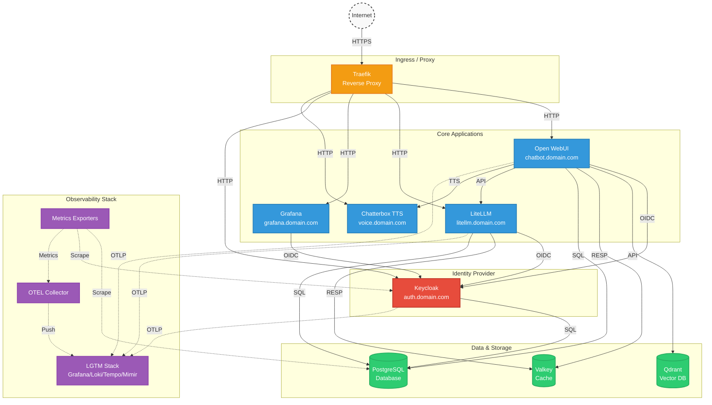

# Open WebUI Stack

Docker Compose stack for [Open WebUI](https://github.com/open-webui/open-webui) with LiteLLM proxy, observability, and security best practices.

## Architecture



## Features

- **Traefik Reverse Proxy**: Automatic HTTPS with self-signed certificates generated by Traefik, HTTP to HTTPS redirect
- **LiteLLM Proxy**: Unified gateway for multiple LLM providers (Gemini, AWS Bedrock, Ollama, local llama.cpp)
- **Keycloak Identity Provider**: Single Sign-On (SSO) for all services
- **LGTM Observability Stack**: Grafana, Loki, Tempo, Mimir for logs, traces, and metrics
- **Qdrant Vector Database**: Production-ready vector search for RAG
- **PostgreSQL**: Shared database for Open WebUI, LiteLLM, and Keycloak
- **OpenTelemetry**: Full observability with distributed tracing
- **Security**: Network isolation, secure headers, rate limiting, admin IP restriction
- **Chatterbox TTS**: OpenAI-compatible voice cloning for Open WebUI, with a voice library UI at `voice.<domain>`. This is the only TTS engine in the stack.
- **Voice assistant**: LiteLLM alias `voice-assistant` routes to `gemini-3.5-flash-lite`. `./scripts/create-voice-key.sh` creates a virtual key that can call only that model and stores it in `.env` as `LITELLM_VOICE_API_KEY`.

##  Quick Start

### Prerequisites

- Docker Engine 24.0+
- Docker Compose v2.20+
- 8GB+ RAM recommended
- (Optional) NVIDIA GPU with drivers for GPU metrics

### Installation

1. **Clone the repository**
   ```bash
   git clone https://github.com/mhajder/openwebui-stack.git
   cd openwebui-stack
   ```

2. **Run the setup script**
   ```bash
   chmod +x scripts/*.sh
   ./scripts/setup.sh
   ```

In `docker-compose.yml` change `ENABLE_SIGNUP` to `true` if you want to register the first admin user via Open WebUI. You can disable it again after the first user is created.

3. **Start the stack**
   ```bash
   docker compose --profile monitoring --profile gpu up -d
   ```

4. **Access the services**
   - Open WebUI: https://chatbot.localhost
   - Grafana: https://grafana.localhost
   - LiteLLM: https://litellm.localhost
   - Keycloak (admin): https://auth.localhost/admin
   - Chatterbox voice library: https://voice.localhost

### Local Domain Resolution

Add these entries to your `/etc/hosts`:
```
127.0.0.1 localhost chatbot.localhost grafana.localhost litellm.localhost auth.localhost traefik.localhost voice.localhost
```

## Keycloak SSO

This stack includes **Keycloak** for centralized authentication (Single Sign-On). All services authenticate through Keycloak instead of using separate credentials.

### Services Integrated with Keycloak

| Service | URL | Client ID | Redirect URI |
|---------|-----|-----------|--------------|
| Open WebUI | https://chatbot.example.com | `open-webui` | `/oauth/oidc/callback` |
| Grafana | https://grafana.example.com | `grafana` | `/login/generic_oauth` |
| LiteLLM | https://litellm.example.com | `litellm` | `/sso/callback` |

### Keycloak Administration

Access the Keycloak Admin Console to manage users and applications:

- **URL**: https://auth.example.com/admin
- **Username**: `admin` (or `KEYCLOAK_ADMIN_USER`)
- **Password**: Set during setup (`KEYCLOAK_ADMIN_PASSWORD`)

### First-Time Setup

1. After starting the stack, run the Ansible playbook from `ansible/`:
   ```bash
   ansible-galaxy collection install -r requirements.yaml
   ansible-playbook playbooks/site.yml
   ```
   This creates the `platform` realm, the `keycloak-provisioner` service account, confidential clients for Grafana, Open WebUI, and LiteLLM, client roles that match `docker-compose.yml`, group-to-role mappings, and one login user per group. It also syncs `otel/`, `grafana/`, `traefik/`, and `json-exporter/` to `project_root` as mode `0644`. The collector image runs as uid `10001`, and a `0640` root-owned `otel/config.yaml` makes it crash-loop. Client secrets are the `*_OIDC_CLIENT_SECRET` values the role writes to `.env`. Set `KEYCLOAK_ADMIN_PASSWORD`, `KEYCLOAK_PROVISIONER_CLIENT_SECRET`, those three secrets, and the `KEYCLOAK_USER_*_PASSWORD` values before the run, or store the user passwords as `vault_keycloak_user_*_password` in Ansible Vault.

2. `./scripts/configure-keycloak-clients.py` can create the same three clients. It does not create these users. Only Grafana, Open WebUI, and LiteLLM use Keycloak. Traefik, Keycloak admin, and the exporters keep their own credentials.

### Role Mapping

Users are assigned roles based on their Keycloak group membership:

| Keycloak group | Grafana role | Open WebUI role | LiteLLM role | Ansible user |
|----------------|---------------|-----------------|--------------|--------------|
| `platform-admins` | GrafanaAdmin | `openwebui_admin` | `proxy_admin` | `platform-admin` |
| `admin` | Admin | `openwebui_admin` | `proxy_admin` | |
| `editor` | Editor | | | `grafana-editor` |
| `viewer` | Viewer | | | `grafana-viewer` |
| `user` | | `openwebui_user` | `internal_user` | `openwebui-user`, `litellm-user` |
| `litellm-admin` | | | `proxy_admin` | |
| `litellm-viewer` | | | `proxy_admin_viewer` | `litellm-viewer` |

Role names are the values in the `roles` token claim. Grafana maps them with the JMESPath in `docker-compose.yml`. Open WebUI treats `openwebui_admin` as admin. LiteLLM reads `proxy_admin`, `proxy_admin_viewer`, `internal_user`, and `internal_user_viewer` from `GENERIC_USER_ROLE_ATTRIBUTE`.

**Creating more users:**

1. Go to Keycloak Admin Console → Users → Add user
2. Fill in user details and save
3. Go to Credentials tab → Set password (uncheck "Temporary")
4. Go to Groups tab → Join one of the groups in the table

### SSO Login Flow

**Open WebUI:**
1. Navigate to https://chatbot.localhost
2. Click "Continue with Keycloak"
3. Enter Keycloak credentials
4. Redirected back to Open WebUI, logged in

**LiteLLM:**
1. Navigate to https://litellm.localhost/ui
2. Click SSO login button
3. Enter Keycloak credentials
4. Redirected back to LiteLLM, logged in

**Grafana:**
1. Navigate to https://grafana.localhost
2. Click "Sign in with Keycloak"
3. Enter Keycloak credentials
4. Redirected back to Grafana, logged in

### Security Features

Keycloak includes several security hardening options:

- **Admin IP Restriction**: Restrict access to the admin console by IP
  - Set `KEYCLOAK_ADMIN_IP_RANGE` in `.env` (e.g., `10.0.0.0/8`)
  - Default: `0.0.0.0/0` (allow all)

- **Security Headers**: Strict HTTP security headers configured via Traefik

- **Resource Limits**: Memory and CPU limits applied to Keycloak container

### Realm Import

To import a pre-configured realm:
1. Place your `realm-export.json` file in `keycloak/import/`
2. Keycloak will automatically import it on startup

### Backups

Keycloak database backups can be run on-demand:
```bash
# Run backup
docker compose --profile backup up keycloak-backup

# List backups
docker volume ls | grep keycloak_backups
```

Configure retention with `BACKUP_RETENTION_DAYS` in `.env` (default: 7 days)

## Configuration

### Environment Variables

Key environment variables in `.env`:

| Variable | Description | Example |
|----------|-------------|---------|
| `COMPOSE_PROJECT_NAME` | Docker Compose project name | `openwebui-stack` |
| `DOMAIN` | Base domain for services | `localhost` or `example.com` |
| `POSTGRES_USER` | PostgreSQL admin user | `postgres` |
| `POSTGRES_PASSWORD` | PostgreSQL admin password | Generated by setup script |
| `OPENWEBUI_DB_NAME` | Open WebUI database name | `openwebui` |
| `OPENWEBUI_DB_USER` | Open WebUI database user | `openwebui` |
| `OPENWEBUI_DB_PASSWORD` | Open WebUI database password | Generated by setup script |
| `LITELLM_DB_NAME` | LiteLLM database name | `litellm` |
| `LITELLM_DB_USER` | LiteLLM database user | `litellm` |
| `LITELLM_DB_PASSWORD` | LiteLLM database password | Generated by setup script |
| `OPENWEBUI_SECRET_KEY` | Secret key for Open WebUI sessions | Generated by setup script |
| `LITELLM_MASTER_KEY` | Master API key for LiteLLM | Generated by setup script |
| `LITELLM_SALT_KEY` | Salt key for LiteLLM encryption | Generated by setup script |
| `TRAEFIK_DASHBOARD_USER` | Traefik dashboard username | `admin` |
| `TRAEFIK_DASHBOARD_PASSWORD` | Traefik dashboard password (plain) | Generated by setup script |
| `TRAEFIK_DASHBOARD_PASSWORD_HASH` | Traefik dashboard password (apr1 hash) | Auto-generated by setup script |
| `GF_SECURITY_ADMIN_PASSWORD` | Grafana admin password | Generated by setup script |
| `KEYCLOAK_DB_PASSWORD` | Keycloak database password | Generated by setup script |
| `KEYCLOAK_ADMIN_PASSWORD` | Keycloak admin password | Generated by setup script |
| `KEYCLOAK_ADMIN_IP_RANGE` | Allowed IPs for admin console | `0.0.0.0/0` (all) |
| `OPENWEBUI_OIDC_CLIENT_SECRET` | Open WebUI OIDC client secret | Auto-configured |
| `LITELLM_OIDC_CLIENT_SECRET` | LiteLLM OIDC client secret | Auto-configured |
| `GF_OIDC_CLIENT_SECRET` | Grafana OIDC client secret | Auto-configured |
| `SSL_CERT_TYPE` | SSL certificate type | `selfsigned`, `existing`, `traefik` |
| `LLAMA_CPP_EDGE_NODES` | Comma-separated llama.cpp nodes (`host:port`) | `node1.local:8080` |
| `chatterbox_device` | Ansible value that selects the Chatterbox profile | `gpu` or `cpu` |
| `CHATTERBOX_TTS_VOICE` | Voice library name Open WebUI speaks with | empty uses the built-in sample |
| `LITELLM_VOICE_API_KEY` | Virtual key for the voice assistant. Created by `./scripts/create-voice-key.sh`. Allows only the model behind `voice-assistant`. | empty until the script runs |

### Services Overview

#### Core Services

- **Traefik**: Reverse proxy with automatic HTTPS, routing, and load balancing
- **Open WebUI**: Web UI for interacting with LLMs (chatbot.domain.com)
- **LiteLLM**: Unified gateway for multiple LLM providers (litellm.domain.com). `litellm/config.yaml` ships Gemini 3.8 Flash, Gemini 3.5 Flash-Lite, and Gemini 3.1 Pro, plus Bedrock MiniMax M2.5, Qwen3 Next 80B A3B, Qwen3 Coder Next, and Kimi K3 (`us.moonshotai.kimi-k3`). Bedrock calls use `AWS_REGION` (default `us-east-1`). Model IDs were checked on 2026-10-21. The `voice-assistant` alias routes to `gemini-3.5-flash-lite` for short spoken replies. LiteLLM rewrites the alias to that model before checking the key, so the voice key allows `gemini-3.5-flash-lite`. Point Home Assistant at `https://litellm.<domain>/v1`, model `voice-assistant`, with `LITELLM_VOICE_API_KEY`. Do not use the master key. Create it after LiteLLM is healthy:

  ```bash
  ./scripts/create-voice-key.sh
  ```

  The script reads `LITELLM_MASTER_KEY` from `.env`, calls `POST /key/generate` on `http://127.0.0.1:4000`, and writes `LITELLM_VOICE_API_KEY` back to `.env`. It does not print the key. A second run does nothing when that key still works. If the alias already exists but `.env` has no working key, delete the LiteLLM key and rerun; the secret cannot be recovered. `LITELLM_URL` overrides the proxy address. Port 4000 is not published, so from the host use `LITELLM_URL=https://litellm.<domain>` (the script uses `curl`, which follows the stack's TLS). From another container on the backend network, use `http://litellm:4000`. Chatterbox remains the only speech engine: Open WebUI uses `http://chatterbox-tts:4123/v1`, and a speaker client uses `https://voice.<domain>/v1`. Chatterbox does not do speech-to-text.
- **Keycloak**: Identity provider for SSO (auth.domain.com)
- **PostgreSQL**: Shared relational database for Open WebUI, LiteLLM, and Keycloak
- **Valkey**: High-performance Redis alternative for caching and sessions
- **Chatterbox TTS**: Local OpenAI-compatible text-to-speech with voice cloning (`voice.domain.com`). Open WebUI calls `http://chatterbox-tts:4123/v1` on the backend network. The UI and public API share `https://voice.${DOMAIN}`: Traefik sends `/v1`, `/audio`, `/voices`, and the API docs to the API, and everything else to the React frontend. Set Ansible `chatterbox_device` to `gpu` or `cpu` (default `gpu` in `ansible/group_vars/all/vars.yml`). The playbook adds profile `chatterbox-gpu` or `chatterbox-cpu`. GPU builds [travisvn/chatterbox-tts-api](https://github.com/travisvn/chatterbox-tts-api) `main` with `docker/Dockerfile.uv.gpu` (CUDA 12.4) and needs the NVIDIA Container Toolkit. CPU uses `docker/Dockerfile.cpu` and does not request a GPU. Do not enable both profiles. Without Ansible: `docker compose --profile chatterbox-gpu up -d` or `--profile chatterbox-cpu`. The first speech request downloads the model into `chatterbox_models` and can take several minutes. Traefik's default `responseHeaderTimeout` is 10s, which closes a speech request before the model returns audio. The `chatterbox@file` serversTransport sets that timeout to `0s` (no limit) for the Chatterbox API service only. Upstream notes that non-CUDA multilingual builds are currently unreliable; use the `stable` branch if the CPU image fails. Upload a voice at the UI, then set **TTS Voice** in Open WebUI to that library name (`CHATTERBOX_TTS_VOICE`). OpenAI voice names with no alias (`alloy`, and the rest) use the built-in sample. `AUDIO_TTS_*` are persisted after the first boot, so later changes belong in **Admin → Settings → Audio**. Integration notes: [Chatterbox TTS](https://docs.openwebui.com/features/chat-conversations/audio/text-to-speech/chatterbox-tts-api-integration). Env names checked against [Open WebUI v0.12.1](https://docs.openwebui.com/reference/env-configuration/).

#### Storage & Search

- **Qdrant**: Vector database for semantic search and RAG operations

#### Observability (LGTM Stack)

- **LGTM** (Grafana OTel): Integrated stack providing:
  - **Prometheus/Mimir**: Metrics collection and storage
  - **Loki**: Centralized log aggregation
  - **Tempo**: Distributed tracing
  - **Grafana**: Visualization and dashboards

#### Exporters & Collectors

- **Node Exporter**: System-level metrics (CPU, memory, disk, network)
- **OpenTelemetry Collector**: Collects and forwards metrics, logs, and traces
- **PostgreSQL Exporter** (optional profile): Database metrics
- **NVIDIA GPU Exporter** (optional profile): GPU metrics (requires GPU)

### Production Deployment

For production environments:

1. **Use proper certificates**
   - **Option A**: Use existing wildcard certificates
     - Place your certificate and key files in the `certs/` directory
     - During setup, select option 1 to use existing certificates
     - Supported formats: `.crt`, `.key`, `.pem`, `.fullchain.pem`
   - **Option B**: Generate self-signed certificates (development only)
     - The setup script can generate persistent self-signed certificates
   - **Option C**: Let's Encrypt (requires public domain)
     - Update [traefik/traefik.yml](traefik/traefik.yml) for ACME configuration
     - Example ACME configuration:
     ```yaml
     certificatesResolvers:
       letsencrypt:
         acme:
           email: admin@example.com
           storage: /data/acme.json
           httpChallenge:
             entryPoint: web
     ```

2. **Update security settings**
   - Change default passwords in `.env` (setup script generates strong ones automatically)
   - Enable authentication on all service dashboards
   - Configure rate limiting and WAF rules in Traefik

3. **Enable GPU support** (if available)
   ```bash
   docker compose --profile gpu up -d
   ```
   This activates the NVIDIA GPU Exporter for monitoring GPU metrics.

4. **Configure persistent backups**
   - Use external volume drivers for data persistence
   - Set up automated backup scripts using cron
   - Store backups in secure, off-site locations

5. **Network security**
   - Use VPN or IP whitelisting for external access
   - Configure firewall rules (UFW, iptables)
   - Use private networks when possible

6. **Database optimization**
   - Configure PostgreSQL replication for HA
   - Set up automated backup and recovery procedures
   - Monitor database performance and storage

7. **Monitoring and alerting**
   - Configure alert rules in Grafana for critical metrics
   - Set up notification channels (email, Slack, PagerDuty)
   - Implement log retention policies in Loki

8. **Keycloak SSO**
   - Run `ansible-playbook playbooks/site.yml` from `ansible/` to set up OIDC clients and users
   - Configure admin IP restriction via `KEYCLOAK_ADMIN_IP_RANGE`
   - Monitor authentication via the Keycloak dashboard in Grafana
   - Set up automated backups with the backup profile

## Local models

Open WebUI does not talk to Ollama or llama.cpp directly (`ENABLE_OLLAMA_API` is `false`). It uses LiteLLM. Register local models on LiteLLM and they show up in the chat UI.

### llama.cpp edge nodes

Use this for GGUF models served by `llama-server` (typically a Fedora host with an NVIDIA GPU). `./scripts/setup.sh` can launch the same flow when you answer yes to local llama.cpp edge nodes.

1. **Configure the nodes**
   ```bash
   ./scripts/setup-edge-nodes.sh
   ```
   The script asks for each node's hostname or IP, port (default `8080`), and model name, then GPU layers, context size, parallel slots, the model directory (default `/opt/models`), and the `llama-server` path. Current `llama-server` takes parallel slots as `--parallel` (`-np`), not `--slots`. If a generated unit fails to start, change `--slots` to `--parallel` in that unit. Flag list: [llama.cpp server README](https://github.com/ggml-org/llama.cpp/blob/master/tools/server/README.md).

2. **What it writes**
   - `LLAMA_CPP_EDGE_NODES` in `.env` (`host:port`, comma-separated)
   - `edge-nodes/llama-server.service` plus one unit per node
   - `edge-nodes/setup-edge-node.sh` (installs llama.cpp with CUDA and enables the systemd unit)
   - `edge-nodes/monitor-edge-nodes.sh`
   - A LiteLLM `model_list` snippet printed at the end

3. **Install each edge node**
   Copy `edge-nodes/setup-edge-node.sh` and that node's `llama-server-*.service` to the machine, then run the setup script there (it needs `sudo`). Put the GGUF at `/opt/models/<model-name>.gguf`. The generated unit expects that filename.

4. **Register the model in LiteLLM**

   Add the snippet the script printed to `model_list` in [litellm/config.yaml](litellm/config.yaml). llama.cpp's OpenAI-compatible API is `http://<host>:<port>/v1`. LiteLLM's OpenAI provider rejects the call without `api_key`, so the snippet uses `local`. `max_input_tokens` and `max_tokens` match the server context. Start `llama-server` with `-c` at least that large:

   ```yaml
   - model_name: llama-3.1-8b-instruct
     litellm_params:
       model: openai/llama-3.1-8b-instruct
       api_base: http://192.0.2.10:8080/v1
     model_info:
       description: "llama-3.1-8b-instruct on 192.0.2.10"
   ```

5. **Reload LiteLLM and check the node**
   ```bash
   docker compose restart litellm
   ./edge-nodes/monitor-edge-nodes.sh
   ```
   The monitor script reads `LLAMA_CPP_EDGE_NODES` and checks `http://<host>:<port>/health`. In Open WebUI the model name is the `model_name` you set (for example `llama-3.1-8b-instruct`).

### Sync Ollama models

There is no `sync-llama-models` script. `./scripts/sync-ollama-models.sh` registers models that are already installed in Ollama with the LiteLLM proxy. It does not pull models, start Ollama, edit `litellm/config.yaml`, or restart containers. LiteLLM has `store_model_in_db` enabled, so each new model is stored through `POST /model/new` and is available without a restart. Open WebUI then lists it under the registered name.

The script is interactive and takes no arguments. It asks for the four values below, prints them back (the master key is truncated), and waits for `y` before it changes anything.

```bash
./scripts/sync-ollama-models.sh
```

| Prompt | What to enter |
|--------|----------------|
| Ollama public URL | Where **this script** can reach Ollama. Used only for `GET /api/tags`. Default `http://localhost:11434`. |
| Ollama internal URL | Where the **LiteLLM container** can reach Ollama. Saved as `api_base` on each model. Default `http://host.docker.internal:11434` (Docker Desktop and OrbStack). On Linux Engine, use an address that resolves inside the container. `localhost` here points at the LiteLLM container, not the host. |
| LiteLLM API URL | Where this script can reach the proxy. Default `https://litellm.localhost`. TLS verification is disabled (`curl -k`) so the stack's self-signed cert works. |
| LiteLLM master key | `LITELLM_MASTER_KEY` from `.env`. Required. Sent as `Authorization: Bearer`. |

What it does, in order:

1. `GET <ollama public URL>/api/tags` and read each `.models[].name`. `jq` is used when it is installed; otherwise the script extracts `"name"` fields itself. It exits if Ollama cannot be reached or the response has no models.
2. `GET <LiteLLM URL>/models` and collect existing model ids. If that call fails, it warns and continues with an empty list, so it will try to add every Ollama model.
3. For each Ollama model not already registered as `ollama/<name>`, `POST <LiteLLM URL>/model/new` with:

```json
{
  "model_name": "ollama/llama3.1:8b",
  "litellm_params": {
    "model": "ollama/llama3.1:8b",
    "api_base": "http://host.docker.internal:11434"
  }
}
```

`ollama/` is the LiteLLM provider prefix. `api_base` is the Ollama root (no `/v1`). A model whose id is already `ollama/<name>` is skipped, not updated. The script does not delete LiteLLM entries that you later remove from Ollama.

It prints successful, skipped, and failed counts. Exit code is `0` when nothing failed (including a `n` at the confirm prompt) and `1` when any registration failed. Re-run it after `ollama pull`. New models show up in Open WebUI as `ollama/<name>`. Pull the model into Ollama first, and have the stack running so `https://litellm.localhost` answers.

## Monitoring

### Grafana Dashboards

Access Grafana at **https://grafana.localhost** with default credentials:
- **Username**: `admin`
- **Password**: Set in `.env` as `GF_SECURITY_ADMIN_PASSWORD` (generated by setup script)

#### Pre-configured Dashboards

The stack includes several pre-configured dashboards:

1. **litellm-dashboard.json** - LiteLLM proxy metrics and performance
   - Request rates and latencies
   - Token usage and costs
   - Error rates by model
   - Model provider health

2. **node-exporter-dashboard.json** - System metrics
   - CPU, memory, and disk usage
   - Network I/O
   - Process metrics
   - System uptime

3. **openwebui-dashboard.json** - Open WebUI application metrics
   - Request rates and response times
   - User activity
   - Message counts
   - API endpoint performance

4. **postgresql-dashboard.json** - Database metrics
   - Query performance
   - Connection pool status
   - Cache hit rates
   - Replication lag (if configured)

5. **traefik-dashboard.json** - Reverse proxy metrics
   - Request rates by service
   - Response time percentiles
   - HTTP status codes
   - SSL/TLS certificate expiry

6. **opentelemetry-dashboard.json** - System-wide observability
   - Distributed traces
   - Span analysis
   - Service dependencies
   - Error tracking

7. **nvidia-dcgm-dashboard.json** - GPU metrics (if GPU profile enabled)
   - GPU memory usage
   - Compute utilization
   - Temperature monitoring
   - Power consumption

8. **tokenization-dashboard.json** - Token counts and throughput
   - LiteLLM input, output, cached, and reasoning tokens
   - Output tokens per second and seconds per output token
   - Time to first token and request latency
   - llama.cpp prompt and predicted tokens per second
   - Requires `callbacks: ["otel", "prometheus"]` and a scrape of `litellm:4000/metrics` with the master key. llama.cpp panels need `--metrics`.

8. **keycloak-dashboard.json** - Keycloak authentication monitoring
   - Login attempts (success/failed)
   - Active sessions
   - Database connection pool
   - JVM memory usage
   - Failed login alerts

9. **chatterbox-dashboard.json** - Chatterbox TTS (`monitoring` profile)
   - Health, model load, live progress, success rate, and errors
   - CPU and CUDA memory, alerts, voices, languages, and generation settings
   - Chatterbox container CPU, memory, and error logs

10. **stack-logs-dashboard.json** - Logs from every service (`monitoring` profile)
    - Service, stream, and text filters
    - Log volume and error lines

11. **container-resources-dashboard.json** - Per-container Docker stats (`monitoring` profile)
    - CPU, memory, network, disk, restarts, PIDs, and uptime

Traefik v3.7 only emits `traefik_entrypoint_*` request metrics when the entrypoint sets `observability.metrics: true`. The `web` and `websecure` entrypoints do. The internal `traefik` entrypoint stays off. Node dashboards default to job `openwebui-stack/node` and instance `node-exporter:9100`. Open WebUI and LiteLLM panels use their OTel HTTP series (`http_server_requests_total`, `http_server_duration_milliseconds_bucket`). Keycloak panels use `http_server_requests_seconds_*`; this build does not emit `keycloak_user_events_total`.

Chatterbox does not expose Prometheus. With `--profile monitoring`, `json-exporter` reads `/status`, `/status/statistics`, `/memory`, `/memory/config`, `/health`, `/voices`, `/languages`, and `/config`, and the collector scrapes those series. CUDA series are missing on the CPU profile. The same profile tails every container log into Loki. `docker-log-discovery` links each Docker json-file log to `/var/log/containers/<container>.log`, and the collector reads that directory. Loki label `container_name` is the container name. The collector also reads `/var/run/docker.sock` for Docker engine stats. It runs as root and joins group `DOCKER_GID` (default `999`). Set `DOCKER_GID` from `getent group docker` when that group id differs. App logs that already use OTLP (Open WebUI, LiteLLM, Keycloak) are still exported as well.

### Available Metrics

**Prometheus/Mimir** stores these metric types:

| Category | Metrics |
|----------|---------|
| **System** | CPU load, memory usage, disk I/O, network traffic |
| **Database** | Connection count, query latency, transaction rate |
| **HTTP** | Request rate, response time, status codes, error rate |
| **Cache** | Hit/miss rates, eviction rates, memory usage |
| **Application** | Custom metrics from services |
| **GPU** | Memory usage, compute, temperature, power (if enabled) |

### Traces in Tempo

OpenTelemetry traces are automatically collected and stored in Tempo:

- Access via Grafana → Explore → Tempo
- View distributed traces across all services
- Analyze service dependencies
- Identify performance bottlenecks
- Track errors through the system

## Additional Resources

- [Open WebUI Documentation](https://docs.openwebui.com/)
- [LiteLLM Proxy Docs](https://docs.litellm.ai/docs/proxy/configs)
- [Keycloak Documentation](https://www.keycloak.org/documentation)
- [Keycloak Server Installation Guide](https://www.keycloak.org/server/installation)
- [Traefik Documentation](https://traefik.io/traefik/)
- [Grafana LGTM Stack](https://grafana.com/products/lgtm-stack/)
- [Qdrant Documentation](https://qdrant.tech/documentation/)
- [OpenTelemetry](https://opentelemetry.io/)
- [llama.cpp server](https://github.com/ggml-org/llama.cpp/blob/master/tools/server/README.md)
- [LiteLLM model management](https://docs.litellm.ai/docs/proxy/model_management)

## License

This project is licensed under the MIT License - see the [LICENSE](LICENSE) file for details.
