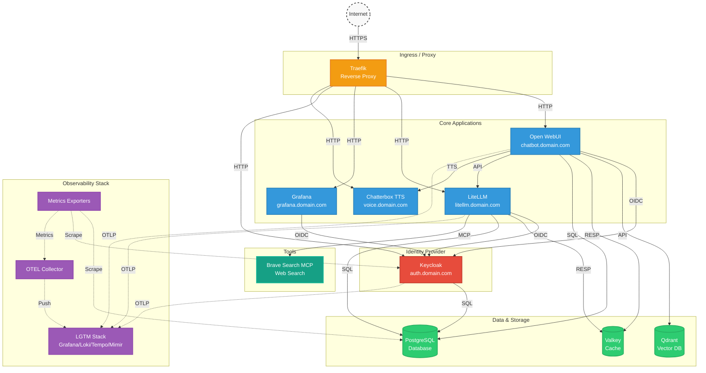

# Open WebUI Stack

Docker Compose stack for [Open WebUI](https://github.com/open-webui/open-webui) with LiteLLM proxy, observability, and security best practices.

## Architecture



## Features

- **Traefik Reverse Proxy**: Automatic HTTPS with self-signed certificates generated by Traefik, HTTP to HTTPS redirect
- **LiteLLM Proxy**: Unified gateway for multiple LLM providers (Gemini, AWS Bedrock, Ollama, local llama.cpp). A built-in content filter runs on every request, and model `auto` routes by prompt complexity.
- **Keycloak Identity Provider**: Single Sign-On (SSO) for all services
- **LGTM Observability Stack**: Grafana, Loki, Tempo, Mimir for logs, traces, and metrics
- **Qdrant Vector Database**: Production-ready vector search for RAG
- **PostgreSQL**: Shared database for Open WebUI, LiteLLM, and Keycloak
- **OpenTelemetry**: Full observability with distributed tracing
- **Security**: Network isolation, secure headers, rate limiting, admin IP restriction
- **Chatterbox TTS**: OpenAI-compatible voice cloning for Open WebUI, with a voice library UI at `voice.<domain>`. This is the only TTS engine in the stack.
- **Brave Search MCP**: Web search for every chat model. The `brave-search-mcp` container serves the official Brave MCP tools over streamable HTTP, LiteLLM mounts them at `/mcp/brave_search`, and a LiteLLM startup hook (`litellm/brave_mcp_callback.py`) injects them into every `/v1/chat/completions` request. Models call the tools; LiteLLM executes them server-side (`require_approval: never`), so no client-side tool wiring is needed.
- **Voice assistant**: LiteLLM alias `voice-assistant` routes to `gemini-3.5-flash-lite`. `./scripts/create-voice-key.sh` creates a virtual key that can call only that model and stores it in `.env` as `LITELLM_VOICE_API_KEY`.

##  Quick Start

### Prerequisites

- Docker Engine 24.0+
- Docker Compose v2.20+
- 8GB+ RAM recommended
- (Optional) NVIDIA GPU with drivers for GPU metrics

### Installation

1. **Clone the repository**
   ```bash
   git clone https://github.com/mhajder/openwebui-stack.git
   cd openwebui-stack
   ```

2. **Run the setup script**
   ```bash
   chmod +x scripts/*.sh
   ./scripts/setup.sh
   ```

In `docker-compose.yml` change `ENABLE_SIGNUP` to `true` if you want to register the first admin user via Open WebUI. You can disable it again after the first user is created.

3. **Start the stack**
   ```bash
   docker compose --profile monitoring --profile gpu up -d
   ```

4. **Access the services**
   - Open WebUI: https://chatbot.localhost
   - Grafana: https://grafana.localhost
   - LiteLLM: https://litellm.localhost
   - Keycloak (admin): https://auth.localhost/admin
   - Chatterbox voice library: https://voice.localhost

### Local Domain Resolution

Add these entries to your `/etc/hosts`:
```
127.0.0.1 localhost chatbot.localhost grafana.localhost litellm.localhost auth.localhost traefik.localhost voice.localhost
```

## Keycloak SSO

This stack includes **Keycloak** for centralized authentication (Single Sign-On). All services authenticate through Keycloak instead of using separate credentials.

### Services Integrated with Keycloak

| Service | URL | Client ID | Redirect URI |
|---------|-----|-----------|--------------|
| Open WebUI | https://chatbot.example.com | `open-webui` | `/oauth/oidc/callback` |
| Grafana | https://grafana.example.com | `grafana` | `/login/generic_oauth` |
| LiteLLM | https://litellm.example.com | `litellm` | `/sso/callback` |

### Keycloak Administration

Access the Keycloak Admin Console to manage users and applications:

- **URL**: https://auth.example.com/admin
- **Username**: `admin` (or `KEYCLOAK_ADMIN_USER`)
- **Password**: Set during setup (`KEYCLOAK_ADMIN_PASSWORD`)

### First-Time Setup

1. After starting the stack, run the Ansible playbook from `ansible/`:
   ```bash
   ansible-galaxy collection install -r requirements.yaml
   ansible-playbook playbooks/site.yml
   ```
   This creates the `platform` realm, the `keycloak-provisioner` service account, confidential clients for Grafana, Open WebUI, and LiteLLM, client roles that match `docker-compose.yml`, group-to-role mappings, and one login user per group. It also turns on passkeys for that realm: Keycloak shows **Sign in with Passkey** on the username form, and users can register a passwordless credential from the account console. Set `keycloak_passkeys_enabled: false` in `ansible/group_vars/all/vars.yml` to leave password login unchanged. It also syncs `otel/`, `grafana/`, `traefik/`, and `json-exporter/` to `project_root` as mode `0644`. The collector image runs as uid `10001`, and a `0640` root-owned `otel/config.yaml` makes it crash-loop. Client secrets are the `*_OIDC_CLIENT_SECRET` values the role writes to `.env`. Set `KEYCLOAK_ADMIN_PASSWORD`, `KEYCLOAK_PROVISIONER_CLIENT_SECRET`, those three secrets, and the `KEYCLOAK_USER_*_PASSWORD` values before the run, or store the user passwords as `vault_keycloak_user_*_password` in Ansible Vault.

2. Only Grafana, Open WebUI, and LiteLLM use Keycloak. Traefik, Keycloak admin, and the exporters keep their own credentials. `./scripts/setup.sh` step 5 can run the playbook for you (it installs collections and exports the secrets from `.env` when present).

3. Optional MCP servers are configured by the playbook through per-server task files in `ansible/roles/openwebui_stack/tasks/mcp/`. Each server is toggled by a variable in `ansible/group_vars/all/vars.yml`, and `tasks/mcp/main.yml` includes only the enabled ones:

   | Variable | Task file | What it configures |
   |----------|-----------|---------------------|
   | `brave_search_enabled` + `BRAVE_SEARCH_API_KEY` | `mcp/brave.yml` | Open WebUI web search and the `brave_search` tool server connection |
   | `playwright_mcp_enabled` | `mcp/playwright.yml` | The `playwright_cluster` tool server connection (no secret; containers run from docker-compose.yml) |

   Add a future MCP server by dropping `<name>.yml` in `tasks/mcp/`, guarding it in `tasks/mcp/main.yml` with `mcp_<name>_enabled`, and adding that variable to `group_vars/all/vars.yml` and the role defaults.

### Role Mapping

Users are assigned roles based on their Keycloak group membership:

| Keycloak group | Grafana role | Open WebUI role | LiteLLM role | Ansible user |
|----------------|---------------|-----------------|--------------|--------------|
| `platform-admins` | GrafanaAdmin | `openwebui_admin` | `proxy_admin` | `platform-admin` |
| `admin` | Admin | `openwebui_admin` | `proxy_admin` | |
| `editor` | Editor | | | `grafana-editor` |
| `viewer` | Viewer | | | `grafana-viewer` |
| `user` | | `openwebui_user` | `internal_user` | `openwebui-user`, `litellm-user` |
| `litellm-admin` | | | `proxy_admin` | |
| `litellm-viewer` | | | `proxy_admin_viewer` | `litellm-viewer` |

Role names are the values in the `roles` token claim. Grafana maps them with the JMESPath in `docker-compose.yml`. Open WebUI treats `openwebui_admin` as admin. LiteLLM reads `proxy_admin`, `proxy_admin_viewer`, `internal_user`, and `internal_user_viewer` from `GENERIC_USER_ROLE_ATTRIBUTE`.

**Creating more users:**

1. Go to Keycloak Admin Console → Users → Add user
2. Fill in user details and save
3. Go to Credentials tab → Set password (uncheck "Temporary")
4. Go to Groups tab → Join one of the groups in the table

To register a passkey for that user, follow [docs/passkey-user.md](docs/passkey-user.md).

### SSO Login Flow

**Open WebUI:**
1. Navigate to https://chatbot.localhost
2. Click "Continue with Keycloak"
3. Enter Keycloak credentials
4. Redirected back to Open WebUI, logged in

**LiteLLM:**
1. Navigate to https://litellm.localhost/ui
2. Click SSO login button
3. Enter Keycloak credentials
4. Redirected back to LiteLLM, logged in

**Grafana:**
1. Navigate to https://grafana.localhost
2. Click "Sign in with Keycloak"
3. Enter Keycloak credentials
4. Redirected back to Grafana, logged in

### Security Features

Keycloak includes several security hardening options:

- **Admin IP Restriction**: Restrict access to the admin console by IP
  - Set `KEYCLOAK_ADMIN_IP_RANGE` in `.env` (e.g., `10.0.0.0/8`)
  - Default: `0.0.0.0/0` (allow all)

- **Security Headers**: Strict HTTP security headers configured via Traefik

- **Resource Limits**: Memory and CPU limits applied to Keycloak container

### Realm Import

To import a pre-configured realm:
1. Place your `realm-export.json` file in `keycloak/import/`
2. Keycloak will automatically import it on startup

### Backups

Keycloak database backups can be run on-demand:
```bash
# Run backup
docker compose --profile backup up keycloak-backup

# List backups
docker volume ls | grep keycloak_backups
```

Configure retention with `BACKUP_RETENTION_DAYS` in `.env` (default: 7 days)

### opencode (terminal AI coding agent)

The `opencode` Ansible role installs [OpenCode](https://opencode.ai) on the target host and points it at the stack's LiteLLM proxy, with per-user token accounting. It is a no-op until you list users:

```yaml
# ansible/group_vars/all/vars.yml
opencode_users:
  - username: nicholas.krouse
```

Then run the playbook (tag `opencode` limits the run to this role):

```bash
cd ansible && ansible-playbook playbooks/site.yml --tags opencode
```

Per user, the role:

1. **Installs opencode** globally via npm (`opencode-ai`), installing Node.js first with the OS-appropriate package manager (tdnf on the Photon host, apt/dnf elsewhere) when `opencode_manage_nodejs: true`.
2. **Mints a per-user LiteLLM virtual key** through `POST /key/generate` with the master key from the deployed `.env`, tagging it `key_alias: opencode-<user>`, `user_id: <user>`, and `metadata: {user: <user>, source: opencode}`. Every request opencode makes is then attributed to that user in the LiteLLM UI and `LiteLLM_SpendLogs`, so `/key/list` spend and the Grafana LiteLLM views resolve usage per person without extra headers. The key lands in `~/.config/opencode/litellm.key` (mode 0600); later runs reuse a still-valid key instead of minting again. Optional `models:` on the user entry restricts the key's allowed models, `opencode_key_max_budget`/`opencode_key_rpm` set spend/rate caps.
3. **Auto-discovers models**: the config declares a `litellm` custom provider (`@ai-sdk/openai-compatible`, baseURL `https://litellm.<domain>/v1`) and the [`opencode-plugin-litellm`](https://github.com/yuseferi/opencode-litellm) plugin. The plugin pulls the whole `model_list` from `/v1/models` + `/v1/model/info` (limits, pricing, capability flags) at startup, caches it under `~/.cache/opencode-litellm`, and refreshes in the background — no model list to maintain when you add models to `litellm/config.yaml`. New sessions pick new models up within the 5-minute refresh window. Requires OpenCode ≥ 1.18.29.
4. **Logs local usage**: `~/.config/opencode/plugins/litellm-usage.js` appends one JSON line per assistant message to `~/.local/share/opencode/usage.jsonl` — `user`, `modelID`, input/output/reasoning/cached tokens, cost, and duration — which cross-references the LiteLLM-side spend for the same turns.
5. **Handles the Origin CA**: the proxy serves a Cloudflare Origin certificate, and Node's fetch does not use the system trust store. The role detects the OS: on the Photon host it points `NODE_EXTRA_CA_CERTS` at `certs/origin_ca_rsa_root.pem` in the deployed tree; elsewhere it distributes the public CA root from `ansible/roles/opencode/files/` into `~/.config/opencode/`. Set `opencode_node_ca_cert: false` when the proxy has a publicly trusted cert.

Defaults (`opencode_default_model: litellm/gemini-4-argon`, `small_model: litellm/gemini-3.5-flash-lite`) are set in `ansible/roles/opencode/defaults/main.yml`; any LiteLLM `model_name` works since discovery fills the picker. Run `opencode` and use `/models` to verify the full catalog.

## Configuration

### Environment Variables

Key environment variables in `.env`:

| Variable | Description | Example |
|----------|-------------|---------|
| `COMPOSE_PROJECT_NAME` | Docker Compose project name | `openwebui-stack` |
| `DOMAIN` | Base domain for services | `localhost` or `example.com` |
| `POSTGRES_USER` | PostgreSQL admin user | `postgres` |
| `POSTGRES_PASSWORD` | PostgreSQL admin password | Generated by setup script |
| `OPENWEBUI_DB_NAME` | Open WebUI database name | `openwebui` |
| `OPENWEBUI_DB_USER` | Open WebUI database user | `openwebui` |
| `OPENWEBUI_DB_PASSWORD` | Open WebUI database password | Generated by setup script |
| `LITELLM_DB_NAME` | LiteLLM database name | `litellm` |
| `LITELLM_DB_USER` | LiteLLM database user | `litellm` |
| `LITELLM_DB_PASSWORD` | LiteLLM database password | Generated by setup script |
| `OPENWEBUI_SECRET_KEY` | Secret key for Open WebUI sessions | Generated by setup script |
| `LITELLM_MASTER_KEY` | Master API key for LiteLLM | Generated by setup script |
| `LITELLM_SALT_KEY` | Salt key for LiteLLM encryption | Generated by setup script |
| `TRAEFIK_DASHBOARD_USER` | Traefik dashboard username | `admin` |
| `TRAEFIK_DASHBOARD_PASSWORD` | Traefik dashboard password (plain) | Generated by setup script |
| `TRAEFIK_DASHBOARD_PASSWORD_HASH` | Traefik dashboard password (apr1 hash) | Auto-generated by setup script |
| `GF_SECURITY_ADMIN_PASSWORD` | Grafana admin password | Generated by setup script |
| `KEYCLOAK_DB_PASSWORD` | Keycloak database password | Generated by setup script |
| `KEYCLOAK_ADMIN_PASSWORD` | Keycloak admin password | Generated by setup script |
| `KEYCLOAK_ADMIN_IP_RANGE` | Allowed IPs for admin console | `0.0.0.0/0` (all) |
| `OPENWEBUI_OIDC_CLIENT_SECRET` | Open WebUI OIDC client secret | Auto-configured |
| `LITELLM_OIDC_CLIENT_SECRET` | LiteLLM OIDC client secret | Auto-configured |
| `GF_OIDC_CLIENT_SECRET` | Grafana OIDC client secret | Auto-configured |
| `SSL_CERT_TYPE` | SSL certificate type | `selfsigned`, `existing`, `traefik` |
| `LLAMA_CPP_EDGE_NODES` | Comma-separated llama.cpp nodes (`host:port`) | `node1.local:8080` |
| `chatterbox_device` | Ansible value that selects the Chatterbox profile | `gpu` or `cpu` |
| `CHATTERBOX_TTS_VOICE` | Voice library name Open WebUI speaks with | empty uses the built-in sample |
| `LITELLM_VOICE_API_KEY` | Virtual key for the voice assistant. Created by `./scripts/create-voice-key.sh`. Allows only the model behind `voice-assistant`. | empty until the script runs |
| `BRAVE_SEARCH_API_KEY` | Brave Search API key for the MCP server | From [brave.com/search/api](https://brave.com/search/api/) |

### Services Overview

#### Core Services

- **Traefik**: Reverse proxy with automatic HTTPS, routing, and load balancing
- **Open WebUI**: Web UI for interacting with LLMs (chatbot.domain.com)
- **LiteLLM**: Unified gateway for multiple LLM providers (litellm.domain.com). `litellm/config.yaml` ships Gemini 3.8 Flash, Gemini 3.5 Flash-Lite, Gemini 3.1 Pro, and Gemini 4 Argon, plus Bedrock MiniMax M2.5, Qwen3 Next 80B A3B, Qwen3 Coder Next, and Kimi K3 (`us.moonshotai.kimi-k3`). Bedrock calls use `AWS_REGION` (default `us-east-1`). Model IDs were checked on 2026-10-21. The `voice-assistant` alias routes to `gemini-3.5-flash-lite` for short spoken replies. LiteLLM rewrites the alias to that model before checking the key, so the voice key allows `gemini-3.5-flash-lite`. Point Home Assistant at `https://litellm.<domain>/v1`, model `voice-assistant`, with `LITELLM_VOICE_API_KEY`. Do not use the master key. Create it after LiteLLM is healthy:

  ```bash
  ./scripts/create-voice-key.sh
  ```

   The script reads `LITELLM_MASTER_KEY` from `.env`, calls `POST /key/generate` on `http://127.0.0.1:4000`, and writes `LITELLM_VOICE_API_KEY` back to `.env`. It does not print the key. A second run does nothing when that key still works. If the alias already exists but `.env` has no working key, delete the LiteLLM key and rerun; the secret cannot be recovered. `LITELLM_URL` overrides the proxy address. Port 4000 is not published, so from the host use `LITELLM_URL=https://litellm.<domain>` (the script uses `curl`, which follows the stack's TLS). From another container on the backend network, use `http://litellm:4000`. Chatterbox remains the only speech engine: Open WebUI uses `http://chatterbox-tts:4123/v1`, and a speaker client uses `https://voice.<domain>/v1`. Chatterbox does not do speech-to-text.

   **Guardrails.** `default-content-filter` is the built-in LiteLLM content filter (`litellm_content_filter`). It is `default_on`, so it runs on every request without the client naming it. `pre_call` scans the user message and `post_call` scans the reply. System and tool turns are skipped (`skip_system_message_in_guardrail`, `skip_tool_message_in_guardrail`) so stack prompts and tool results are not scanned. US SSNs, AWS access keys, AWS secret keys, and GitHub tokens are blocked. Email addresses and US phone numbers are masked. Prompt-injection categories and harmful self-harm, violence, weapons, and child-safety categories block the request. There is no extra container or API key. A blocked call returns HTTP 400 before the model is billed. Docs: [content filter](https://docs.litellm.ai/docs/proxy/guardrails/litellm_content_filter).

   **Complexity routing.** Model `auto` is `auto_router/complexity_router`. The heuristic scorer (no extra API call) maps each turn to a Gemini model already in `model_list`:

   | Tier | Model |
   | --- | --- |
   | SIMPLE | `gemini-3.5-flash-lite` |
   | MEDIUM | `gemini-3.8-flash` |
   | COMPLEX | `gemini-4-argon` |
   | REASONING | `gemini-3.1-pro` |

   Unclassifiable turns use `gemini-3.8-flash`. `session_affinity` is off, so a short follow-up is not stuck on the model that answered a hard first turn. Open WebUI can select `auto` like any other model. Bedrock models stay direct-select only. Docs: [auto routing](https://docs.litellm.ai/docs/proxy/auto_routing). `store_model_in_db` is on, so a guardrail or router key saved in the Admin UI overrides the same key in this file after a restart.

   **Adaptive routing (beta).** Model `adaptive` is `auto_router/adaptive_router`. Unlike the heuristic `auto` router, it is a Thompson-sampling bandit that learns which model wins each request type (`code_generation`, `code_understanding`, `technical_design`, `analytical_reasoning`, `writing`, `factual_lookup`, `general`) from conversation signals (user satisfaction, stagnation, misalignment). It balances quality against cost with `weights: {quality: 0.7, cost: 0.3}`:

   | Model | quality_tier | strengths | input $/tok |
   | --- | --- | --- | --- |
   | `gemini-3.5-flash-lite` | 1 (budget) | factual_lookup | 0.0000003 |
   | `gemini-3.8-flash` | 2 (mid) | writing, code_understanding | 0.00000075 |
   | `gemini-3.1-pro` | 3 (frontier) | analytical_reasoning | 0.000002 |
   | `gemini-4-argon` | 3 (frontier) | code_generation, technical_design, analytical_reasoning | 0.000002 |

   Cold start uses these declared tiers; after ~10 real requests per model per type, learned estimates take over. The response carries `x-litellm-adaptive-router-model` naming the model actually used. Force a frontier model on one request with the `x-litellm-min-quality-tier: 3` header (or `min_quality_tier` request metadata). Inspect what it has learned with `GET /adaptive_router/state` (admin). Learned state persists in Postgres (`LiteLLM_AdaptiveRouter*` tables) and survives restarts. Beta: latency is not scored and signals are regex/English-biased. Docs: [adaptive router](https://docs.litellm.ai/docs/adaptive_router).
- **Keycloak**: Identity provider for SSO (auth.domain.com)
- **PostgreSQL**: Shared relational database for Open WebUI, LiteLLM, and Keycloak
- **Valkey**: High-performance Redis alternative for caching and sessions
- **Brave Search MCP**: Official Brave Search MCP server (`mcp/brave-search`) over streamable HTTP. LiteLLM mounts it at `/mcp/brave_search` and injects the tools into every chat request (see [Web Search](#web-search-brave-search-mcp)). Not published to the internet; only reachable on the backend network.
- **Playwright MCP cluster**: Five `mcr.microsoft.com/playwright/mcp` replicas behind Traefik, giving concurrent browser automation (clicks, PDFs, devtools) for chat models. MCP sessions live in each replica's process memory, so the Traefik `playwright` service pins every request of a session to one replica with sticky cookies; without it, round-robin routing returns `404 Session not found`. LiteLLM mounts the cluster as `playwright_cluster` via Traefik's non-redirecting `mcp` entrypoint (`http://traefik:8082/mcp`). See [Browser Automation (Playwright MCP cluster)](#browser-automation-playwright-mcp-cluster).
- **Chatterbox TTS**: Local OpenAI-compatible text-to-speech with voice cloning (`voice.domain.com`). Open WebUI calls `http://chatterbox-tts:4123/v1` on the backend network. The UI and public API share `https://voice.${DOMAIN}`: Traefik sends `/v1`, `/audio`, `/voices`, and the API docs to the API, and everything else to the React frontend. Both public routes use the `voice-auth@file` ForwardAuth middleware. [oauth2-proxy](https://oauth2-proxy.github.io/oauth2-proxy/configuration/providers/keycloak_oidc/) `v7.15.1` checks the Keycloak `platform` realm and redirects anonymous browsers to `https://auth.${DOMAIN}`. The callback is `https://voice.${DOMAIN}/oauth2/callback`, not `auth.${DOMAIN}`, because that host is Keycloak. Open WebUI keeps calling `http://chatterbox-tts:4123/v1` on the backend network, so speech in chat does not go through the proxy. Set `VOICE_OIDC_CLIENT_SECRET` and `OAUTH2_PROXY_COOKIE_SECRET` before starting the proxy. `scripts/setup.sh` generates both. Re-run `ansible-playbook playbooks/site.yml` so the `voice` client and `voice_user` role exist; `platform-admins` receive that role. Set Ansible `chatterbox_device` to `gpu` or `cpu` (default `gpu` in `ansible/group_vars/all/vars.yml`). The playbook adds profile `chatterbox-gpu` or `chatterbox-cpu`. GPU builds [travisvn/chatterbox-tts-api](https://github.com/travisvn/chatterbox-tts-api) `main` with `docker/Dockerfile.uv.gpu` (CUDA 12.4) and needs the NVIDIA Container Toolkit. CPU uses `docker/Dockerfile.cpu` and does not request a GPU. Do not enable both profiles. Without Ansible: `docker compose --profile chatterbox-gpu up -d` or `--profile chatterbox-cpu`. The first speech request downloads the model into `chatterbox_models` and can take several minutes. Traefik's default `responseHeaderTimeout` is 10s, which closes a speech request before the model returns audio. The `chatterbox@file` serversTransport sets that timeout to `0s` (no limit) for the Chatterbox API service only. Upstream notes that non-CUDA multilingual builds are currently unreliable; use the `stable` branch if the CPU image fails. Upload a voice at the UI, then set **TTS Voice** in Open WebUI to that library name (`CHATTERBOX_TTS_VOICE`). OpenAI voice names with no alias (`alloy`, and the rest) use the built-in sample. `AUDIO_TTS_*` are persisted after the first boot, so later changes belong in **Admin → Settings → Audio**. Integration notes: [Chatterbox TTS](https://docs.openwebui.com/features/chat-conversations/audio/text-to-speech/chatterbox-tts-api-integration). Env names checked against [Open WebUI v0.12.1](https://docs.openwebui.com/reference/env-configuration/).

#### Storage & Search

- **Qdrant**: Vector database for semantic search and RAG operations

#### Observability (LGTM Stack)

- **LGTM** (Grafana OTel): Integrated stack providing:
  - **Prometheus/Mimir**: Metrics collection and storage
  - **Loki**: Centralized log aggregation
  - **Tempo**: Distributed tracing
  - **Grafana**: Visualization and dashboards

#### Exporters & Collectors

- **Node Exporter**: System-level metrics (CPU, memory, disk, network)
- **OpenTelemetry Collector**: Collects and forwards metrics, logs, and traces
- **PostgreSQL Exporter** (optional profile): Database metrics
- **NVIDIA GPU Exporter** (optional profile): GPU metrics (requires GPU)

### Production Deployment

For production environments:

1. **Use proper certificates**
   - **Option A**: Use existing wildcard certificates
     - Place your certificate and key files in the `certs/` directory
     - During setup, select option 1 to use existing certificates
     - Supported formats: `.crt`, `.key`, `.pem`, `.fullchain.pem`
   - **Option B**: Generate self-signed certificates (development only)
     - The setup script can generate persistent self-signed certificates
   - **Option C**: Let's Encrypt (requires public domain)
     - Update [traefik/traefik.yml](traefik/traefik.yml) for ACME configuration
     - Example ACME configuration:
     ```yaml
     certificatesResolvers:
       letsencrypt:
         acme:
           email: admin@example.com
           storage: /data/acme.json
           httpChallenge:
             entryPoint: web
     ```

2. **Update security settings**
   - Change default passwords in `.env` (setup script generates strong ones automatically)
   - Enable authentication on all service dashboards
   - Configure rate limiting and WAF rules in Traefik

3. **Enable GPU support** (if available)
   ```bash
   docker compose --profile gpu up -d
   ```
   This activates the NVIDIA GPU Exporter for monitoring GPU metrics.

4. **Configure persistent backups**
   - Use external volume drivers for data persistence
   - Set up automated backup scripts using cron
   - Store backups in secure, off-site locations

5. **Network security**
   - Use VPN or IP whitelisting for external access
   - Configure firewall rules (UFW, iptables)
   - Use private networks when possible

6. **Database optimization**
   - Configure PostgreSQL replication for HA
   - Set up automated backup and recovery procedures
   - Monitor database performance and storage

7. **Monitoring and alerting**
   - Configure alert rules in Grafana for critical metrics
   - Set up notification channels (email, Slack, PagerDuty)
   - Implement log retention policies in Loki

8. **Keycloak SSO**
   - Run `ansible-playbook playbooks/site.yml` from `ansible/` to set up OIDC clients and users
   - Configure admin IP restriction via `KEYCLOAK_ADMIN_IP_RANGE`
   - Monitor authentication via the Keycloak dashboard in Grafana
   - Set up automated backups with the backup profile

## Web Search (Brave Search MCP)

Every chat model served by LiteLLM can search the web. No per-chat tool setup is required.

### How it works

1. **`brave-search-mcp`** runs the official `mcp/brave-search` image with `BRAVE_SEARCH_API_KEY` and exposes the MCP endpoint over streamable HTTP at `http://brave-search-mcp:8080/mcp` (backend network, no published port).
2. **LiteLLM mounts it as an MCP server** named `brave_search` (`mcp_servers:` in [litellm/config.yaml](litellm/config.yaml)), reachable at `http://litellm:4000/mcp/brave_search`. `allow_all_keys: true` lets any LiteLLM virtual key use it. Eight tools are exposed: `brave_web_search`, `brave_news_search`, `brave_image_search`, `brave_video_search`, `brave_summarizer`, and local search (places, POIs, maps).
3. **A startup hook injects the tools into every non-streaming chat request.** `LITELLM_WORKER_STARTUP_HOOKS: "brave_mcp_callback:register_callback"` loads [litellm/brave_mcp_callback.py](litellm/brave_mcp_callback.py), whose `BraveMCPInjector` is a LiteLLM `CustomLogger`. Its `async_pre_call_hook` appends `{"type": "mcp", "server_url": "litellm_proxy/mcp/brave_search", "require_approval": "never"}` to the `tools` list of every `completion`/`acompletion` call. Streaming requests (`stream: true`) are **skipped**: LiteLLM's MCP streaming iterator forwards the tool-call deltas to the client, and clients with their own function-calling loop (Open WebUI) record those deltas as their own tool calls, fail to resolve the MCP-namespaced name, and append error tool responses that corrupt the history ("Missing corresponding tool call for tool response message" on the next Gemini turn). If the request already carries Brave tools, the hook also skips injection so the model never sees the tool set twice.
4. **LiteLLM executes the tool calls server-side.** With `require_approval: never`, LiteLLM converts the MCP tools to provider function-calling format (Gemini function declarations, Bedrock tools, etc.), runs the call against the Brave MCP container, and sends the results back to the model in a follow-up turn — all inside one `/v1/chat/completions` request. The client only sees the final answer.

Because injection happens in the proxy, it works identically for non-streaming Open WebUI automations, Home Assistant, the voice assistant, and direct `curl` calls: just ask the model to "search the web".

### Web search in streaming chats (Open WebUI)

Streaming chats use the **client-side** MCP path instead, enabled per model with default tool IDs:

1. Open WebUI has a tool server connection of type `mcp` pointing at `http://litellm:4000/mcp/brave_search` (Admin Settings → Tool Servers, bearer auth with `LITELLM_MASTER_KEY`).
2. Each Gemini model has a Workspace entry (Admin → Workspace → Models) with **Default Tools** set to `server:mcp:brave_search`, stored as `meta.toolIds`. The frontend merges this into every chat request's `tool_ids`.
3. Open WebUI resolves the tool server, fetches the 8 tool specs (`brave_search-brave_web_search`, ...), and exposes them to the model as native function tools. The model's tool calls are executed by Open WebUI's MCP client against LiteLLM's MCP gateway.

Verified flow: user asks for weather → model emits a `brave_search_brave_search-brave_web_search` call → Open WebUI calls LiteLLM `/mcp/brave_search` → result returned → final answer with live data. The history stays well-formed (`user → assistant(tool_call) → tool → assistant`), so multi-turn chats never hit "Missing corresponding tool call".

> **Note:** the hook checks `call_type` for both `"completion"` and `"acompletion"`. LiteLLM's `/v1/chat/completions` route invokes `async_pre_call_hook` with `call_type="acompletion"`, so a hook that only matches `"completion"` never fires on real proxy traffic.

### Prerequisites and configuration

- `BRAVE_SEARCH_API_KEY` in `.env` (required; the stack fails to start without it). Free tier: 1 query/second, 2,000/month.
- The `litellm` container mounts `litellm/brave_mcp_callback.py` at `/app/brave_mcp_callback.py` and loads it via `LITELLM_WORKER_STARTUP_HOOKS`.

### Verification

```bash
# 1. Startup hook loaded (litellm logs)
docker compose logs litellm | grep "startup hook"
# ... Worker startup hook 'brave_mcp_callback:register_callback' executed successfully

# 2. A chat request carries the injected mcp tool (check LiteLLM_SpendLogs)
docker compose exec postgres psql -U litellm -d litellm -c \
  "SELECT request_id, jsonb_array_length(proxy_server_request->'tools') AS ntools,
          proxy_server_request->'tools'->0->>'type' AS t0
   FROM \"LiteLLM_SpendLogs\" ORDER BY \"startTime\" DESC LIMIT 3;"
# ntools >= 1 and t0 = "mcp" on a plain chat request means injection works

# 3. End-to-end: model actually searches (needs a working provider quota)
curl -sk https://litellm.localhost/v1/chat/completions \
  -H "Authorization: Bearer $LITELLM_MASTER_KEY" -H "Content-Type: application/json" \
  -d '{"model": "gemini-3.5-flash-lite", "messages": [{"role": "user", "content": "Search the web for today top tech news"}]}'
# A fresh answer citing current events means brave_search-brave_web_search ran.
# The executed tool is recorded in SpendLogs column mcp_namespaced_tool_name.
```

### Troubleshooting

| Symptom | Cause | Fix |
|---------|-------|-----|
| Model says it cannot search the web | Hook did not fire (older callback matched only `call_type="completion"`) | Ensure `litellm/brave_mcp_callback.py` accepts `"acompletion"`; `docker compose restart litellm` |
| "Missing corresponding tool call for tool response message" on Gemini | Streaming request got the injected server-side MCP tool; the client recorded the streamed tool-call deltas as its own and appended error tool responses | Keep `stream` requests excluded in the injector; use the Open WebUI client-side path (Workspace model Default Tools) for streaming chats |
| `Worker startup hook ... executed successfully` missing from logs | Module not mounted or `LITELLM_WORKER_STARTUP_HOOKS` unset | Check the volume mount and env var in `docker-compose.yml` |
| Tool call fails with "fetch failed" | `brave-search-mcp` outbound call to the Brave API failed (transient) | Retry; check `docker compose logs brave-search-mcp` |
| Tool call fails with 401/403 | Invalid `BRAVE_SEARCH_API_KEY` | Update `.env`, then `docker compose up -d brave-search-mcp` |
| Gemini returns 429 quota errors | Gemini free tier exhausted — unrelated to search tools | Wait for quota reset or set billing on the Gemini project |

Open WebUI's **direct** MCP path (Admin Settings → Tool Servers) is independent: an `mcp`-type tool server connects per-chat via tool IDs (`server:mcp:<id>`) and logs `Initialized 0 tool server(s)` at boot, which is expected for MCP-only configs. The Gemini Workspace models ship with Default Tools set, so streaming chats get web search without per-chat tool selection. Other models (Bedrock, Ollama) get it by adding `server:mcp:brave_search` to their Default Tools, or by picking the tool in the chat composer.

## Browser Automation (Playwright MCP cluster)

Chat models can drive a real headless Chromium through the official [Playwright MCP server](https://github.com/microsoft/playwright-mcp). The stack runs five replicas (`deploy.replicas: 5`) behind Traefik so multiple users get parallel browser sessions.

### How it works

1. **Five `playwright-mcp` replicas** run `mcr.microsoft.com/playwright/mcp` (headless Chromium, `pdf` and `devtools` capabilities) on the backend and frontend networks, port 8931. The service has no `container_name`: Compose rejects `container_name` together with `replicas` because replica names must be unique.
2. **Traefik load-balances across the replicas.** The `playwright` router matches `Host(playwright-mcp.${DOMAIN})` on the dedicated `mcp` entrypoint (`:8082`), not `web` — `web` 308-redirects every request to `websecure`, and LiteLLM's MCP client (httpx) does not follow redirects.
3. **Sticky cookies keep MCP sessions working.** Playwright MCP keeps each streamable-HTTP session (`mcp-session-id`) in the replica process's memory. Round-robin routing sends follow-up calls to replicas that never saw the `initialize` and they answer `404 Session not found`. The `playwright` service sets `loadbalancer.sticky.cookie=true` (cookie `pwsticky`), so Traefik pins all requests of one session to the replica that owns it. LiteLLM's MCP client reuses Traefik's `Set-Cookie` automatically (httpx cookie jar), so no client-side wiring is needed.
4. **`PLAYWRIGHT_MCP_ALLOWED_HOSTS: "*"` passes the Host check.** The server enforces a Host allowlist (DNS-rebinding protection) that only contains `localhost:8931` by default. Traefik forwards the incoming `Host: playwright-mcp.<domain>` header, which would get a `403 Access is only allowed at localhost:8931` without the wildcard.
5. **LiteLLM mounts it as `playwright_cluster`** (`mcp_servers:` in [litellm/config.yaml](litellm/config.yaml)) with `url: http://traefik:8082/mcp`, a `Host` header matching the router rule, and `allow_all_keys`-style open access. Tools are exposed with the `playwright_cluster-` prefix (for example `playwright_cluster-browser_navigate`).

Scaling up or down: change `deploy.replicas` in `docker-compose.yml`, then `docker compose up -d playwright-mcp`. Existing sessions stay pinned to their replica via the sticky cookie; a new `initialize` lands on whichever replica Traefik picks next.

### Verification

```bash
# 1. All replicas healthy
docker compose ps playwright-mcp

# 2. Traefik has every replica behind the playwright service (sticky cookie set)
curl -s http://traefik:8080/api/http/services -H "Authorization: Basic ..." | \
  jq '.[] | select(.name | startswith("playwright")) | {name, status, servers: [.loadBalancer.servers[].url]}'

# 3. End-to-end through the load balancer: initialize, then reuse the session
curl -sD /tmp/h -X POST http://traefik:8082/mcp \
  -H "Host: playwright-mcp.localhost" -H "Content-Type: application/json" \
  -H "Accept: application/json, text/event-stream" \
  -d '{"jsonrpc":"2.0","id":1,"method":"initialize","params":{"protocolVersion":"2025-06-18","capabilities":{},"clientInfo":{"name":"t","version":"1"}}}'
# Mcp-Session-Id header present + Set-Cookie: pwsticky=... -> session created and pinned

curl -s -X POST http://traefik:8082/mcp -b "pwsticky=<cookie>" \
  -H "Host: playwright-mcp.localhost" -H "Mcp-Session-Id: <id>" \
  -H "Accept: application/json, text/event-stream" -H "Content-Type: application/json" \
  -d '{"jsonrpc":"2.0","id":2,"method":"tools/list"}'   # HTTP 200, not 404
```

### Troubleshooting

| Symptom | Cause | Fix |
|---------|-------|-----|
| `404 Session not found` on follow-up tool calls | Sticky cookies disabled or cookie not sent | Keep `loadbalancer.sticky.cookie=true`; verify `Set-Cookie: pwsticky` on `initialize` |
| `403 Access is only allowed at localhost:8931` | Server Host allowlist rejects the forwarded Host | Keep `PLAYWRIGHT_MCP_ALLOWED_HOSTS: "*"` |
| `can't set container_name ... must be unique: invalid compose project` | `container_name` left on the replicas service | Remove `container_name` from `playwright-mcp` |
| LiteLLM gets `301/308` or connection errors on the MCP server | URL points at the redirecting `web` entrypoint | Use `http://traefik:8082/mcp` (the `mcp` entrypoint) |
| Compose cannot resolve `traefik` from litellm | Services not sharing a network | `litellm` and `traefik` both attach to `frontend` |

## Local models

Open WebUI does not talk to Ollama or llama.cpp directly (`ENABLE_OLLAMA_API` is `false`). It uses LiteLLM. Register local models on LiteLLM and they show up in the chat UI.

### llama.cpp edge nodes

Use this for GGUF models served by `llama-server` (typically a Fedora host with an NVIDIA GPU). `./scripts/setup.sh` can launch the same flow when you answer yes to local llama.cpp edge nodes.

1. **Configure the nodes**
   ```bash
   ./scripts/setup-edge-nodes.sh
   ```
   The script asks for each node's hostname or IP, port (default `8080`), and model name, then GPU layers, context size, parallel slots, the model directory (default `/opt/models`), and the `llama-server` path. Current `llama-server` takes parallel slots as `--parallel` (`-np`), not `--slots`. If a generated unit fails to start, change `--slots` to `--parallel` in that unit. Flag list: [llama.cpp server README](https://github.com/ggml-org/llama.cpp/blob/master/tools/server/README.md).

2. **What it writes**
   - `LLAMA_CPP_EDGE_NODES` in `.env` (`host:port`, comma-separated)
   - `edge-nodes/llama-server.service` plus one unit per node
   - `edge-nodes/setup-edge-node.sh` (installs llama.cpp with CUDA and enables the systemd unit)
   - `edge-nodes/monitor-edge-nodes.sh`
   - A LiteLLM `model_list` snippet printed at the end

3. **Install each edge node**
   Copy `edge-nodes/setup-edge-node.sh` and that node's `llama-server-*.service` to the machine, then run the setup script there (it needs `sudo`). Put the GGUF at `/opt/models/<model-name>.gguf`. The generated unit expects that filename.

4. **Register the model in LiteLLM**

   Add the snippet the script printed to `model_list` in [litellm/config.yaml](litellm/config.yaml). llama.cpp's OpenAI-compatible API is `http://<host>:<port>/v1`. LiteLLM's OpenAI provider rejects the call without `api_key`, so the snippet uses `local`. `max_input_tokens` and `max_tokens` match the server context. Start `llama-server` with `-c` at least that large:

   ```yaml
   - model_name: llama-3.1-8b-instruct
     litellm_params:
       model: openai/llama-3.1-8b-instruct
       api_base: http://192.0.2.10:8080/v1
     model_info:
       description: "llama-3.1-8b-instruct on 192.0.2.10"
   ```

5. **Reload LiteLLM and check the node**
   ```bash
   docker compose restart litellm
   ./edge-nodes/monitor-edge-nodes.sh
   ```
   The monitor script reads `LLAMA_CPP_EDGE_NODES` and checks `http://<host>:<port>/health`. In Open WebUI the model name is the `model_name` you set (for example `llama-3.1-8b-instruct`).

### vLLM distributed inference compute nodes

For full HF-precision models larger than a single llama.cpp node can serve, use the `vllm_compute` Ansible role. It deploys the official `vllm/vllm-openai` container (Docker + NVIDIA runtime) onto Fedora compute nodes connected over 10/25GbE, with two distributed modes:

- **Pipeline parallelism (`vllm_deployment_mode: ray`, default)**: one Ray head + workers, one `vllm serve` on the head. `--pipeline-parallel-size` defaults to the node count; each node serves a contiguous layer range. Fits the 10GbE fabric because PP transfers activations only at stage boundaries.
- **Cross-node tensor parallelism**: set `vllm_cross_node_tensor_parallel: true`. Spreads TP across the cluster (`TP = tensor_parallel_size × nodes`). Verify the fabric can sustain it (25GbE+ recommended); 10GbE will bottleneck NCCL all-reduce.
- **Standalone replicas (`vllm_deployment_mode: standalone`)**: every node runs the full model independently; LiteLLM load balances across endpoints. No cross-node traffic at all.

1. **Inventory**: add your nodes under `vllm_compute` in `ansible/inventory/hosts.yml` and mark exactly one host `vllm_ray_head: true` for ray mode.
2. **Configure**: edit `ansible/group_vars/vllm_compute/vars.yml` (model, GPUs per node, pipeline size, firewall CIDR, `VLLM_API_KEY`).
3. **Deploy**:
   ```bash
   cd ansible
   ansible-galaxy collection install -r requirements.yaml
   ansible-playbook playbooks/inference.yml
   ```
    The role runs after the global `prerequisites` check role (Docker + compose present; NVIDIA driver for this group via `prerequisites_check_nvidia: true` in `ansible/group_vars/vllm_compute/vars.yml`). The NVIDIA container toolkit and the nvidia runtime registration are now host setup: install the toolkit on each node and run `nvidia-ctk runtime configure --runtime=docker` there. The role opens pinned Ray ports (6379, 8265, 13377-13379, 14000-15000) in a dedicated `vllm-cluster` firewalld zone restricted to the compute CIDR, deploys systemd units (`vllm-ray`, `vllm-serve`), waits for Ray workers to join, then waits for `GET /health` on the API.
4. **Register with LiteLLM**: the run renders `litellm/vllm-models.yaml` with the `model_list` snippet (single cluster endpoint in ray mode; one entry per node in standalone mode). Merge it into `litellm/config.yaml` on the photon host and `docker compose restart litellm`.

Ray traffic is unauthenticated and can execute arbitrary code; keep `vllm_firewall_zone_source` limited to the compute segment and set `VLLM_API_KEY` on the controller so the API requires auth.

### Sync Ollama models

There is no `sync-llama-models` script. `./scripts/sync-ollama-models.sh` registers models that are already installed in Ollama with the LiteLLM proxy. It does not pull models, start Ollama, edit `litellm/config.yaml`, or restart containers. LiteLLM has `store_model_in_db` enabled, so each new model is stored through `POST /model/new` and is available without a restart. Open WebUI then lists it under the registered name.

The script is interactive and takes no arguments. It asks for the four values below, prints them back (the master key is truncated), and waits for `y` before it changes anything.

```bash
./scripts/sync-ollama-models.sh
```

| Prompt | What to enter |
|--------|----------------|
| Ollama public URL | Where **this script** can reach Ollama. Used only for `GET /api/tags`. Default `http://localhost:11434`. |
| Ollama internal URL | Where the **LiteLLM container** can reach Ollama. Saved as `api_base` on each model. Default `http://host.docker.internal:11434` (Docker Desktop and OrbStack). On Linux Engine, use an address that resolves inside the container. `localhost` here points at the LiteLLM container, not the host. |
| LiteLLM API URL | Where this script can reach the proxy. Default `https://litellm.localhost`. TLS verification is disabled (`curl -k`) so the stack's self-signed cert works. |
| LiteLLM master key | `LITELLM_MASTER_KEY` from `.env`. Required. Sent as `Authorization: Bearer`. |

What it does, in order:

1. `GET <ollama public URL>/api/tags` and read each `.models[].name`. `jq` is used when it is installed; otherwise the script extracts `"name"` fields itself. It exits if Ollama cannot be reached or the response has no models.
2. `GET <LiteLLM URL>/models` and collect existing model ids. If that call fails, it warns and continues with an empty list, so it will try to add every Ollama model.
3. For each Ollama model not already registered as `ollama/<name>`, `POST <LiteLLM URL>/model/new` with:

```json
{
  "model_name": "ollama/llama3.1:8b",
  "litellm_params": {
    "model": "ollama/llama3.1:8b",
    "api_base": "http://host.docker.internal:11434"
  }
}
```

`ollama/` is the LiteLLM provider prefix. `api_base` is the Ollama root (no `/v1`). A model whose id is already `ollama/<name>` is skipped, not updated. The script does not delete LiteLLM entries that you later remove from Ollama.

It prints successful, skipped, and failed counts. Exit code is `0` when nothing failed (including a `n` at the confirm prompt) and `1` when any registration failed. Re-run it after `ollama pull`. New models show up in Open WebUI as `ollama/<name>`. Pull the model into Ollama first, and have the stack running so `https://litellm.localhost` answers.

## Monitoring

### Grafana Dashboards

Access Grafana at **https://grafana.localhost** with default credentials:
- **Username**: `admin`
- **Password**: Set in `.env` as `GF_SECURITY_ADMIN_PASSWORD` (generated by setup script)

#### Pre-configured Dashboards

The stack includes several pre-configured dashboards:

1. **litellm-dashboard.json** - LiteLLM proxy metrics and performance
   - Request rates and latencies
   - Token usage and costs
   - Error rates by model
   - Model provider health

2. **node-exporter-dashboard.json** - System metrics
   - CPU, memory, and disk usage
   - Network I/O
   - Process metrics
   - System uptime

3. **openwebui-dashboard.json** - Open WebUI application metrics
   - Request rates and response times
   - User activity
   - Message counts
   - API endpoint performance

4. **postgresql-dashboard.json** - Database metrics
   - Query performance
   - Connection pool status
   - Cache hit rates
   - Replication lag (if configured)

5. **traefik-dashboard.json** - Reverse proxy metrics
   - Request rates by service
   - Response time percentiles
   - HTTP status codes
   - SSL/TLS certificate expiry

6. **opentelemetry-dashboard.json** - System-wide observability
   - Distributed traces
   - Span analysis
   - Service dependencies
   - Error tracking

7. **nvidia-dcgm-dashboard.json** - GPU metrics (if GPU profile enabled)
   - GPU memory usage
   - Compute utilization
   - Temperature monitoring
   - Power consumption

8. **tokenization-dashboard.json** - Token counts and throughput
   - LiteLLM input, output, cached, and reasoning tokens
   - Output tokens per second and seconds per output token
   - Time to first token and request latency
   - llama.cpp prompt and predicted tokens per second
   - Requires `callbacks: ["otel", "prometheus"]` and a scrape of `litellm:4000/metrics` with the master key. llama.cpp panels need `--metrics`.

 8. **keycloak-dashboard.json** - Keycloak authentication monitoring
    - Login success and failure from `keycloak_user_events_total` (`event="login"`, empty `error` is success)
    - Authentication latency SLO, P50/P95/P99, and server error rate
    - Password hash validations, database pool, JVM memory, and scrape status
    - Keycloak container logs and keycloak-backup container logs
    - Last backup result, success count, failure count, and age of the last success

9. **chatterbox-dashboard.json** - Chatterbox TTS (`monitoring` profile)
   - Health, model load, live progress, success rate, and errors
   - CPU and CUDA memory, alerts, voices, languages, and generation settings
   - Chatterbox container CPU, memory, and error logs

10. **stack-logs-dashboard.json** - Logs from every service (`monitoring` profile)
    - Service, stream, and text filters
    - Log volume and error lines

11. **container-resources-dashboard.json** - Per-container Docker stats (`monitoring` profile)
    - CPU, memory, network, disk, restarts, PIDs, and uptime

Traefik v3.7 only emits `traefik_entrypoint_*` request metrics when the entrypoint sets `observability.metrics: true`. The `web` and `websecure` entrypoints do. The internal `traefik` entrypoint stays off. Node dashboards default to job `openwebui-stack/node` and instance `node-exporter:9100`. Open WebUI and LiteLLM panels use their OTel HTTP series (`http_server_requests_total`, `http_server_duration_milliseconds_bucket`). Keycloak panels use job `openwebui-stack/keycloak`. HTTP URIs are templates such as `/realms/{realm}/protocol/{protocol}/auth`, so match the braces literally. User events use `keycloak_user_events_total` with lowercase `event` (`login`, not `LOGIN`) and an `error` label that is empty on success. Password checks use `keycloak_credentials_password_hashing_validations_total`. The official troubleshooting and capacity dashboards are retargeted the same way. They no longer filter on Kubernetes `namespace`, `pod`, or `container` labels.

Chatterbox does not expose Prometheus. With `--profile monitoring`, `json-exporter` reads `/status`, `/status/statistics`, `/memory`, `/memory/config`, `/health`, `/voices`, `/languages`, and `/config`, and the collector scrapes those series. CUDA series are missing on the CPU profile. The compose logging driver is `local`, so there is no json-file log to tail. Grafana Alloy (`loki.source.docker`) reads every container through the Docker API and pushes to Loki with `service_name` set to the container name. Select Keycloak logs with `{service_name=~".*keycloak"}` and backup logs with `{service_name=~".*keycloak-backup.*"}`. Alloy stores its read positions in the `alloy_data` volume. The collector still reads `/var/run/docker.sock` for Docker engine stats. Both run as root and join group `DOCKER_GID` (default `999`). Set `DOCKER_GID` from `getent group docker` when that group id differs. App logs that already use OTLP (Open WebUI, LiteLLM, Keycloak) are still exported as well. A backup run prints `keycloak_backup_success 1` or `keycloak_backup_success 0`. The Keycloak dashboard counts those lines. The backup container only exists while `docker compose --profile backup up keycloak-backup` is running.

### Available Metrics

**Prometheus/Mimir** stores these metric types:

| Category | Metrics |
|----------|---------|
| **System** | CPU load, memory usage, disk I/O, network traffic |
| **Database** | Connection count, query latency, transaction rate |
| **HTTP** | Request rate, response time, status codes, error rate |
| **Cache** | Hit/miss rates, eviction rates, memory usage |
| **Application** | Custom metrics from services |
| **GPU** | Memory usage, compute, temperature, power (if enabled) |

### Traces in Tempo

OpenTelemetry traces are automatically collected and stored in Tempo:

- Access via Grafana → Explore → Tempo
- View distributed traces across all services
- Analyze service dependencies
- Identify performance bottlenecks
- Track errors through the system

## Additional Resources

- [Complete setup and usage guide](docs/setup-guide.md) - end-to-end install, SSO, usage, local inference, monitoring, backups, upgrades, and troubleshooting
- [Passkey user guide](docs/passkey-user.md)
- [Open WebUI Documentation](https://docs.openwebui.com/)
- [LiteLLM Proxy Docs](https://docs.litellm.ai/docs/proxy/configs)
- [Keycloak Documentation](https://www.keycloak.org/documentation)
- [Keycloak Server Installation Guide](https://www.keycloak.org/server/installation)
- [Traefik Documentation](https://traefik.io/traefik/)
- [Grafana LGTM Stack](https://grafana.com/products/lgtm-stack/)
- [Qdrant Documentation](https://qdrant.tech/documentation/)
- [OpenTelemetry](https://opentelemetry.io/)
- [llama.cpp server](https://github.com/ggml-org/llama.cpp/blob/master/tools/server/README.md)
- [LiteLLM model management](https://docs.litellm.ai/docs/proxy/model_management)

## License

This project is licensed under the MIT License - see the [LICENSE](LICENSE) file for details.
