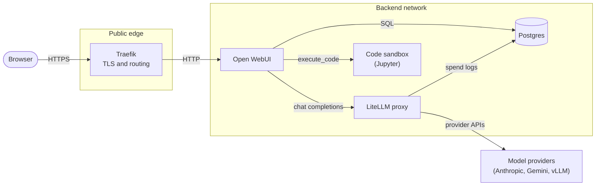
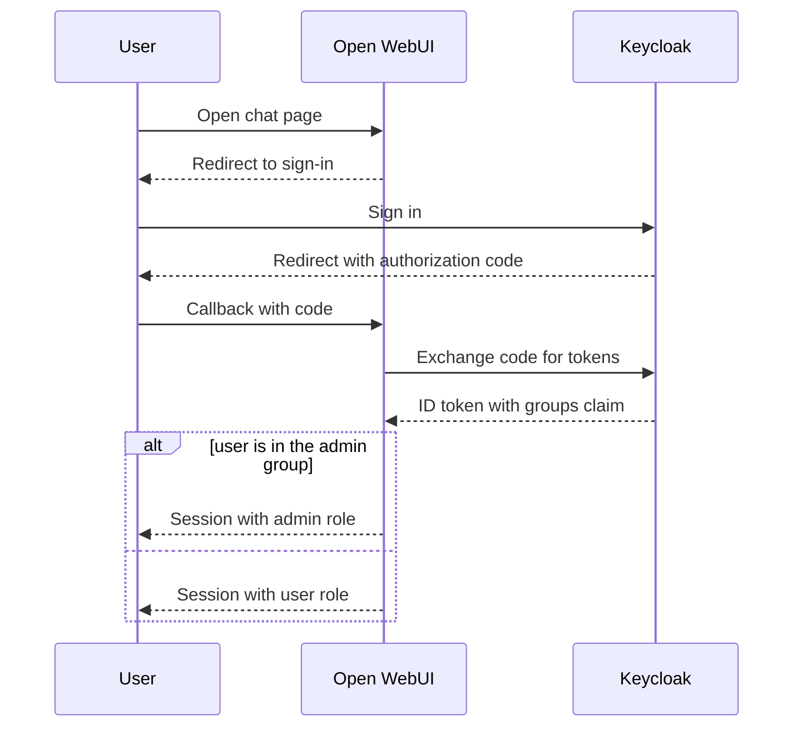
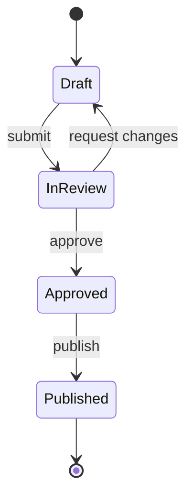

# Diagramming

A diagram earns its place when the explanation has several parts that
relate: who calls whom, in what order, through which states, inside which
boundary. Draw the mechanism, with real names, so the reader can point at
the picture and say what happens next.

## Pick the type from the question

| The reader needs to see | Mermaid type | Direction and notes |
|---|---|---|
| Components and what flows between them | `flowchart LR` with `subgraph` boundaries | Label every edge with what moves |
| Calls between actors over time | `sequenceDiagram` | `alt`/`opt` blocks for branches |
| The lifecycle of one thing | `stateDiagram-v2` | Name the events on transitions |
| Steps and decisions | `flowchart TD` | Decisions as `{}` with labeled exits |
| A data model | `erDiagram` | Show cardinality |
| Types and their relations | `classDiagram` | Only the fields that matter |
| Phases or a schedule | `gantt` or `timeline` | |
| A hierarchy of ideas | `mindmap` | |

If the content is a list with no relations, write a list instead.

## What makes a diagram worth it

- **Real names.** The actual services, files, tables, endpoints, and
  people from the conversation, not "Service A".
- **Edges say what moves:** `POST /v1/chat/completions`, "JWT", "STL
  file", "webhook". Arrows follow the data or the control, consistently;
  say which in the caption if it could be read either way.
- **Boundaries are visible:** networks, trust zones, hosts, and
  containers as subgraphs.
- **One level of detail per diagram.** At more than about 15 nodes, draw
  an overview and then one diagram per area.
- **A caption** of one sentence under the diagram: what to notice.

## Mermaid that renders the first time

- Node ids are plain words (`gateway`, `db`); the text goes in quoted
  labels: `gateway["API gateway (Traefik)"]`. Quote every label that
  contains spaces, parentheses, slashes, colons, or other punctuation.
- Never use a keyword such as `end`, `graph`, or `subgraph` as a node id.
- Line breaks inside a label: `<br/>`. No other HTML.
- Edge labels: `a -->|"HTTPS"| b`. One edge per line.
- Shapes: `["box"]`, `("rounded")`, `(["pill"])`, `[("database")]`,
  `{"decision"}`, `[["subroutine"]]`.
- Styling sparingly: `classDef store stroke:#0072B2,stroke-width:2px;`
  then `class db,cache store;`. Prefer stroke colors to fills: the chat
  may be in a dark theme, and light fills with default text become
  unreadable there.
- In a chat, one ` ```mermaid ` block per diagram, with nothing else
  inside the fence.

An architecture overview:



Caption: every model call leaves the backend network only through the
LiteLLM proxy.

A request sequence:



A lifecycle:



## Hand-written SVG

Use SVG when the layout itself carries meaning (a floor plan, a network
with fixed positions, an annotated figure) or when Mermaid's layout
tangles. In Open WebUI put it in an ` ```html ` block (a small page holding
the SVG) so it opens in the Artifacts panel; in a coding agent write an
`.svg` or `.html` file.

- `viewBox="0 0 W H"` with `width="100%"`, never a fixed pixel width.
  Keep labels legible on a phone: give a wide diagram a `min-width`
  (about 560 px) inside a wrapper with `overflow-x: auto`, or lay it out
  top to bottom.
- Align boxes on an 8-unit grid; equal sizes for equal kinds of thing; at
  least 24 units between boxes.
- Size each box for its longest label; text 14 units on an 800-unit-wide
  canvas, `font-family="system-ui, sans-serif"`, `text-anchor="middle"`.
- Theme with CSS variables and apply them through classes in a `<style>`
  block, so it reads on dark backgrounds too. Do not put `var()` in
  presentation attributes such as `fill="..."`; browsers do not treat it
  the same way there.
- Define one arrow `<marker>` and reuse it. Connect box edges, not
  centers, and route lines at right angles.
- Give it `role="img"`, a `<title>`, and a `<desc>`.

```html
<!doctype html>
<html lang="en">
<head><meta charset="utf-8"><meta name="viewport" content="width=device-width, initial-scale=1"><title>Upload pipeline</title>
<style>
  :root { --bg: #ffffff; --ink: #202124; --muted: #5f6368; --line: #0072b2; --box: #f1f3f4; }
  @media (prefers-color-scheme: dark) { :root { --bg: #1e1f22; --ink: #e8eaed; --muted: #9aa0a6; --line: #56b4e9; --box: #2a2b2e; } }
  body { margin: 0; padding: 16px; background: var(--bg); }
  .scroll { overflow-x: auto; }
  svg { min-width: 560px; max-width: 800px; display: block; }
  .box { fill: var(--box); stroke: var(--muted); }
  .label { fill: var(--ink); font: 14px system-ui, sans-serif; }
  .edge { stroke: var(--line); stroke-width: 2; fill: none; }
  .edge-label { fill: var(--muted); font: 12px system-ui, sans-serif; }
  .arrowhead { fill: var(--line); }
</style></head>
<body>
<div class="scroll">
<svg viewBox="0 0 800 160" width="100%" role="img" aria-labelledby="t d">
  <title id="t">Upload pipeline</title>
  <desc id="d">The browser uploads a file to the API, which stores it and queues a scan job for the worker.</desc>
  <defs><marker id="arrow" viewBox="0 0 10 10" refX="9" refY="5" markerWidth="8" markerHeight="8" orient="auto-start-reverse"><path class="arrowhead" d="M0,0 L10,5 L0,10 z"/></marker></defs>
  <rect class="box" x="16" y="56" width="160" height="48" rx="8"/><text class="label" x="96" y="85" text-anchor="middle">Browser</text>
  <rect class="box" x="320" y="56" width="160" height="48" rx="8"/><text class="label" x="400" y="85" text-anchor="middle">API</text>
  <rect class="box" x="624" y="56" width="160" height="48" rx="8"/><text class="label" x="704" y="85" text-anchor="middle">Scan worker</text>
  <path class="edge" d="M176,80 H316" marker-end="url(#arrow)"/><text class="edge-label" x="248" y="70" text-anchor="middle">file upload</text>
  <path class="edge" d="M480,80 H620" marker-end="url(#arrow)"/><text class="edge-label" x="552" y="70" text-anchor="middle">scan job</text>
</svg>
</div>
</body>
</html>
```

## Before you deliver

- Could someone redraw the system from your diagram alone?
- Does every edge say what moves, in a consistent direction?
- Are the names the real ones from the conversation?
- Mermaid: quoted labels, no keyword ids, one diagram per block.
- SVG: `viewBox`, theme variables, title and description.
