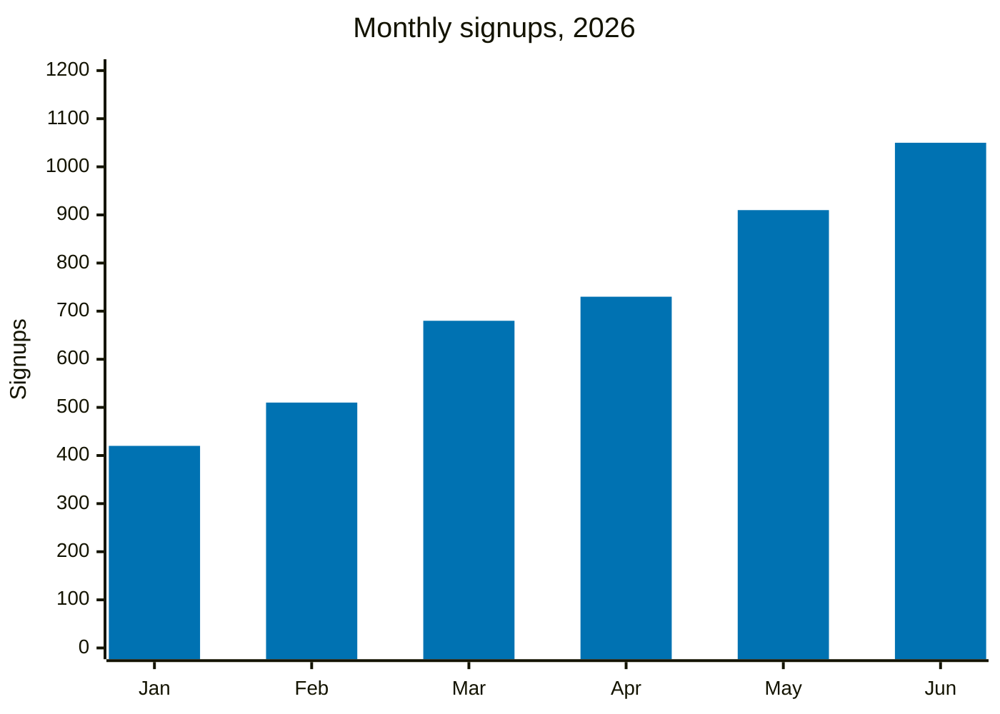
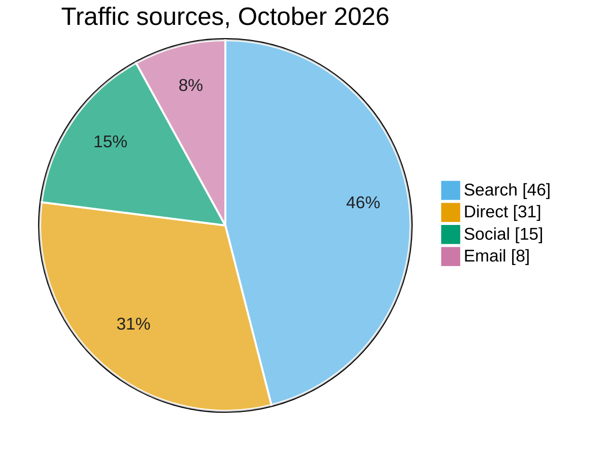

# Data Visualization

A chart answers one question. Pick the form that answers it fastest, draw
it without distortion, and title it with the answer.

## Where the chart goes

| You are in | Draw with | The user sees |
|---|---|---|
| Open WebUI with Code Interpreter on (you have `execute_code`) | matplotlib | `plt.show()` returns the figure as an image in your reply. For a file, save a PDF to the download directory your instructions name; Open WebUI attaches `.pdf` files from there. |
| Open WebUI without Code Interpreter | An HTML page with a chart library from a CDN, or a Mermaid chart | An ` ```html ` block opens in the Artifacts panel; a ` ```mermaid ` block renders in the chat |
| Claude Code or opencode | A matplotlib script, or an HTML file | A PNG, SVG, or HTML file in the working directory |

Use Mermaid only for simple bar, line, and pie charts; it has no
annotations or real axis control.

## 1. Choose the form from the question

| The question | Use | Avoid |
|---|---|---|
| How do categories compare? | Bar chart, sorted by value unless the categories have a natural order; horizontal when labels are long | Pie charts with more than 5 slices, 3D bars |
| How did it change over time? | Line chart; bars for a few periods or counts per period | Uneven time steps drawn as even |
| What is the whole made of? | Stacked or 100% bar; a pie or donut only for 2-5 parts of one whole | Stacked lines, nested pies |
| How are values spread? | Histogram, box plot, or strip plot | An average alone |
| Do two measures move together? | Scatter plot; a trend line only if the fit is meaningful | Two y-axes |
| What ranks highest? | Sorted horizontal bars or a dot plot | Unsorted bars |
| Where does it happen? | A map only when location itself matters; otherwise bars by region | Choropleths of raw counts (use rates) |
| One number that matters | A stat tile | A chart with one bar |
| Exact values for lookup | A table | A chart |

When several series crowd one chart, split them into small multiples that
share an axis instead of adding colors.

## 2. Encode honestly

- Bar axes start at zero. A line chart may zoom in, with the axis labeled.
- Charts that will be compared share the same scale.
- Units go in the axis title or the value labels: "Revenue ($M)".
- Label lines and bars directly when there are five series or fewer; use
  a legend only beyond that, ordered like the data.
- The title states the finding ("Tickets fell 30% after the March
  release"); the subtitle names the measure, unit, and period; a source
  line goes underneath when the data has one.
- Mark estimates, projections, and gaps in the data (dashed line, lighter
  fill, a note). Never interpolate across missing data silently.
- Round labels to what the reader needs (two or three significant
  digits), with thousands separators.

## 3. Color

- One palette for the whole answer: the same series keeps the same color
  in every chart.
- Categorical, colorblind-safe (Okabe-Ito), in this order: `#0072B2`
  blue, `#E69F00` orange, `#009E73` green, `#D55E00` vermillion,
  `#CC79A7` purple, `#56B4E9` sky. Beyond six categories, group the small
  ones into "Other" or use small multiples.
- To tell a story, color the series that carries it and draw the rest in
  grey (`#9AA0A6`).
- Ordered magnitudes: one hue from light to dark (matplotlib `Blues`, or
  `viridis`). Values around a meaningful midpoint (zero, a target): a
  diverging map (`RdBu`, `PuOr`) centered on that midpoint.
- Never rely on color alone: add labels, markers, or line styles for any
  distinction the reader must make.
- Text and lines need contrast of at least 4.5:1 against the background.
  For a dark theme, keep the hues and use their lighter tints, on a
  background around `#1E1F22` with subtle gridlines (`#3C4043`).

## 4. Marks and layout

- Light horizontal gridlines on bar and line charts (vertical for
  horizontal bars); no chart border, background fill, or heavy ticks.
- Lines 2 px wide; markers only when points are few or irregular.
- Gaps between bars about a third of the bar width.
- Time series wider than tall (about 16:9); horizontal bar charts grow
  with the number of bars.
- Title 14-16 pt, labels 10-12 pt; the same sizes across charts.

## 5. Stat tiles and dashboards

- A stat tile holds a label, the value in large type, and the change
  against a named period with its direction ("▲ 12% vs October"). Color
  the change green or red only when up is clearly good or bad. Add a
  sparkline when the trend matters.
- A dashboard answers its main question in the top-left, with a one-line
  summary above everything. Three to six charts, the same time range and
  colors throughout, related charts next to each other, the key view
  visible without scrolling.

## 6. Recipes

### matplotlib

Runs as-is in Open WebUI's code interpreter and in local Python:

```python
import matplotlib.pyplot as plt

PALETTE = ["#0072B2", "#E69F00", "#009E73", "#D55E00", "#CC79A7", "#56B4E9"]
MUTED, TEXT, SUBTLE, GRID = "#9AA0A6", "#202124", "#5F6368", "#E8EAED"


def tidy(ax, title, subtitle=None, grid_axis="y"):
    """Strip chart junk and put a finding-style title in the top left."""
    for side in ("top", "right"):
        ax.spines[side].set_visible(False)
    for side in ("left", "bottom"):
        ax.spines[side].set_color(SUBTLE)
    ax.tick_params(colors=TEXT, labelsize=10)
    ax.grid(axis=grid_axis, color=GRID, linewidth=0.8)
    ax.set_axisbelow(True)
    ax.set_title(title, loc="left", fontsize=14, fontweight="bold", color=TEXT, pad=24 if subtitle else 10)
    if subtitle:
        ax.text(0, 1.02, subtitle, transform=ax.transAxes, fontsize=10, color=SUBTLE)


# Ranked comparison with one highlighted bar
regions = ["North", "South", "East", "West", "Central"]
sales = [4.2, 3.1, 5.6, 2.4, 3.8]
ranked = sorted(zip(sales, regions))
fig, ax = plt.subplots(figsize=(8, 4.5), dpi=150)
bars = ax.barh(
    [name for _, name in ranked],
    [value for value, _ in ranked],
    color=[PALETTE[0] if name == "East" else MUTED for _, name in ranked],
)
ax.bar_label(bars, labels=[f"${value:.1f}M" for value, _ in ranked], padding=4, fontsize=10, color=TEXT)
ax.set_xlim(0, max(sales) * 1.15)
ax.set_xticks([])
tidy(ax, "East led Q3 sales", "Revenue by region, Q3 2026 ($M)", grid_axis="x")
ax.grid(False)
fig.tight_layout()
plt.show()

# Trend with direct labels instead of a legend
months = ["Jan", "Feb", "Mar", "Apr", "May", "Jun"]
series = {"Web": [120, 135, 160, 158, 190, 210], "Mobile": [80, 95, 90, 120, 135, 160]}
fig, ax = plt.subplots(figsize=(8, 4.5), dpi=150)
for color, (name, values) in zip(PALETTE, series.items()):
    ax.plot(months, values, color=color, linewidth=2)
    ax.annotate(name, (len(months) - 1, values[-1]), xytext=(6, 0), textcoords="offset points",
                va="center", color=color, fontsize=10, fontweight="bold")
ax.set_ylim(0, None)
ax.margins(x=0.08)
tidy(ax, "Mobile signups doubled in six months", "Weekly signups, January-June 2026")
fig.tight_layout()
plt.show()
```

For a file, replace `plt.show()` with `fig.savefig(path, bbox_inches="tight")`:
PNG for chats and documents, SVG or PDF when it will be printed or scaled.

### HTML chart (Artifacts panel or an .html file)

Chart.js from a pinned CDN URL; colors come from CSS variables so the
chart follows the light or dark theme:

```html
<!doctype html>
<html lang="en">
<head>
<meta charset="utf-8">
<meta name="viewport" content="width=device-width, initial-scale=1">
<title>Q3 sales by region</title>
<script src="https://cdn.jsdelivr.net/npm/chart.js@4.4.1/dist/chart.umd.min.js"></script>
<style>
  :root { --bg: #ffffff; --text: #202124; --muted: #5f6368; --grid: #e8eaed; --accent: #0072b2; --other: #9aa0a6; }
  @media (prefers-color-scheme: dark) {
    :root { --bg: #1e1f22; --text: #e8eaed; --muted: #9aa0a6; --grid: #3c4043; --accent: #56b4e9; --other: #5f6368; }
  }
  body { margin: 0; padding: 16px; background: var(--bg); color: var(--text); font: 14px/1.5 system-ui, sans-serif; }
  h1 { font-size: 18px; margin: 0 0 4px; }
  p { margin: 0 0 12px; color: var(--muted); }
  .chart { position: relative; max-width: 760px; height: 320px; }
</style>
</head>
<body>
<h1>East led Q3 sales</h1>
<p>Revenue by region, Q3 2026 ($M)</p>
<div class="chart"><canvas id="sales" role="img" aria-label="Bar chart: East 5.6, North 4.2, Central 3.8, South 3.1, West 2.4 million dollars"></canvas></div>
<script>
  const css = getComputedStyle(document.documentElement);
  const token = (name) => css.getPropertyValue(name).trim();
  const rows = [["East", 5.6], ["North", 4.2], ["Central", 3.8], ["South", 3.1], ["West", 2.4]];
  new Chart(document.getElementById("sales"), {
    type: "bar",
    data: {
      labels: rows.map((r) => r[0]),
      datasets: [{ data: rows.map((r) => r[1]), backgroundColor: rows.map((r) => (r[0] === "East" ? token("--accent") : token("--other"))) }],
    },
    options: {
      indexAxis: "y",
      maintainAspectRatio: false,
      plugins: { legend: { display: false }, tooltip: { callbacks: { label: (c) => `$${c.raw.toFixed(1)}M` } } },
      scales: {
        x: { beginAtZero: true, grid: { color: token("--grid") }, ticks: { color: token("--muted"), callback: (v) => `$${v}M` } },
        y: { grid: { display: false }, ticks: { color: token("--text") } },
      },
    },
  });
</script>
</body>
</html>
```

Keep the data inline as a constant; the Artifacts panel has no backend
and no storage.

### Mermaid (renders directly in an Open WebUI chat)

Mermaid's default chart colors are pale and low-contrast; set the palette
in a `config` block at the top of the diagram:





## Before you deliver

- Does the title state what the chart shows, and would the chart still
  make sense without your reply around it?
- Are units, period, and source on the chart?
- Do bars start at zero, and do compared charts share a scale?
- Is every color distinction also carried by a label or marker?
- Did you check the numbers on the chart against the data?
